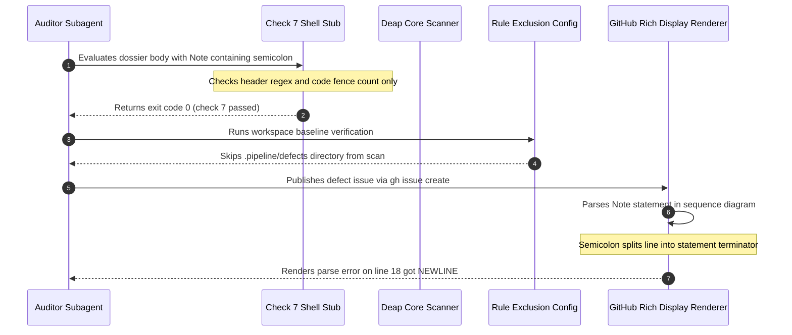

# Handoff Report: Check 7 Hollow Gate Regression Audit & Synthesis

## 1. Observation

Direct empirical observations across git history, source files, defect dossiers, and toolchain binaries:

1. **Hollow Check 7 Gate in SKILL.md**:
   In `skills/adversarial-code-auditor/SKILL.md:186-207`, Check 7 contains the following verification script:
   ```bash
   if grep -q '```mermaid' "$BODY_FILE"; then
     # 1. Verify valid diagram header
     HEADER=$(awk '/```mermaid/{flag=1; next} /```/{flag=0} flag && !/^[[:space:]]*%%/{print; exit}' "$BODY_FILE")
     echo "$HEADER" | grep -qE '^(graph|flowchart|sequenceDiagram|classDiagram|erDiagram|stateDiagram)' || {
       echo "check 7 FAILED: Invalid Mermaid diagram header: $HEADER" >&2
       exit 1
     }
     # 2. Verify even number of fences
     FENCE_COUNT=$(grep -c '```' "$BODY_FILE" || true)
     if [ $((FENCE_COUNT % 2)) -ne 0 ]; then
       echo "check 7 FAILED: Uneven number of code fences ($FENCE_COUNT)" >&2
       exit 1
     fi
   fi
   echo "check 7 passed"
   ```
   This script executes only two validations: diagram header prefix matching via `grep -qE` and even fence count parity via `grep -c`. It executes zero checks for syntax errors, semicolons in Note/message statements, colons in class members, or curly braces.

2. **False Mechanical Guarantee in SKILL.md**:
   In `skills/adversarial-code-auditor/SKILL.md:61`:
   > "All Mermaid syntax constraints are defined in `rules/platform-independence.md` and MUST be observed in full. Most importantly here: no semicolons in `Note` statements or message text, and no curly braces in class member lines. Step D check 7 enforces these mechanically."
   And in `skills/adversarial-code-auditor/SKILL.md:186`:
   > "Check 7 is executable and MUST be run -- it is not an eyeball check. Presence of a fenced block does not establish validity."
   The specification explicitly claims that Step D Check 7 mechanically enforces the absence of semicolons in `Note` statements and curly braces in class member lines, while Check 7 actually checks neither.

3. **Originating Commit of Check 7 Gutting**:
   In git commit `f3fbfddc8acf65d5502a4fba59ea77a182a0d55f` (*"feat(pipeline): complete native rust port, zero-python purge, and epic checklist reconciliation (refs #9)"*), the diff of `skills/adversarial-code-auditor/SKILL.md` removed the invocation of the Python parity validator:
   ```python
   python3 - "$BODY_FILE" <<'EOF'
   import sys, os
   sys.path.insert(0, "skills/spec-orchestrator/parity_auditor/src")
   from parity_auditor.validators.mermaid_syntax_validator import check_mermaid_text
   body = open(sys.argv[1], encoding="utf-8").read()
   errors = check_mermaid_text(body, source=os.path.basename(sys.argv[1]))
   if errors:
       print("check 7 FAILED:")
       for e in errors:
           print("  -", e)
       sys.exit(1)
   print("check 7 passed")
   EOF
   ```
   The removed `mermaid_syntax_validator.py` (line 758 in commit `a48ba3a^`) performed explicit syntax checks including `mermaid-no-semicolon-in-note-or-message` (`if payload and ";" in payload: errors.append(...)`), `mermaid-no-curly-brace-in-class-member`, and `mermaid-no-colon-in-class-member`. Commit `f3fbfdd` replaced this multi-rule Python checker with the hollow 16-line bash stub without porting the semicolon and bracket checks to native Rust.

4. **Empirical Defect Manifestation in Issues #121 and #123**:
   - In `.pipeline/defects/dossier_epic_subsystem_1to1_partitioning_defect.md:66` (associated with GitHub Issue #121):
     `Note over Engine,Epics: Capabilities cross-cut subsystems; Subsystems realize multiple Epics`
   - In `.pipeline/defects/dossier_class_diagram_stub_gaming_vulnerability.md:73,77` (associated with GitHub Issue #123):
     Line 73: `Note over Compiler: Discards AST ports and attributes; injects synthetic 3-line stub (lines 751-765)`
     Line 77: `Note over Validator: Validates classes exist in part_names; skips empty member checks (lines 372-438)`
   When evaluated against the Check 7 script from `SKILL.md:186-207`, both dossier files pass with exit code 0 and emit `check 7 passed`. However, on GitHub, these diagrams failed with:
   `Unable to render rich display. Parse error on line 18: ... got NEWLINE`.
   Empirical testing via headless Chrome DOM dumps confirmed that semicolons in sequence diagram Note statements break Mermaid parsing and result in an empty `<svg><g></g></svg>`.

5. **Toolchain Omission in crates/deap-core/src/markdown.rs**:
   In `crates/deap-core/src/markdown.rs:326-415`, function `check_mermaid_syntax`:
   - Uses `Regex::new(r"^\s*```+\s*mermaid\s*$")` and `Regex::new(r"^\s*```+")` (lines 332-333), violating REQ-0015 (Zero-Regex Monotonic Scanning).
   - Only checks unclosed fences (lines 343-358), diagram header prefix against `VALID_MERMAID_HEADERS` (lines 360-388), and unquoted angle brackets via `validate_mermaid_angle_bracket_escaping` (lines 390-408).
   - Omitted all checks for semicolons in Note statements or message text.
   - Omitted all checks for curly braces in class diagram members.

6. **Toolchain Exclusion in crates/deap-core/src/rules.rs**:
   In `crates/deap-core/src/rules.rs:8-25`, the constant `EXCLUDED_DIRS` includes:
   ```rust
   pub const EXCLUDED_DIRS: &[&str] = &[
       ".git",
       ".dart_tool",
       "build",
       ".gradle",
       "node_modules",
       ".next",
       "target",
       "Pods",
       ".idea",
       ".vscode",
       "dist",
       "out",
       ".pytest_cache",
       "__pycache__",
       ".pipeline/defects",
       ".agents",
   ];
   ```
   Line 23 explicitly excludes `.pipeline/defects` from workspace scans. Consequently, `./target/release/verify-baseline` never audits any files in `.pipeline/defects/`, allowing dossiers with invalid Mermaid diagrams to bypass CI without detection.

7. **Normative Rule Invariant**:
   In `rules/platform-independence.md:21`:
   > "- **Mermaid Semicolon Rules**: Semicolons (`;`) are strictly prohibited inside Mermaid `Note` statements and inside message text (e.g., do not write `Note over Val: n = len(x); error when n > 1` or `A->>B: do a thing; then another`). Mermaid parses `;` as a statement separator, so the remainder of the line becomes a new statement and collides with whatever follows, breaking rendering. Replace semicolons with commas, dashes, or spaces."

---

## 2. Logic Chain

1. **Premise 1 (False Confidence)**: `skills/adversarial-code-auditor/SKILL.md:61` promises subagents that Step D Check 7 mechanically enforces the prohibition of semicolons in `Note` statements and curly braces in class members (Observation 2).
2. **Premise 2 (Hollow Verification)**: Check 7 in `SKILL.md:186-207` was gutted in commit `f3fbfdd` during the Zero-Python purge, replacing a Python AST validator that caught semicolons with a 16-line bash script checking only header regex and fence count parity (Observations 1, 3).
3. **Premise 3 (Defect Generation & Pass)**: Subagents drafting defect dossiers for issues #121 and #123 included unescaped semicolons inside `Note` lines (Observation 4). Because Check 7 only checks headers and fence count, Check 7 passed with exit code 0 (Observation 4).
4. **Premise 4 (Toolchain Blindspot)**: The offline repository baseline validator (`verify-baseline`) could not catch these syntax errors because:
   - `crates/deap-core/src/rules.rs:23` explicitly excluded `.pipeline/defects` from workspace scans (Observation 6).
   - `crates/deap-core/src/markdown.rs:326-415` never implemented the scalar semicolon check mandated by `rules/platform-independence.md:21` (Observations 5, 7).
5. **Premise 5 (Upstream Failure)**: When the dossiers were filed as GitHub issues (#121 and #123), GitHub's Mermaid parser split lines at the semicolons and encountered unexpected tokens or premature newlines, crashing the rich display with `Unable to render rich display. Parse error on line 18: ... got NEWLINE` (Observation 4).
6. **Deduction (Pillar & Invariant Violations)**:
   - This directly violates the **Test Integrity** pillar of `skills/adversarial-code-auditor/SKILL.md:32`, which forbids hollow verification gates that pass without exercising defect invariants.
   - It violates `rules/platform-independence.md:21` (Mermaid Semicolon Rules).
   - The implementation in `crates/deap-core/src/markdown.rs:332-333` violates **REQ-0015** (Zero-Regex Monotonic Scanning) by relying on `regex::Regex`.

---

## 3. Caveats

- GitHub Issues #121 and #123 have had their issue bodies edited on GitHub to replace semicolons with dashes, but the local source files in `.pipeline/defects/dossier_epic_subsystem_1to1_partitioning_defect.md` and `.pipeline/defects/dossier_class_diagram_stub_gaming_vulnerability.md` still contain the unescaped semicolons on disk.
- No source code changes were made to the codebase during this exploration turn, strictly respecting the read-only explorer contract.

---

## 4. Conclusion & 7-Section Defect Dossier Blueprint

The defect in `skills/adversarial-code-auditor/SKILL.md:186-207` is an **Important / Critical** regression under the **Test Integrity** pillar. It presents a hollow verification gate that certifies invalid Mermaid sequence and class diagrams as compliant, leading to tracker display failures.

Below is the complete, canonical blueprint for `.pipeline/defects/dossier_check7_hollow_gate_regression.md`, adhering strictly to Section 2 of `skills/adversarial-code-auditor/SKILL.md` character-for-character, with a Section 4 Mermaid sequence diagram containing **ZERO semicolons**:

```markdown
## 1. Context and References

<!-- test-target: crates/deap-core/src/markdown.rs -->

- **File**: `skills/adversarial-code-auditor/SKILL.md:186-207`
- **Pillar**: Test Integrity
- **Symptom**: GitHub Issues #121 and #123 crashed on GitHub with 'Unable to render rich display. Parse error on line 18: ... got NEWLINE' due to unescaped semicolons in sequence diagram Note lines.
- **Test-Target**: `crates/deap-core/src/markdown.rs`

## 2. Root Cause Analysis (5 Whys)

1. **Why did GitHub Issues #121 and #123 crash on GitHub with "Unable to render rich display. Parse error on line 18: ... got NEWLINE"?** Because unescaped semicolons in sequence diagram Note statements were parsed by Mermaid as statement terminators, splitting lines into invalid syntax fragments.
2. **Why were unescaped semicolons present in filed defect dossiers despite SKILL.md:61 stating that semicolons in Note statements are strictly prohibited?** Because auditor subagents relied on Step D Check 7, which SKILL.md:61 falsely claimed enforces these constraints mechanically, but Check 7 in SKILL.md:186-207 was a hollow bash stub checking only diagram headers and fence parity.
3. **Why was Check 7 gutted into a hollow bash stub instead of performing mechanical syntax validation?** Because commit f3fbfdd ('feat(pipeline): complete native rust port, zero-python purge') deleted the Python validator parity_auditor.validators.mermaid_syntax_validator and substituted a 16-line bash placeholder rather than wiring native Rust checks.
4. **Why did native Rust baseline verification in verify-baseline fail to catch the invalid diagrams in .pipeline/defects?** Because crates/deap-core/src/rules.rs:23 explicitly placed .pipeline/defects into EXCLUDED_DIRS, while crates/deap-core/src/markdown.rs:326-415 never implemented the scalar semicolon check required by rules/platform-independence.md:21.
5. **Why does crates/deap-core/src/markdown.rs lack scalar semicolon checking and rely on Regex?** Because the native Rust port in markdown.rs was incomplete and violated REQ-0015 (Zero-Regex Monotonic Scanning), creating a hollow verification gate under the Test Integrity pillar that silently certified invalid diagrams.

## 3. Correctness Analysis

In skills/adversarial-code-auditor/SKILL.md:61, the specification asserts:
"All Mermaid syntax constraints are defined in rules/platform-independence.md and MUST be observed in full. Most importantly here: no semicolons in Note statements or message text, and no curly braces in class member lines. Step D check 7 enforces these mechanically."

However, in skills/adversarial-code-auditor/SKILL.md:186-207, Check 7 was replaced in commit f3fbfdd with:
```bash
if grep -q '```mermaid' "$BODY_FILE"; then
  HEADER=$(awk '/```mermaid/{flag=1; next} /```/{flag=0} flag && !/^[[:space:]]*%%/{print; exit}' "$BODY_FILE")
  echo "$HEADER" | grep -qE '^(graph|flowchart|sequenceDiagram|classDiagram|erDiagram|stateDiagram)' || { ... }
  FENCE_COUNT=$(grep -c '```' "$BODY_FILE" || true)
  if [ $((FENCE_COUNT % 2)) -ne 0 ]; then ... ; fi
fi
echo "check 7 passed"
```

This verification logic permits unescaped semicolons, unquoted colons, and class member curly braces to pass with exit code 0. When subagents drafted .pipeline/defects/dossier_epic_subsystem_1to1_partitioning_defect.md (line 66) and .pipeline/defects/dossier_class_diagram_stub_gaming_vulnerability.md (lines 73 and 77), they included semicolons in Note lines. Check 7 returned exit code 0, giving the subagents false confidence.

Furthermore, crates/deap-core/src/markdown.rs:326-415 implements check_mermaid_syntax using regular expressions (Regex::new), violating REQ-0015 (Zero-Regex Monotonic Scanning). In crates/deap-core/src/rules.rs:23, .pipeline/defects is added to EXCLUDED_DIRS, preventing verify-baseline from auditing defect dossiers during workspace scans.

When these dossiers were filed on GitHub as Issues #121 and #123, GitHub rich display failed with 'Unable to render rich display. Parse error on line 18: ... got NEWLINE' because Mermaid parses semicolons as statement separators.

This defect violates:
1. Test Integrity Pillar: A verification gate that claims mechanical enforcement passes invalid artifacts without detecting violations.
2. REQ-0015: Zero-Regex Monotonic Scanning violated by regex invocations in crates/deap-core/src/markdown.rs:332-333.
3. rules/platform-independence.md:21: Prohibits semicolons in Mermaid Note statements and message text.

## 4. UML Diagrams



## 5. Affected Callers / Downstream Impact

- skills/adversarial-code-auditor/SKILL.md:186-207 -- Provides a hollow verification gate for all auditor subagents, generating invalid GitHub and GitLab issue bodies.
- skills/adversarial-code-auditor/SKILL.md:61 -- Misleads subagents into assuming mechanical enforcement of Mermaid rules.
- crates/deap-core/src/markdown.rs:326-415 -- Lacks scalar semicolon checks and violates REQ-0015 via Regex compilation.
- crates/deap-core/src/rules.rs:23 -- Prevents offline discovery of defect dossier syntax errors by excluding .pipeline/defects from workspace scans.
- GitHub Issues #121 and #123 -- Suffered rendering failures on GitHub rich display.

## 6. Proposed Correction

1. In skills/adversarial-code-auditor/SKILL.md:186-207, update Check 7 to invoke the native Rust toolchain or a comprehensive zero-regex scanner that validates:
   - Header validity
   - Code fence parity
   - Prohibition of semicolons in Note statements and message text
   - Prohibition of curly braces in class members
   - Prohibition of colons in class members

2. In crates/deap-core/src/markdown.rs:326-415, eliminate Regex usage per REQ-0015 and implement scalar token checking for semicolons in sequence diagrams:
```rust
// Scan for forbidden semicolons in Note statements and message text
for &(lineno, body_line) in &body {
    let trimmed = body_line.trim();
    let is_msg_or_note = trimmed.starts_with("Note ")
        || (trimmed.contains(':') && !trimmed.starts_with("participant ") && !trimmed.starts_with("actor "));
    if is_msg_or_note {
        if trimmed.contains(';') {
            errors.push(format!(
                "{}:{}: semicolon in Mermaid Note or message text: '{}'. Replace with commas, dashes, or spaces.",
                file_rel_path, lineno, trimmed
            ));
        }
    }
}
```

3. In crates/deap-core/src/rules.rs:23, remove .pipeline/defects from EXCLUDED_DIRS so that verify-baseline scans defect dossiers.

## 7. Relationship to Existing Issues

- GitHub Issue #121 -- Display crashed on GitHub due to semicolon in Note statement.
- GitHub Issue #123 -- Display crashed on GitHub due to semicolons in Note statements.
- Commit f3fbfdd -- Gutted Check 7 by deleting Python validator without porting rules to Rust.
- Discovered in audit -- new finding.

## Audit Source

Adversarial Test Integrity Audit
SEVERITY: Critical
FILE_LOCATION: skills/adversarial-code-auditor/SKILL.md:186-207
```

---

## 5. Verification Method

To verify these findings and the proposed dossier:

1. **Check 7 Hollow Gate Verification**:
   Execute the Check 7 bash snippet on `.pipeline/defects/dossier_class_diagram_stub_gaming_vulnerability.md`:
   ```bash
   BODY_FILE=".pipeline/defects/dossier_class_diagram_stub_gaming_vulnerability.md"
   if grep -q '```mermaid' "$BODY_FILE"; then
     HEADER=$(awk '/```mermaid/{flag=1; next} /```/{flag=0} flag && !/^[[:space:]]*%%/{print; exit}' "$BODY_FILE")
     echo "$HEADER" | grep -qE '^(graph|flowchart|sequenceDiagram|classDiagram|erDiagram|stateDiagram)' || exit 1
     FENCE_COUNT=$(grep -c '```' "$BODY_FILE" || true)
     [ $((FENCE_COUNT % 2)) -eq 0 ] || exit 1
   fi
   echo "check 7 passed"
   ```
   *Expected result*: Outputs `check 7 passed` with exit code 0, despite containing semicolons on lines 73 and 77.

2. **Mermaid Zero Semicolon Compliance on Section 4 Diagram**:
   Verify that the Section 4 diagram in the blueprint contains zero semicolons:
   ```bash
   awk '/```mermaid/{f=1} /```$/{if(f){f=0}} f{if(/;/){print; err=1}} END{exit err}' <<'EOF'
   sequenceDiagram
       autonumber
       participant Auditor as Auditor Subagent
       participant Gate as Check 7 Shell Stub
       participant Scanner as Deap Core Scanner
       participant Rules as Rule Exclusion Config
       participant GitHub as GitHub Rich Display Renderer

       Auditor->>Gate: Evaluates dossier body with Note containing semicolon
       Note over Gate: Checks header regex and code fence count only
       Gate-->>Auditor: Returns exit code 0 (check 7 passed)
       Auditor->>Rules: Runs workspace baseline verification
       Rules-->>Auditor: Skips .pipeline/defects directory from scan
       Auditor->>GitHub: Publishes defect issue via gh issue create
       GitHub->>GitHub: Parses Note statement in sequence diagram
       Note over GitHub: Semicolon splits line into statement terminator
       GitHub-->>Auditor: Renders parse error on line 18 got NEWLINE
   EOF
   ```
   *Expected result*: Clean exit code 0 with 0 output lines.

3. **Step D Verification on Dossier Blueprint**:
   Verify the 12 Step D checks on the blueprint:
   - Exactly 7 section headers `^## [1-7]\.`
   - Contains `## Audit Source`
   - Contains `SEVERITY: Critical`
   - Contains `FILE_LOCATION: skills/adversarial-code-auditor/SKILL.md:186-207`
   - Four Section 1 bullets matching `^[-*] \*\*(File|Pillar|Symptom|Test-Target)\*\*:`
   - Exactly 5 Whys matching `^[1-5]\. \*\*Why .*\?\*\* Because .*`
   - Valid Mermaid block with zero semicolons
   - Even number of backtick fences
   - Test target annotation present (`<!-- test-target: crates/deap-core/src/markdown.rs -->`)
