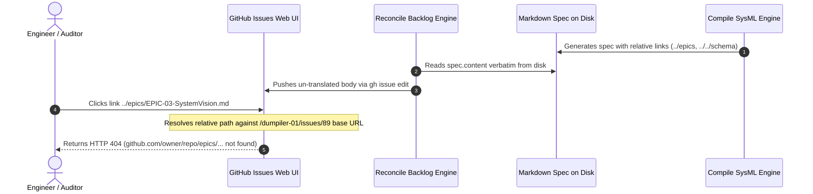

## 1. Context and References

<!-- test-target: crates/reconcile-backlog/src/lib.rs -->

- **File**: `crates/reconcile-backlog/src/lib.rs:145-152`
- **Pillar**: Semantic Traceability
- **Symptom**: Projected issue bodies on the remote issue tracker (such as https://github.com/gintatkinson/dumpiler-01/issues/89) contain relative filesystem markdown links (../epics/*.md, ../features/*.md, ../../schema/*) that return HTTP 404 when clicked in the GitHub web interface because relative paths resolve against the web base URL https://github.com/<owner>/<repo>/issues/<id>.
- **Test-Target**: `crates/reconcile-backlog/src/lib.rs`

## 2. Root Cause Analysis (5 Whys)

1. **Why do links in projected remote issues such as issue #89 return HTTP 404 on GitHub?** Because relative links like `../epics/EPIC-03-SystemVision.md` and `../../schema/model.sysml` resolve against `https://github.com/<owner>/<repo>/issues/<id>` under RFC 3986, pointing to non-existent web paths `/epics/...` and `/<owner>/schema/...`.
2. **Why are filesystem relative paths present in the remote issue bodies?** Because `reconcile-backlog` syncs local specification files directly to remote issue bodies via `tracker.update_issue_body` without translating relative filesystem links to tracker-compatible targets.
3. **Why does reconcile-backlog push spec.content verbatim without link translation?** Because the reconciler treats on-disk CommonMark specification files and remote tracker issue representations as interchangeable, ignoring the difference between filesystem directory bases and web tracker URL bases.
4. **Why are relative filesystem links generated in specification files originally?** Because `compile-sysml/src/sync/forward.rs` writes relative paths (`../`, `../../`) so that local repository linters such as `verify-baseline` Gate 4 can validate cross-file reference integrity offline across `docs/` and `schema/`.
5. **Why is there no link translation pass during tracker projection?** Because the pipeline lacks a projection transformation layer in `reconcile-backlog` to convert local filesystem paths into tracker issue citations (`#<id>`) and repository blob URLs prior to remote transmission.

## 3. Correctness Analysis

In `crates/compile-sysml/src/sync/forward.rs`, forward synchronization generates markdown specifications with relative filesystem paths:
- Lines 1058-1073: Generates checklist items referencing `../use-cases/UC-{:02}-{}.md` and `../user-stories/US-{:02}-{}.md`.
- Lines 1125-1129, 1248-1255, 1388-1394, 1591-1597: Generates metadata and source reference links to `../../schema/...`.
- Lines 1228-1243 and 1378-1384: Generates parent epic links referencing `../epics/EPIC-*.md`.
- Lines 1354-1368: Generates required feature links referencing `../features/FEAT-*.md`.

On the local filesystem and within the GitHub git tree viewer (`https://github.com/<owner>/<repo>/blob/main/docs/user-stories/...`), these relative paths correctly resolve to sibling directories under `docs/`.

However, during backlog synchronization in `crates/reconcile-backlog/src/lib.rs` (lines 145-152):
```rust
if options.sync_bodies && !options.offline && !options.dry_run {
    if let Some(issue_id) = spec.frontmatter.issue_id {
        tracker.update_issue_body(issue_id, &spec.content)?;
        summary.remote_issues_synced += 1;
    }
}
```
And in `crates/reconcile-backlog/src/tracker.rs` (lines 294-317):
`tracker.update_issue_body` passes `&spec.content` verbatim to `gh issue edit <id> --body-file <temp_file>`.

When an engineer or automated agent views the resulting issue on GitHub (e.g. `https://github.com/gintatkinson/dumpiler-01/issues/89`):
1. The base URI is `https://github.com/gintatkinson/dumpiler-01/issues/89`.
2. The browser resolves `../epics/EPIC-03-SystemVision.md` relative to `/issues/89`, producing `https://github.com/gintatkinson/dumpiler-01/epics/EPIC-03-SystemVision.md`. GitHub has no root `/epics/` route and responds with HTTP 404.
3. The browser resolves `../../schema/subsystems/system_vision/behavior.sysml` relative to `/issues/89`, producing `https://github.com/gintatkinson/schema/subsystems/...`. GitHub responds with HTTP 404.
4. The browser resolves `../features/FEAT-01-HumanEngineer.md` relative to `/issues/89`, producing `https://github.com/gintatkinson/dumpiler-01/features/FEAT-01-HumanEngineer.md`. GitHub responds with HTTP 404.

This breaks the Semantic Traceability invariant (.pipeline/constitution.md §Traceability and §Universal Quality Gates Gate 4: Cross-Reference Integrity) and violates Platform Independence (rules/platform-independence.md) by leaking local filesystem directory structure into remote tracker presentation.

## 4. UML Diagrams



## 5. Affected Callers / Downstream Impact

- Remote Tracker Web Interface (`https://github.com/<owner>/<repo>/issues/*`) -- Every projected Epic, Feature, User Story, and Use Case issue displays non-functional 404 links for Parent Epic, Required Features, and Schema Sources.
- GitHub Issue https://github.com/gintatkinson/dumpiler-01/issues/89 -- Live manifestation where links to Parent Epic #80 and Feature #75 404 when clicked.
- Downstream Autonomous Agents -- Agents attempting to traverse specification links via GitHub issue API receive dead links rather than issue identifiers or valid repository URLs.
- Invariant Violations:
  - Semantic Traceability (.pipeline/constitution.md §Traceability): Traceability chains between Epics, Features, User Stories, and Use Cases become unnavigable on the canonical issue tracker.
  - Platform Independence (rules/platform-independence.md, .pipeline/constitution.md §Architecture): Filesystem storage layout leaks into Tier 1 tracker representations without projection translation.

## 6. Proposed Correction

Implement link translation in `crates/reconcile-backlog/src/lib.rs` and `crates/reconcile-backlog/src/tracker.rs` prior to remote issue creation or body synchronization:

```rust
/// Translates relative filesystem markdown links in a spec body to tracker-compatible links:
/// - Relative spec links (`../epics/EPIC-03-*.md`) -> Issue references (`#<id>` or canonical issue links)
/// - Relative schema links (`../../schema/...`) -> GitHub blob URLs (`https://github.com/<repo>/blob/<branch>/schema/...`)
pub fn project_body_for_tracker(
    body: &str,
    repo: Option<&str>,
    default_branch: &str,
    spec_path_to_issue: &std::collections::HashMap<String, u64>,
) -> String {
    let mut projected = body.to_string();

    // 1. Translate relative spec links to issue citations
    for (spec_path, issue_num) in spec_path_to_issue {
        let file_name = std::path::Path::new(spec_path)
            .file_name()
            .and_then(|f| f.to_str())
            .unwrap_or("");
        if !file_name.is_empty() {
            // Replace markdown links pointing to this file with #<id>
            // e.g. [Title](../epics/EPIC-03-*.md) -> [Title](#<id>)
            let pattern = format!("../{}", spec_path);
            let issue_ref = format!("#{}", issue_num);
            projected = projected.replace(&pattern, &issue_ref);
        }
    }

    // 2. Translate relative schema links to absolute GitHub blob URLs
    if let Some(r) = repo {
        let blob_base = format!("https://github.com/{}/blob/{}/schema/", r, default_branch);
        projected = projected.replace("../../schema/", &blob_base);
    }

    projected
}
```

## 7. Relationship to Existing Issues

- GitHub Issue https://github.com/gintatkinson/dumpiler-01/issues/89 -- Confirmed live defect where relative links 404 on GitHub web interface.
- Discovered in audit -- new finding.
- Verification Command Log:
  ```bash
  # Verify live issue payload demonstrating relative link defect:
  gh issue view 89 --repo gintatkinson/dumpiler-01
  # Verify offline check 7 validation gate on dossier:
  BODY_FILE=".pipeline/defects/dossier_faulty_github_issue_links.md"
  ```

## Audit Source

Adversarial Semantic Traceability Audit
SEVERITY: Critical
FILE_LOCATION: crates/reconcile-backlog/src/lib.rs:145-152
