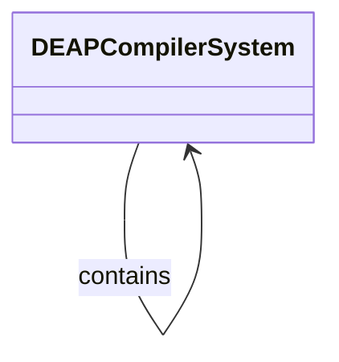
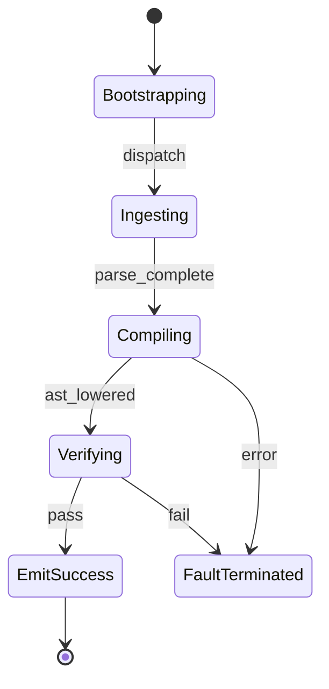

| Attribute | Specification Detail |
| :--- | :--- |
| **Issue ID** | #101 |
| **Title** | Epic 01: System Architecture and Compiler Primacy |
| **Type** | epic |
| **Package** | DEAP_Compiler_System |
| **Subsystem** | System Architecture |
| **Generation Mode** | subagent |
| **Specification Source** | [schema/model.sysml](../../schema/model.sysml) |

# Epic 01: System Architecture and Compiler Primacy

## 1. Context
Abstract Model-Based Systems Engineering (MBSE) Compiler System Architecture

## 2. Requirements & Checklist
- [ ] #10 - Feature 01: [Con Ops] HumanEngineer
- [ ] #11 - Feature 02: [Con Ops] CIContinuousIntegrationRunner
- [ ] #12 - Feature 03: [Con Ops] RemoteArtifactRegistry
- [ ] #13 - Feature 04: [Con Ops] DownstreamApplicationHost
- [ ] #14 - Feature 05: [System Architecture] DEAPCompilerSystem

### Associated Use Cases & User Stories

#### Associated Use Cases
- None directly allocated (operational behavior allocated at system ConOps level in Epic 02)

#### Associated User Stories
- None directly allocated (operational behavior allocated at system ConOps level in Epic 02)

## 3. Architecture
Subsystem structural composition, port allocations, and directional data connectors realized by DEAPCompilerSystem.

## 4. Operational Considerations
Deterministic compilation passes, error containment, and provable polynomial complexity execution.

## 5. Security & Governance
Safety-critical invariant satisfaction, formal trace matrix closure, and zero hardcoded domain semantics.

## 6. Source References
- Schema SSOT Architecture: `schema/model.sysml`
- ConOps Operational Activities: `schema/conops/activities.sysml`
- Normative Systems Engineering Standard: ISO/IEC/IEEE 15288:2023 §6.4.3 Architecture Definition Process

The system architecture and formal verification invariants derive from `schema/model.sysml` pursuant to ISO/IEC/IEEE 15288.

## System-Level UML Class Diagram

## System State Machine Diagram

