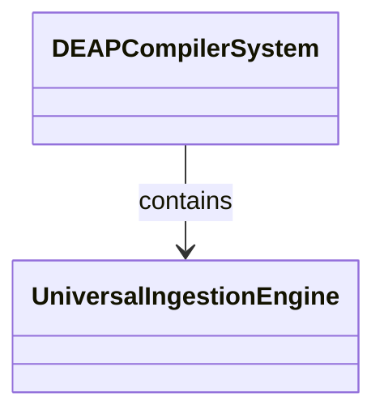
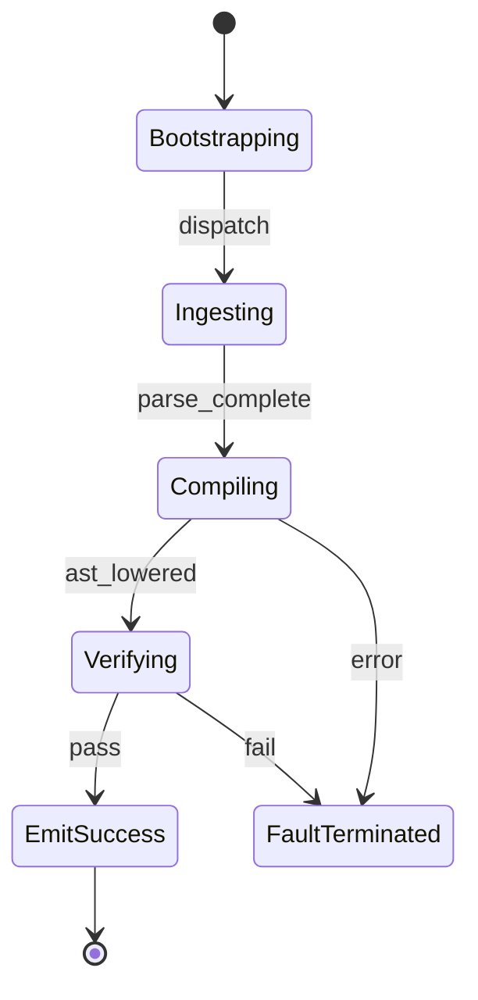

| Attribute | Specification Detail |
| :--- | :--- |
| **Issue ID** | #104 |
| **Title** | Epic 04: Universal Schema Ingestion |
| **Type** | epic |
| **Package** | UniversalSchemaIngestion |
| **Subsystem** | Universal Schema Ingestion |
| **Generation Mode** | subagent |
| **Specification Source** | [schema/model.sysml](../../schema/model.sysml) |

# Epic 04: Universal Schema Ingestion

## 1. Context
Structural Architecture for Subsystem 2 Universal Schema Ingestion Engine

## 2. Requirements & Checklist
- [ ] #19 - Feature 10: [Universal Schema Ingestion] UniversalIngestionEngine
- [ ] #20 - Feature 11: [Universal Schema Ingestion] FormatClassifier
- [ ] #21 - Feature 12: [Universal Schema Ingestion] CommonMarkTableLexer
- [ ] #22 - Feature 13: [Universal Schema Ingestion] ProtobufParser
- [ ] #23 - Feature 14: [Universal Schema Ingestion] OpenApiParser

### Associated Use Cases & User Stories

#### Associated Use Cases
- [ ] #96 - [Use Case 02: Universal Schema Ingestion Workflow](../use-cases/UC-02-Universal_Schema_Ingestion_Workflow.md)

#### Associated User Stories
- [ ] #90 - [User Story 02: Classify Format Action](../user-stories/US-02-ClassifyFormatAction.md)

## 3. Architecture
Subsystem structural composition, port allocations, and directional data connectors realized by UniversalIngestionEngine.

## 4. Operational Considerations
Deterministic compilation passes, error containment, and provable polynomial complexity execution.

## 5. Security & Governance
Safety-critical invariant satisfaction, formal trace matrix closure, and zero hardcoded domain semantics.

## 6. Source References
- System Architecture Model: `schema/model.sysml`
- Subsystem Specification Model: `schema/subsystems/universal_schema_ingestion/architecture.sysml`
- Subsystem Requirements Model: `schema/subsystems/universal_schema_ingestion/requirements.sysml`
- Normative Systems Engineering Standard: ISO/IEC/IEEE 15288:2023 §6.4.3 Architecture Definition Process

Subsystem architectural composition and formal invariants derive from `schema/model.sysml` pursuant to ISO/IEC/IEEE 15288.

## System-Level UML Class Diagram

## System State Machine Diagram

