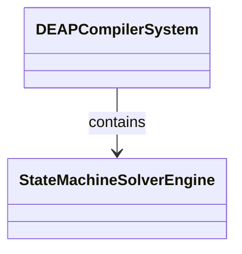
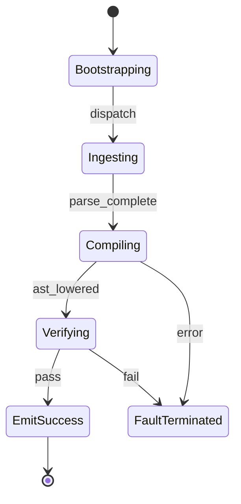

| Attribute | Specification Detail |
| :--- | :--- |
| **Issue ID** | #108 |
| **Title** | Epic 08: Spatio Temporal State Solvers |
| **Type** | epic |
| **Package** | SpatioTemporalStateSolvers |
| **Subsystem** | Spatio Temporal State Solvers |
| **Generation Mode** | subagent |
| **Specification Source** | [schema/model.sysml](../../schema/model.sysml) |

# Epic 08: Spatio Temporal State Solvers

## 1. Context
Structural Architecture for Subsystem 6 Spatio Temporal State Solvers

## 2. Requirements & Checklist
- [ ] #36 - Feature 27: [Spatio Temporal State Solvers] StateMachineSolverEngine
- [ ] #37 - Feature 28: [Spatio Temporal State Solvers] StateHierarchyFlattener
- [ ] #38 - Feature 29: [Spatio Temporal State Solvers] DiscreteTransitionSolver
- [ ] #39 - Feature 30: [Spatio Temporal State Solvers] ReachabilityMatrixEvaluator

### Associated Use Cases & User Stories

#### Associated Use Cases
- [ ] #100 - [Use Case 06: State Machine Solver Workflow](../use-cases/UC-06-State_Machine_Solver_Workflow.md)

#### Associated User Stories
- [ ] #94 - [User Story 06: Solve State Dynamics Action](../user-stories/US-06-SolveStateDynamicsAction.md)

## 3. Architecture
Subsystem structural composition, port allocations, and directional data connectors realized by StateMachineSolverEngine.

## 4. Operational Considerations
Deterministic compilation passes, error containment, and provable polynomial complexity execution.

## 5. Security & Governance
Safety-critical invariant satisfaction, formal trace matrix closure, and zero hardcoded domain semantics.

## 6. Source References
- System Architecture Model: `schema/model.sysml`
- Subsystem Specification Model: `schema/subsystems/spatio_temporal_state_solvers/architecture.sysml`
- Subsystem Requirements Model: `schema/subsystems/spatio_temporal_state_solvers/requirements.sysml`
- Normative Systems Engineering Standard: ISO/IEC/IEEE 15288:2023 §6.4.3 Architecture Definition Process

Subsystem architectural composition and formal invariants derive from `schema/model.sysml` pursuant to ISO/IEC/IEEE 15288.

## System-Level UML Class Diagram

## System State Machine Diagram

