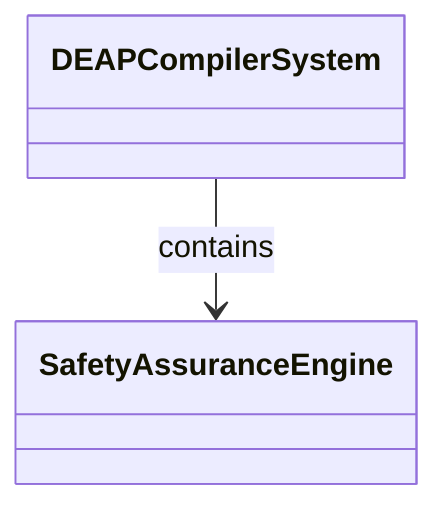
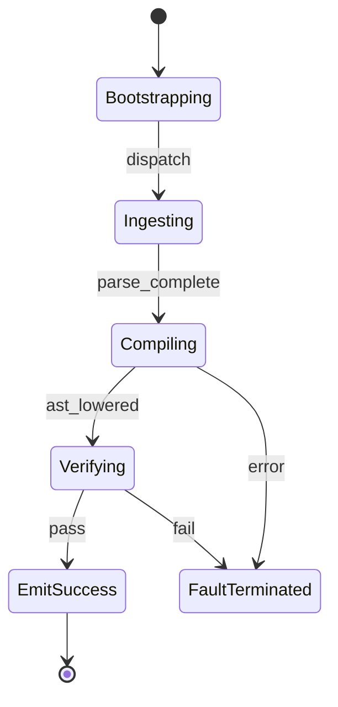

| Attribute | Specification Detail |
| :--- | :--- |
| **Issue ID** | #109 |
| **Title** | Epic 09: Formal Safety Traceability |
| **Type** | epic |
| **Package** | FormalSafetyTraceability |
| **Subsystem** | Formal Safety Traceability |
| **Generation Mode** | subagent |
| **Specification Source** | [schema/model.sysml](../../schema/model.sysml) |

# Epic 09: Formal Safety Traceability

## 1. Context
Structural Architecture for Subsystem 7 Formal Safety Traceability Verification

## 2. Requirements & Checklist
- [ ] #40 - Feature 31: [Formal Safety Traceability] SafetyAssuranceEngine
- [ ] #41 - Feature 32: [Formal Safety Traceability] BipartiteGraphBuilder
- [ ] #42 - Feature 33: [Formal Safety Traceability] DisjointTierValidator
- [ ] #43 - Feature 34: [Formal Safety Traceability] BidirectionalSweepEngine
- [ ] #44 - Feature 35: [Formal Safety Traceability] DiagnosticSentinelSink

### Associated Use Cases & User Stories

#### Associated Use Cases
- [ ] #101 - [Use Case 07: UC 07 Safety Assurance and Traceability Workflow](../use-cases/UC-07-UC_07_Safety_Assurance_and_Traceability_Workflow.md)

#### Associated User Stories
- [ ] #95 - [User Story 07: Verify Safety Traceability Action](../user-stories/US-07-VerifySafetyTraceabilityAction.md)

## 3. Architecture
Subsystem structural composition, port allocations, and directional data connectors realized by SafetyAssuranceEngine.

## 4. Operational Considerations
Deterministic compilation passes, error containment, and provable polynomial complexity execution.

## 5. Security & Governance
Safety-critical invariant satisfaction, formal trace matrix closure, and zero hardcoded domain semantics.

## 6. Source References
- System Architecture Model: `schema/model.sysml`
- Subsystem Specification Model: `schema/subsystems/formal_safety_traceability/architecture.sysml`
- Subsystem Requirements Model: `schema/subsystems/formal_safety_traceability/requirements.sysml`
- Normative Systems Engineering Standard: ISO/IEC/IEEE 15288:2023 §6.4.3 Architecture Definition Process

Subsystem architectural composition and formal invariants derive from `schema/model.sysml` pursuant to ISO/IEC/IEEE 15288.

## System-Level UML Class Diagram

## System State Machine Diagram

