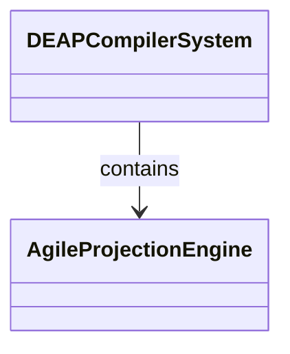
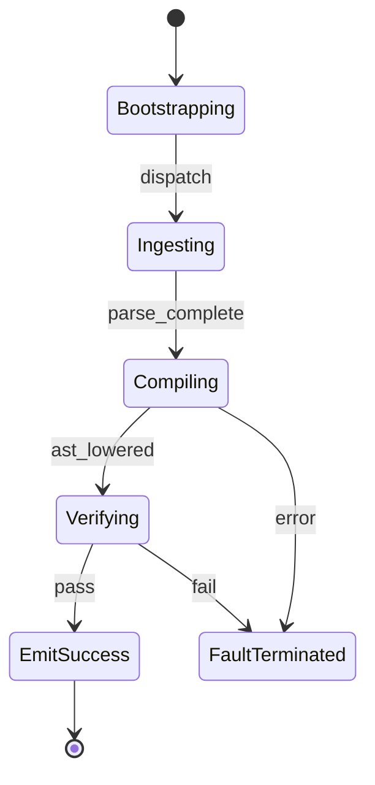

# Epic 11: Downstream Agile Projections

## Metadata
| Attribute | Specification Detail |
| :--- | :--- |
| **Title** | Epic 11: Downstream Agile Projections |
| **Version** | 1.0.0 |
| **Date** | 2026-10-11 |
| **Type** | epic |
| **Package** | DownstreamAgileProjections |
| **Subsystem** | Downstream Agile Projections |
| **Issue ID** | #111 |
| **Generation Mode** | subagent |

## 1. Context
Structural Architecture for Subsystem 9 Downstream Specification Projections

## 2. Requirements & Checklist
- [ ] #49 - Feature 40: [Downstream Agile Projections] AgileProjectionEngine
- [ ] #50 - Feature 41: [Downstream Agile Projections] MarkdownSpecProjector
- [ ] #51 - Feature 42: [Downstream Agile Projections] FrontmatterIntegrityEncoder
- [ ] #52 - Feature 43: [Downstream Agile Projections] BacklogChecklistReconciler

### Associated Use Cases & User Stories

#### Associated Use Cases
- [ ] #103 - [Use Case 09: UC 09 Agile Specification Projection Workflow](../use-cases/UC-09-UC_09_Agile_Specification_Projection_Workflow.md)

#### Associated User Stories
- [ ] #97 - [User Story 09: Project Agile Specifications Action](../user-stories/US-09-ProjectAgileSpecificationsAction.md)

## 3. Architecture
Subsystem structural composition, port allocations, and directional data connectors realized by AgileProjectionEngine.

## 4. Operational Considerations
Deterministic compilation passes, error containment, and provable polynomial complexity execution.

## 5. Security & Governance
Safety-critical invariant satisfaction, formal trace matrix closure, and zero hardcoded domain semantics.

## 6. Source References
- System Architecture Model: `schema/model.sysml`
- Subsystem Specification Model: `schema/subsystems/downstream_agile_projections/architecture.sysml`
- Subsystem Requirements Model: `schema/subsystems/downstream_agile_projections/requirements.sysml`
- Normative Systems Engineering Standard: ISO/IEC/IEEE 15288:2023 §6.4.3 Architecture Definition Process

Subsystem architectural composition and formal invariants derive from `schema/model.sysml` pursuant to ISO/IEC/IEEE 15288.

## System-Level UML Class Diagram

## System State Machine Diagram

