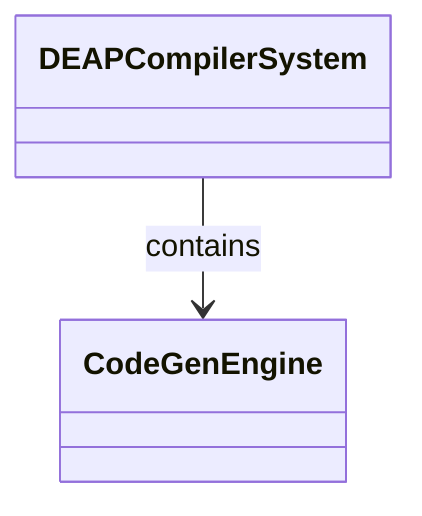
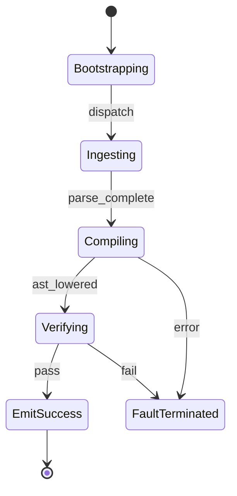

# Epic 12: Multi Target Codegen

## Metadata
| Attribute | Specification Detail |
| :--- | :--- |
| **Title** | Epic 12: Multi Target Codegen |
| **Version** | 1.0.0 |
| **Date** | 2026-10-11 |
| **Type** | epic |
| **Package** | MultiTargetCodegen |
| **Subsystem** | Multi Target Codegen |
| **Issue ID** | #112 |
| **Generation Mode** | subagent |

## 1. Context
Structural Architecture for Subsystem 10 Multi Target CodeGen Simulation Bindings

## 2. Requirements & Checklist
- [ ] #53 - Feature 44: [Multi Target Codegen] CodeGenEngine
- [ ] #54 - Feature 45: [Multi Target Codegen] TargetAstTranspiler
- [ ] #55 - Feature 46: [Multi Target Codegen] TemplateRenderingEngine
- [ ] #56 - Feature 47: [Multi Target Codegen] CodeArtifactFormatter

### Associated Use Cases & User Stories

#### Associated Use Cases
- [ ] #104 - [Use Case 10: UC 10 Multi Target Code Gen Workflow](../use-cases/UC-10-UC_10_Multi_Target_CodeGen_Workflow.md)

#### Associated User Stories
- [ ] #98 - [User Story 10: Synthesize Code Action](../user-stories/US-10-SynthesizeCodeAction.md)

## 3. Architecture
Subsystem structural composition, port allocations, and directional data connectors realized by CodeGenEngine.

## 4. Operational Considerations
Deterministic compilation passes, error containment, and provable polynomial complexity execution.

## 5. Security & Governance
Safety-critical invariant satisfaction, formal trace matrix closure, and zero hardcoded domain semantics.

## 6. Source References
- System Architecture Model: `schema/model.sysml`
- Subsystem Specification Model: `schema/subsystems/multi_target_codegen/architecture.sysml`
- Subsystem Requirements Model: `schema/subsystems/multi_target_codegen/requirements.sysml`
- Normative Systems Engineering Standard: ISO/IEC/IEEE 15288:2023 §6.4.3 Architecture Definition Process

Subsystem architectural composition and formal invariants derive from `schema/model.sysml` pursuant to ISO/IEC/IEEE 15288.

## System-Level UML Class Diagram

## System State Machine Diagram

