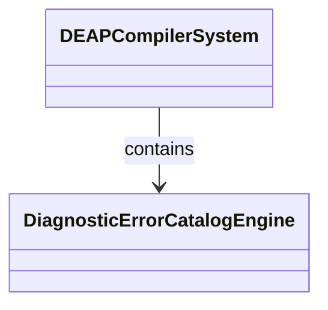
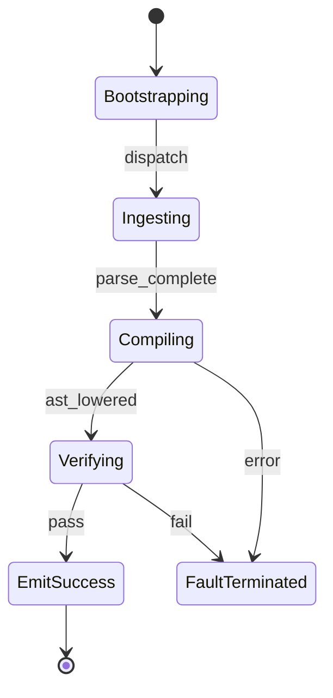

| Attribute | Specification Detail |
| :--- | :--- |
| **Issue ID** | #113 |
| **Title** | Epic 13: Diagnostic Error Catalog |
| **Type** | epic |
| **Package** | DiagnosticErrorCatalog |
| **Subsystem** | Diagnostic Error Catalog |
| **Generation Mode** | subagent |
| **Specification Source** | [schema/model.sysml](../../schema/model.sysml) |

# Epic 13: Diagnostic Error Catalog

## 1. Context
Structural Architecture for Subsystem 11 Standardized Diagnostic Error Catalog

## 2. Requirements & Checklist
- [ ] #57 - Feature 48: [Diagnostic Error Catalog] DiagnosticErrorCatalogEngine
- [ ] #58 - Feature 49: [Diagnostic Error Catalog] ErrorCodeRegistry
- [ ] #59 - Feature 50: [Diagnostic Error Catalog] SourceLocationMapper
- [ ] #60 - Feature 51: [Diagnostic Error Catalog] DiagnosticReportFormatter

### Associated Use Cases & User Stories

#### Associated Use Cases
- [ ] #105 - [Use Case 11: Diagnostic Catalog Triage Workflow](../use-cases/UC-11-Diagnostic_Catalog_Triage_Workflow.md)

#### Associated User Stories
- [ ] #99 - [User Story 11: Triage Diagnostic Action](../user-stories/US-11-TriageDiagnosticAction.md)

## 3. Architecture
Subsystem structural composition, port allocations, and directional data connectors realized by DiagnosticErrorCatalogEngine.

## 4. Operational Considerations
Deterministic compilation passes, error containment, and provable polynomial complexity execution.

## 5. Security & Governance
Safety-critical invariant satisfaction, formal trace matrix closure, and zero hardcoded domain semantics.

## 6. Source References
- System Architecture Model: `schema/model.sysml`
- Subsystem Specification Model: `schema/subsystems/diagnostic_error_catalog/architecture.sysml`
- Subsystem Requirements Model: `schema/subsystems/diagnostic_error_catalog/requirements.sysml`
- Normative Systems Engineering Standard: ISO/IEC/IEEE 15288:2023 §6.4.3 Architecture Definition Process

Subsystem architectural composition and formal invariants derive from `schema/model.sysml` pursuant to ISO/IEC/IEEE 15288.

## System-Level UML Class Diagram

## System State Machine Diagram

