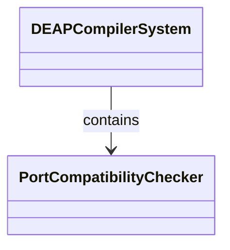

# Feature 38: [Interconnect Contracts] PortCompatibilityChecker

## Metadata
| Attribute | Specification Detail |
| :--- | :--- |
| **Title** | Feature 38: [Interconnect Contracts] PortCompatibilityChecker |
| **Version** | 1.0.0 |
| **Date** | 2026-10-11 |
| **Type** | feature |
| **Part** | PortCompatibilityChecker |
| **Subsystem** | Interconnect Contracts |
| **Issue ID** | #47 |
| **Generation Mode** | subagent |

## UML Class Diagram



## Interface Requirements
### 1. Test Data Shape
```json
{
  "$schema": "https://json-schema.org/draft/2020-12/schema",
  "title": "PortCompatibilityCheckerPayloadSchema",
  "type": "object",
  "properties": {
    "part": {
      "type": "string",
      "const": "PortCompatibilityChecker"
    },
    "status": {
      "type": "string",
      "enum": ["nominal", "degraded", "fault"]
    },
    "safety_in": {
      "type": "object",
      "properties": {
        "direction": { "type": "string", "const": "in" },
        "port_type": { "type": "string", "const": "SafetyPort" }
      },
      "required": ["direction", "port_type"]
    },
    "icd_out": {
      "type": "object",
      "properties": {
        "direction": { "type": "string", "const": "out" },
        "port_type": { "type": "string", "const": "ICDInterconnectPort" }
      },
      "required": ["direction", "port_type"]
    }
  },
  "required": [
    "part",
    "status",
    "safety_in",
    "icd_out"
  ],
  "additionalProperties": false
}
```

### 2. Validation & Constraints
Formal constraints and invariant guarantees enforced by PortCompatibilityChecker.

### 3. Visual Layout & Arrangement
Logical layout, viewport containment, and container structure for PortCompatibilityChecker conforming to platform design tokens. Container boundaries enforce @container isolation rules.

### 4. Interactive Flow & States
Operational lifecycle events and discrete state transitions for PortCompatibilityChecker.

### Layer 1: Domain State & Signal Model
Domain state vector representing PortCompatibilityChecker status, AST references, and typed signal models.

### Layer 2: Logic & Safety State Management
Deterministic state machine solver and safety monitor logic for PortCompatibilityChecker.

### Layer 3: Presentation & Actuator Interface Binding
Presentation interface binding and diagnostic event routing for PortCompatibilityChecker.

## Acceptance Criteria (BDD)
- [ ] AC-01: Given initialized execution environment, When PortCompatibilityChecker processes inputs, Then state invariants are satisfied.
- [ ] AC-02: Given boundary conditions across interface ports, When PortCompatibilityChecker validates payloads, Then conformant outputs are emitted.
- [ ] AC-03: Given exceptional or malformed input events, When PortCompatibilityChecker detects anomalies, Then error recovery activates safely without panic.
- [ ] AC-04: Given repeated execution passes with identical inputs, When PortCompatibilityChecker executes deterministically, Then outputs are bitwise reproducible.

## Source References
Formal component specifications and normative systems engineering requirements:
- Subsystem Requirements: `schema/subsystems/interconnect_contracts/requirements.sysml`
- Subsystem Architecture: `schema/subsystems/interconnect_contracts/architecture.sysml`
- Normative Systems Engineering Standard: ISO/IEC/IEEE 15288:2023 §6.4.3 Architecture Definition Process

Component behavior and interface definitions derive from `schema/model.sysml` pursuant to ISO/IEC/IEEE 15288.
