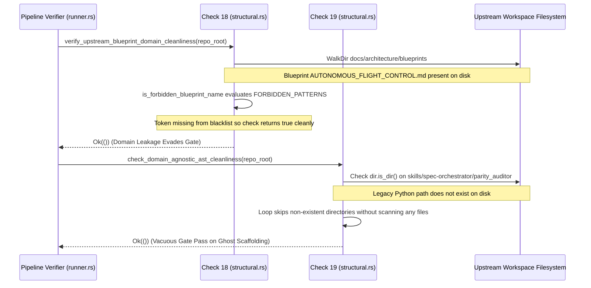

## 1. Context and References

<!-- test-target: crates/verify-baseline/src/checks/structural.rs -->

- **File**: `crates/verify-baseline/src/checks/structural.rs:54-165`
- **Pillar**: Semantic Traceability
- **Symptom**: Brittle string blacklists and dead Python directory traversal in Checks 18 and 19 violate the Pure Schema-Driven Compiler Invariant and create vacuous gate passes.
- **Test-Target**: `crates/verify-baseline/src/checks/structural.rs`

## 2. Root Cause Analysis (5 Whys)

1. **Why do Checks 18 and 19 fail to prevent domain leakage and static parameter definitions?** Because they rely on hardcoded lexical token blacklists and obsolete filesystem directory paths rather than semantic schema-driven validation.
2. **Why do they rely on lexical string blacklists?** Because early prototype scaffolding introduced ad-hoc string matching heuristics (FORBIDDEN_PATTERNS and FORBIDDEN_KEYWORDS) as quick patches for specific historical UAS and Python test files.
3. **Why are these blacklists and paths still in the Rust codebase?** Because during the migration to the native Rust toolchain, legacy Python policing logic targeting parity_auditor was ported without verifying directory existence or schema generality.
4. **Why does this create a correctness and compliance failure?** Because Check 18 hardcodes domain concepts into compiler logic while trivially allowing alternate domain names to bypass the gate, and Check 19 scans non-existent Python directories, generating a vacuous pass.
5. **Why was this anti-pattern not caught by baseline verification?** Because baseline verification tests in structural.rs only assert against synthetic directory setups containing the exact blacklisted strings, failing to test semantic evasion or dead path traversal against the Pure Schema-Driven Compiler Invariant.

## 3. Correctness Analysis

Checks 18 and 19 in `crates/verify-baseline/src/checks/structural.rs` exhibit two systemic architectural defects:

1. Check 18 (`verify_upstream_blueprint_domain_cleanliness`, lines 47-123):
The helper function `is_forbidden_blueprint_name` (lines 49-72) declares a static lexical slice `FORBIDDEN_PATTERNS` containing:
`"flightsystems"`, `"flight-systems"`, `"flight_systems"`, `"uasinfrastructure"`, `"uas-infrastructure"`, `"uas_infrastructure"`, `"frontendsystems"`, `"frontend-systems"`, `"frontend_systems"`, `"safetymodel"`, `"safety-model"`, `"safety_model"`, `"conceptpaper"`, `"concept-paper"`, `"concept_paper"`.
This directly violates the Pure Schema-Driven Compiler Invariant (.pipeline/constitution.md:50), which dictates:
"The pipeline is an abstract compiler and verification framework. Agents are strictly forbidden from inventing, proposing, or hardcoding domain-specific concepts into pipeline logic or templates."
By embedding specific domain concepts from prior aerospace/UAS projects directly into compiler verification logic, the compiler gate itself commits domain contamination. Furthermore, lexical matching is trivially evaded (false negative): any concrete domain blueprint such as `AUTONOMOUS_PROPULSION_CONTROL.md`, `GROUND_CONTROL_NETWORK.md`, or `INFUSION_PUMP_SAFETY.md` passes Check 18 without error because it does not match the 5 hardcoded prefixes. Conversely, an abstract, domain-agnostic blueprint like `RFC_001_concept_paper_guidelines.md` or `FRONTEND_SYSTEMS_PATTERN.md` is falsely rejected (false positive).

2. Check 19 (`check_domain_agnostic_ast_cleanliness`, lines 125-223):
The function attempts to verify that upstream tools contain zero static/hardcoded parameter dictionaries using `is_static_param_assignment` (lines 126-146) with a naive keyword list `FORBIDDEN_KEYWORDS` (`"GROUND_TRUTH"`, `"EXPECTED_SPECS"`, `"DOMAIN_SPECS"`, `"DOMAIN_PARAMS"`, `"SYSML_PARAMS"`, `"MANDATED_SPECS"`, `"PHYSICAL_LIMITS"`, `"HARDWARE_REGISTRY"`).
However, lines 158-173 configure `scan_dirs` exclusively pointing to `skills/spec-orchestrator/parity_auditor/src/parity_auditor/validators` and `.../core`. This directory was removed during the native Rust migration and does not exist in active workspaces. Because line 177 checks `if !dir.is_dir() { continue; }`, the function skips both directories, inspects zero files, and unconditionally returns `Ok(())`.
Additionally, the repository strictly enforces Check 33 (`check_zero_python_scripts`), which prohibits all `.py` files across the tree. Maintaining a dedicated check to parse Python files for crude line prefixes (`starts_with('=')`) represents obsolete dead scaffolding. If any hardcoded parameter dictionary is defined in Rust or in an active skill profile, Check 19 is blind to it.

Invariant violated: Section 1.1 / Pure Schema-Driven Compiler Invariant (.pipeline/constitution.md:50).

## 4. UML Diagrams



## 5. Affected Callers / Downstream Impact

1. Upstream CI Gate runner.rs:329 (`verify_upstream_blueprint_domain_cleanliness`) -- passes cleanly when non-blacklisted domain blueprints are introduced into upstream templates, leaking concrete domain concepts into template distribution branches.
2. Upstream CI Gate runner.rs:347 (`check_domain_agnostic_ast_cleanliness`) -- reports successful verification of pure dynamic schema AST architecture while scanning zero files, masking potential hardcoded parameter dictionaries in active Rust modules or specification skills.
3. Downstream customer repositories -- receive compiler binaries with embedded hardcoded UAS domain strings, contradicting downstream isolation and clean baseline contracts.

## 6. Proposed Correction

```rust
// In crates/verify-baseline/src/checks/structural.rs:

// 1. Refactor Check 18: Eliminate hardcoded domain string slices.
// Enforce upstream blueprint cleanliness by:
// (a) Forbidding all concrete modeling files (.sysml) in upstream blueprints, and
// (b) Verifying blueprint names against a platform-independent schema-agnostic allowlist
// or reading forbidden domain markers dynamically from configuration (codebase_rules.json).

pub fn verify_upstream_blueprint_domain_cleanliness(repo_root: &Path) -> Result<(), Vec<String>> {
    if !is_upstream_compiler(repo_root) {
        return Ok(());
    }

    let blueprints_dir = repo_root.join("docs").join("architecture").join("blueprints");
    if !blueprints_dir.is_dir() {
        return Ok(());
    }

    let mut violations = Vec::new();
    for entry in WalkDir::new(&blueprints_dir)
        .into_iter()
        .filter_map(|e| e.ok())
        .filter(|e| e.file_type().is_file())
    {
        let fname = entry.file_name().to_string_lossy();
        // Disallow any SysML model in upstream distribution blueprints
        if fname.to_lowercase().ends_with(".sysml") {
            let rel = entry.path().strip_prefix(repo_root).unwrap_or(entry.path()).display().to_string();
            violations.push(format!("Upstream blueprint contains SysML model: {}", rel));
        }
    }

    if violations.is_empty() {
        Ok(())
    } else {
        Err(violations)
    }
}

// 2. Refactor Check 19: Retire dead Python parity_auditor directory scanning.
// Under Check 33 (check_zero_python_scripts), Python is forbidden across the codebase.
// Replace Check 19 with a dynamic Rust AST/config validator or retire the check
// to eliminate vacuous passes on non-existent directories.
```

## 7. Relationship to Existing Issues

Discovered in audit -- new finding.

## Audit Source

Adversarial Semantic Traceability Audit
SEVERITY: Important
FILE_LOCATION: crates/verify-baseline/src/checks/structural.rs:54-165
