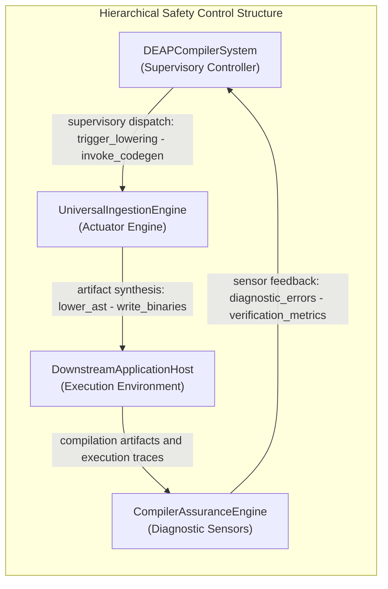
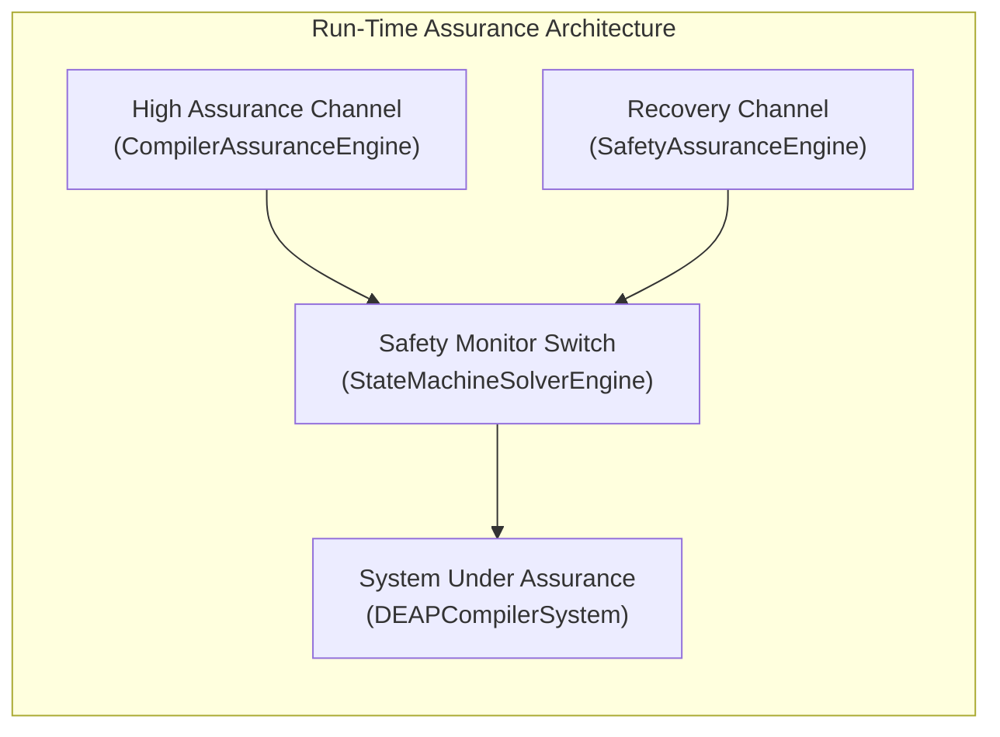

# Unified 8-Pillar STPA Safety & Risk Analysis Matrix

> **Primary Commercial Toolchain Integration Context:** MATLAB / Simulink / Stateflow / Embedded Coder
> **Safety Standards:** ISO/IEC/IEEE 15026-3 | ASTM F3269-17 RTA | MIL-STD-882E | SAE ARP4761 | SORA SAIL

---


## System Losses

| Loss ID | Description |
| :--- | :--- |
| L-1 | Loss of safe function of DEAPCompilerSystem |

## System Hazards

| Hazard ID | Associated Control Action | Controller |
| :--- | :--- | :--- |
| H-1 | OA_01_Ingest_OEM_Artifacts | DEAPCompilerSystem |
| H-2 | OA_01_01_Ingest_System_Vision | DEAPCompilerSystem |
| H-3 | OA_01_02_Ingest_Universal_Schema | DEAPCompilerSystem |
| H-4 | OA_01_1_Format_Detection | DEAPCompilerSystem |
| H-5 | OA_01_2_Token_Lexing | DEAPCompilerSystem |
| H-6 | OA_01_3_Syntax_Normalization | DEAPCompilerSystem |
| H-7 | OA_02_Parse_SysML_AST | DEAPCompilerSystem |
| H-8 | OA_02_01_Construct_Node_Arena | DEAPCompilerSystem |
| H-9 | OA_02_02_Lower_Grammar_Constructs | DEAPCompilerSystem |
| H-10 | OA_02_1_KerML_AST_Build | DEAPCompilerSystem |
| H-11 | OA_02_2_Node_Allocation | DEAPCompilerSystem |
| H-12 | OA_02_3_Topological_Index | DEAPCompilerSystem |
| H-13 | OA_03_Validate_Model_Semantics | DEAPCompilerSystem |
| H-14 | OA_03_01_Verify_Metrology_Flows | DEAPCompilerSystem |
| H-15 | OA_03_02_Solve_State_Transitions | DEAPCompilerSystem |
| H-16 | OA_03_1_Type_Checking | DEAPCompilerSystem |
| H-17 | OA_03_2_Metrology_Verification | DEAPCompilerSystem |
| H-18 | OA_03_3_State_Reachability | DEAPCompilerSystem |
| H-19 | OA_04_Transpile_Safety_Artifacts | DEAPCompilerSystem |
| H-20 | OA_04_01_Verify_Safety_Traceability | DEAPCompilerSystem |
| H-21 | OA_04_02_Verify_ICD_Interconnect_Contracts | DEAPCompilerSystem |
| H-22 | OA_04_1_STPA_Matrix_Synthesis | DEAPCompilerSystem |
| H-23 | OA_04_2_UCA_Derivation | DEAPCompilerSystem |
| H-24 | OA_04_3_FMECA_Generation | DEAPCompilerSystem |
| H-25 | OA_05_Synthesize_Downstream_Projections | DEAPCompilerSystem |
| H-26 | OA_05_01_Project_Agile_Backlog | DEAPCompilerSystem |
| H-27 | OA_05_02_Synthesize_Multi_Target_CodeGen | DEAPCompilerSystem |
| H-28 | OA_05_1_Agile_Backlog_Projection | DEAPCompilerSystem |
| H-29 | OA_05_2_Multi_Target_CodeGen | DEAPCompilerSystem |
| H-30 | OA_05_3_Interface_Binding | DEAPCompilerSystem |
| H-31 | OA_06_Verify_Baseline_Parity | DEAPCompilerSystem |
| H-32 | OA_06_01_Triage_Diagnostic_Catalog | DEAPCompilerSystem |
| H-33 | OA_06_02_Assure_Compiler_Performance_Gates | DEAPCompilerSystem |
| H-34 | OA_06_1_Diagnostic_Catalog_Scan | DEAPCompilerSystem |
| H-35 | OA_06_2_Baseline_Parity_Audit | DEAPCompilerSystem |
| H-36 | OA_06_3_Performance_Benchmarking | DEAPCompilerSystem |
| H-37 | VerifyCompilerAssuranceAction | DEAPCompilerSystem |
| H-38 | AllocateNodeAction | DEAPCompilerSystem |
| H-39 | TriageDiagnosticAction | DEAPCompilerSystem |
| H-40 | ProjectAgileSpecificationsAction | DEAPCompilerSystem |
| H-41 | VerifySafetyTraceabilityAction | DEAPCompilerSystem |
| H-42 | SynthesizeICDContractsAction | DEAPCompilerSystem |
| H-43 | SynthesizeCodeAction | DEAPCompilerSystem |
| H-44 | SolveFlowsAction | DEAPCompilerSystem |
| H-45 | SolveStateDynamicsAction | DEAPCompilerSystem |
| H-46 | LowerSysMLAction | DEAPCompilerSystem |
| H-47 | BootstrapSystemVisionAction | DEAPCompilerSystem |
| H-48 | ClassifyFormatAction | DEAPCompilerSystem |
| H-49 | TokenizeStreamAction | DEAPCompilerSystem |
| H-50 | RecoverSyncAction | DEAPCompilerSystem |
| H-51 | IngestSchemaAction | DEAPCompilerSystem |

## Hierarchical Control Structure Topology




---

## 4. Unsafe Control Actions (**UCA-1..N**)

Systematic identification across the 4 STPA guide word / failure mode categories:

1. **Not providing causes hazard**
2. **Providing causes hazard**
3. **Too early, too late, or out of order**
4. **Stopped too soon or applied too long**


Cartesian product of controlling part-def control actions across the
four canonical STPA guide-word categories.

| UCA ID | Controller | Control Action | Guide Word | Context | Hazard | Safety Constraint | Severity | SAIL |
| :--- | :--- | :--- | :--- | :--- | :--- | :--- | :--- | :--- |
| UCA-001 | DEAPCompilerSystem | OA_01_Ingest_OEM_Artifacts | Not providing | Context for OA_01_Ingest_OEM_Artifacts under Not providing | H-1 | SC-001 | PENDING_PARAMETER | PENDING_PARAMETER |
| UCA-002 | DEAPCompilerSystem | OA_01_Ingest_OEM_Artifacts | Providing | Context for OA_01_Ingest_OEM_Artifacts under Providing | H-1 | SC-002 | PENDING_PARAMETER | PENDING_PARAMETER |
| UCA-003 | DEAPCompilerSystem | OA_01_Ingest_OEM_Artifacts | Too early / Too late / Out of order | Context for OA_01_Ingest_OEM_Artifacts under Too early / Too late / Out of order | H-1 | SC-003 | PENDING_PARAMETER | PENDING_PARAMETER |
| UCA-004 | DEAPCompilerSystem | OA_01_Ingest_OEM_Artifacts | Stopped too soon / Applied too long | Context for OA_01_Ingest_OEM_Artifacts under Stopped too soon / Applied too long | H-1 | SC-004 | PENDING_PARAMETER | PENDING_PARAMETER |
| UCA-005 | DEAPCompilerSystem | OA_01_01_Ingest_System_Vision | Not providing | Context for OA_01_01_Ingest_System_Vision under Not providing | H-2 | SC-005 | PENDING_PARAMETER | PENDING_PARAMETER |
| UCA-006 | DEAPCompilerSystem | OA_01_01_Ingest_System_Vision | Providing | Context for OA_01_01_Ingest_System_Vision under Providing | H-2 | SC-006 | PENDING_PARAMETER | PENDING_PARAMETER |
| UCA-007 | DEAPCompilerSystem | OA_01_01_Ingest_System_Vision | Too early / Too late / Out of order | Context for OA_01_01_Ingest_System_Vision under Too early / Too late / Out of order | H-2 | SC-007 | PENDING_PARAMETER | PENDING_PARAMETER |
| UCA-008 | DEAPCompilerSystem | OA_01_01_Ingest_System_Vision | Stopped too soon / Applied too long | Context for OA_01_01_Ingest_System_Vision under Stopped too soon / Applied too long | H-2 | SC-008 | PENDING_PARAMETER | PENDING_PARAMETER |
| UCA-009 | DEAPCompilerSystem | OA_01_02_Ingest_Universal_Schema | Not providing | Context for OA_01_02_Ingest_Universal_Schema under Not providing | H-3 | SC-009 | PENDING_PARAMETER | PENDING_PARAMETER |
| UCA-010 | DEAPCompilerSystem | OA_01_02_Ingest_Universal_Schema | Providing | Context for OA_01_02_Ingest_Universal_Schema under Providing | H-3 | SC-010 | PENDING_PARAMETER | PENDING_PARAMETER |
| UCA-011 | DEAPCompilerSystem | OA_01_02_Ingest_Universal_Schema | Too early / Too late / Out of order | Context for OA_01_02_Ingest_Universal_Schema under Too early / Too late / Out of order | H-3 | SC-011 | PENDING_PARAMETER | PENDING_PARAMETER |
| UCA-012 | DEAPCompilerSystem | OA_01_02_Ingest_Universal_Schema | Stopped too soon / Applied too long | Context for OA_01_02_Ingest_Universal_Schema under Stopped too soon / Applied too long | H-3 | SC-012 | PENDING_PARAMETER | PENDING_PARAMETER |
| UCA-013 | DEAPCompilerSystem | OA_01_1_Format_Detection | Not providing | Context for OA_01_1_Format_Detection under Not providing | H-4 | SC-013 | PENDING_PARAMETER | PENDING_PARAMETER |
| UCA-014 | DEAPCompilerSystem | OA_01_1_Format_Detection | Providing | Context for OA_01_1_Format_Detection under Providing | H-4 | SC-014 | PENDING_PARAMETER | PENDING_PARAMETER |
| UCA-015 | DEAPCompilerSystem | OA_01_1_Format_Detection | Too early / Too late / Out of order | Context for OA_01_1_Format_Detection under Too early / Too late / Out of order | H-4 | SC-015 | PENDING_PARAMETER | PENDING_PARAMETER |
| UCA-016 | DEAPCompilerSystem | OA_01_1_Format_Detection | Stopped too soon / Applied too long | Context for OA_01_1_Format_Detection under Stopped too soon / Applied too long | H-4 | SC-016 | PENDING_PARAMETER | PENDING_PARAMETER |
| UCA-017 | DEAPCompilerSystem | OA_01_2_Token_Lexing | Not providing | Context for OA_01_2_Token_Lexing under Not providing | H-5 | SC-017 | PENDING_PARAMETER | PENDING_PARAMETER |
| UCA-018 | DEAPCompilerSystem | OA_01_2_Token_Lexing | Providing | Context for OA_01_2_Token_Lexing under Providing | H-5 | SC-018 | PENDING_PARAMETER | PENDING_PARAMETER |
| UCA-019 | DEAPCompilerSystem | OA_01_2_Token_Lexing | Too early / Too late / Out of order | Context for OA_01_2_Token_Lexing under Too early / Too late / Out of order | H-5 | SC-019 | PENDING_PARAMETER | PENDING_PARAMETER |
| UCA-020 | DEAPCompilerSystem | OA_01_2_Token_Lexing | Stopped too soon / Applied too long | Context for OA_01_2_Token_Lexing under Stopped too soon / Applied too long | H-5 | SC-020 | PENDING_PARAMETER | PENDING_PARAMETER |
| UCA-021 | DEAPCompilerSystem | OA_01_3_Syntax_Normalization | Not providing | Context for OA_01_3_Syntax_Normalization under Not providing | H-6 | SC-021 | PENDING_PARAMETER | PENDING_PARAMETER |
| UCA-022 | DEAPCompilerSystem | OA_01_3_Syntax_Normalization | Providing | Context for OA_01_3_Syntax_Normalization under Providing | H-6 | SC-022 | PENDING_PARAMETER | PENDING_PARAMETER |
| UCA-023 | DEAPCompilerSystem | OA_01_3_Syntax_Normalization | Too early / Too late / Out of order | Context for OA_01_3_Syntax_Normalization under Too early / Too late / Out of order | H-6 | SC-023 | PENDING_PARAMETER | PENDING_PARAMETER |
| UCA-024 | DEAPCompilerSystem | OA_01_3_Syntax_Normalization | Stopped too soon / Applied too long | Context for OA_01_3_Syntax_Normalization under Stopped too soon / Applied too long | H-6 | SC-024 | PENDING_PARAMETER | PENDING_PARAMETER |
| UCA-025 | DEAPCompilerSystem | OA_02_Parse_SysML_AST | Not providing | Context for OA_02_Parse_SysML_AST under Not providing | H-7 | SC-025 | PENDING_PARAMETER | PENDING_PARAMETER |
| UCA-026 | DEAPCompilerSystem | OA_02_Parse_SysML_AST | Providing | Context for OA_02_Parse_SysML_AST under Providing | H-7 | SC-026 | PENDING_PARAMETER | PENDING_PARAMETER |
| UCA-027 | DEAPCompilerSystem | OA_02_Parse_SysML_AST | Too early / Too late / Out of order | Context for OA_02_Parse_SysML_AST under Too early / Too late / Out of order | H-7 | SC-027 | PENDING_PARAMETER | PENDING_PARAMETER |
| UCA-028 | DEAPCompilerSystem | OA_02_Parse_SysML_AST | Stopped too soon / Applied too long | Context for OA_02_Parse_SysML_AST under Stopped too soon / Applied too long | H-7 | SC-028 | PENDING_PARAMETER | PENDING_PARAMETER |
| UCA-029 | DEAPCompilerSystem | OA_02_01_Construct_Node_Arena | Not providing | Context for OA_02_01_Construct_Node_Arena under Not providing | H-8 | SC-029 | PENDING_PARAMETER | PENDING_PARAMETER |
| UCA-030 | DEAPCompilerSystem | OA_02_01_Construct_Node_Arena | Providing | Context for OA_02_01_Construct_Node_Arena under Providing | H-8 | SC-030 | PENDING_PARAMETER | PENDING_PARAMETER |
| UCA-031 | DEAPCompilerSystem | OA_02_01_Construct_Node_Arena | Too early / Too late / Out of order | Context for OA_02_01_Construct_Node_Arena under Too early / Too late / Out of order | H-8 | SC-031 | PENDING_PARAMETER | PENDING_PARAMETER |
| UCA-032 | DEAPCompilerSystem | OA_02_01_Construct_Node_Arena | Stopped too soon / Applied too long | Context for OA_02_01_Construct_Node_Arena under Stopped too soon / Applied too long | H-8 | SC-032 | PENDING_PARAMETER | PENDING_PARAMETER |
| UCA-033 | DEAPCompilerSystem | OA_02_02_Lower_Grammar_Constructs | Not providing | Context for OA_02_02_Lower_Grammar_Constructs under Not providing | H-9 | SC-033 | PENDING_PARAMETER | PENDING_PARAMETER |
| UCA-034 | DEAPCompilerSystem | OA_02_02_Lower_Grammar_Constructs | Providing | Context for OA_02_02_Lower_Grammar_Constructs under Providing | H-9 | SC-034 | PENDING_PARAMETER | PENDING_PARAMETER |
| UCA-035 | DEAPCompilerSystem | OA_02_02_Lower_Grammar_Constructs | Too early / Too late / Out of order | Context for OA_02_02_Lower_Grammar_Constructs under Too early / Too late / Out of order | H-9 | SC-035 | PENDING_PARAMETER | PENDING_PARAMETER |
| UCA-036 | DEAPCompilerSystem | OA_02_02_Lower_Grammar_Constructs | Stopped too soon / Applied too long | Context for OA_02_02_Lower_Grammar_Constructs under Stopped too soon / Applied too long | H-9 | SC-036 | PENDING_PARAMETER | PENDING_PARAMETER |
| UCA-037 | DEAPCompilerSystem | OA_02_1_KerML_AST_Build | Not providing | Context for OA_02_1_KerML_AST_Build under Not providing | H-10 | SC-037 | PENDING_PARAMETER | PENDING_PARAMETER |
| UCA-038 | DEAPCompilerSystem | OA_02_1_KerML_AST_Build | Providing | Context for OA_02_1_KerML_AST_Build under Providing | H-10 | SC-038 | PENDING_PARAMETER | PENDING_PARAMETER |
| UCA-039 | DEAPCompilerSystem | OA_02_1_KerML_AST_Build | Too early / Too late / Out of order | Context for OA_02_1_KerML_AST_Build under Too early / Too late / Out of order | H-10 | SC-039 | PENDING_PARAMETER | PENDING_PARAMETER |
| UCA-040 | DEAPCompilerSystem | OA_02_1_KerML_AST_Build | Stopped too soon / Applied too long | Context for OA_02_1_KerML_AST_Build under Stopped too soon / Applied too long | H-10 | SC-040 | PENDING_PARAMETER | PENDING_PARAMETER |
| UCA-041 | DEAPCompilerSystem | OA_02_2_Node_Allocation | Not providing | Context for OA_02_2_Node_Allocation under Not providing | H-11 | SC-041 | PENDING_PARAMETER | PENDING_PARAMETER |
| UCA-042 | DEAPCompilerSystem | OA_02_2_Node_Allocation | Providing | Context for OA_02_2_Node_Allocation under Providing | H-11 | SC-042 | PENDING_PARAMETER | PENDING_PARAMETER |
| UCA-043 | DEAPCompilerSystem | OA_02_2_Node_Allocation | Too early / Too late / Out of order | Context for OA_02_2_Node_Allocation under Too early / Too late / Out of order | H-11 | SC-043 | PENDING_PARAMETER | PENDING_PARAMETER |
| UCA-044 | DEAPCompilerSystem | OA_02_2_Node_Allocation | Stopped too soon / Applied too long | Context for OA_02_2_Node_Allocation under Stopped too soon / Applied too long | H-11 | SC-044 | PENDING_PARAMETER | PENDING_PARAMETER |
| UCA-045 | DEAPCompilerSystem | OA_02_3_Topological_Index | Not providing | Context for OA_02_3_Topological_Index under Not providing | H-12 | SC-045 | PENDING_PARAMETER | PENDING_PARAMETER |
| UCA-046 | DEAPCompilerSystem | OA_02_3_Topological_Index | Providing | Context for OA_02_3_Topological_Index under Providing | H-12 | SC-046 | PENDING_PARAMETER | PENDING_PARAMETER |
| UCA-047 | DEAPCompilerSystem | OA_02_3_Topological_Index | Too early / Too late / Out of order | Context for OA_02_3_Topological_Index under Too early / Too late / Out of order | H-12 | SC-047 | PENDING_PARAMETER | PENDING_PARAMETER |
| UCA-048 | DEAPCompilerSystem | OA_02_3_Topological_Index | Stopped too soon / Applied too long | Context for OA_02_3_Topological_Index under Stopped too soon / Applied too long | H-12 | SC-048 | PENDING_PARAMETER | PENDING_PARAMETER |
| UCA-049 | DEAPCompilerSystem | OA_03_Validate_Model_Semantics | Not providing | Context for OA_03_Validate_Model_Semantics under Not providing | H-13 | SC-049 | PENDING_PARAMETER | PENDING_PARAMETER |
| UCA-050 | DEAPCompilerSystem | OA_03_Validate_Model_Semantics | Providing | Context for OA_03_Validate_Model_Semantics under Providing | H-13 | SC-050 | PENDING_PARAMETER | PENDING_PARAMETER |
| UCA-051 | DEAPCompilerSystem | OA_03_Validate_Model_Semantics | Too early / Too late / Out of order | Context for OA_03_Validate_Model_Semantics under Too early / Too late / Out of order | H-13 | SC-051 | PENDING_PARAMETER | PENDING_PARAMETER |
| UCA-052 | DEAPCompilerSystem | OA_03_Validate_Model_Semantics | Stopped too soon / Applied too long | Context for OA_03_Validate_Model_Semantics under Stopped too soon / Applied too long | H-13 | SC-052 | PENDING_PARAMETER | PENDING_PARAMETER |
| UCA-053 | DEAPCompilerSystem | OA_03_01_Verify_Metrology_Flows | Not providing | Context for OA_03_01_Verify_Metrology_Flows under Not providing | H-14 | SC-053 | PENDING_PARAMETER | PENDING_PARAMETER |
| UCA-054 | DEAPCompilerSystem | OA_03_01_Verify_Metrology_Flows | Providing | Context for OA_03_01_Verify_Metrology_Flows under Providing | H-14 | SC-054 | PENDING_PARAMETER | PENDING_PARAMETER |
| UCA-055 | DEAPCompilerSystem | OA_03_01_Verify_Metrology_Flows | Too early / Too late / Out of order | Context for OA_03_01_Verify_Metrology_Flows under Too early / Too late / Out of order | H-14 | SC-055 | PENDING_PARAMETER | PENDING_PARAMETER |
| UCA-056 | DEAPCompilerSystem | OA_03_01_Verify_Metrology_Flows | Stopped too soon / Applied too long | Context for OA_03_01_Verify_Metrology_Flows under Stopped too soon / Applied too long | H-14 | SC-056 | PENDING_PARAMETER | PENDING_PARAMETER |
| UCA-057 | DEAPCompilerSystem | OA_03_02_Solve_State_Transitions | Not providing | Context for OA_03_02_Solve_State_Transitions under Not providing | H-15 | SC-057 | PENDING_PARAMETER | PENDING_PARAMETER |
| UCA-058 | DEAPCompilerSystem | OA_03_02_Solve_State_Transitions | Providing | Context for OA_03_02_Solve_State_Transitions under Providing | H-15 | SC-058 | PENDING_PARAMETER | PENDING_PARAMETER |
| UCA-059 | DEAPCompilerSystem | OA_03_02_Solve_State_Transitions | Too early / Too late / Out of order | Context for OA_03_02_Solve_State_Transitions under Too early / Too late / Out of order | H-15 | SC-059 | PENDING_PARAMETER | PENDING_PARAMETER |
| UCA-060 | DEAPCompilerSystem | OA_03_02_Solve_State_Transitions | Stopped too soon / Applied too long | Context for OA_03_02_Solve_State_Transitions under Stopped too soon / Applied too long | H-15 | SC-060 | PENDING_PARAMETER | PENDING_PARAMETER |
| UCA-061 | DEAPCompilerSystem | OA_03_1_Type_Checking | Not providing | Context for OA_03_1_Type_Checking under Not providing | H-16 | SC-061 | PENDING_PARAMETER | PENDING_PARAMETER |
| UCA-062 | DEAPCompilerSystem | OA_03_1_Type_Checking | Providing | Context for OA_03_1_Type_Checking under Providing | H-16 | SC-062 | PENDING_PARAMETER | PENDING_PARAMETER |
| UCA-063 | DEAPCompilerSystem | OA_03_1_Type_Checking | Too early / Too late / Out of order | Context for OA_03_1_Type_Checking under Too early / Too late / Out of order | H-16 | SC-063 | PENDING_PARAMETER | PENDING_PARAMETER |
| UCA-064 | DEAPCompilerSystem | OA_03_1_Type_Checking | Stopped too soon / Applied too long | Context for OA_03_1_Type_Checking under Stopped too soon / Applied too long | H-16 | SC-064 | PENDING_PARAMETER | PENDING_PARAMETER |
| UCA-065 | DEAPCompilerSystem | OA_03_2_Metrology_Verification | Not providing | Context for OA_03_2_Metrology_Verification under Not providing | H-17 | SC-065 | PENDING_PARAMETER | PENDING_PARAMETER |
| UCA-066 | DEAPCompilerSystem | OA_03_2_Metrology_Verification | Providing | Context for OA_03_2_Metrology_Verification under Providing | H-17 | SC-066 | PENDING_PARAMETER | PENDING_PARAMETER |
| UCA-067 | DEAPCompilerSystem | OA_03_2_Metrology_Verification | Too early / Too late / Out of order | Context for OA_03_2_Metrology_Verification under Too early / Too late / Out of order | H-17 | SC-067 | PENDING_PARAMETER | PENDING_PARAMETER |
| UCA-068 | DEAPCompilerSystem | OA_03_2_Metrology_Verification | Stopped too soon / Applied too long | Context for OA_03_2_Metrology_Verification under Stopped too soon / Applied too long | H-17 | SC-068 | PENDING_PARAMETER | PENDING_PARAMETER |
| UCA-069 | DEAPCompilerSystem | OA_03_3_State_Reachability | Not providing | Context for OA_03_3_State_Reachability under Not providing | H-18 | SC-069 | PENDING_PARAMETER | PENDING_PARAMETER |
| UCA-070 | DEAPCompilerSystem | OA_03_3_State_Reachability | Providing | Context for OA_03_3_State_Reachability under Providing | H-18 | SC-070 | PENDING_PARAMETER | PENDING_PARAMETER |
| UCA-071 | DEAPCompilerSystem | OA_03_3_State_Reachability | Too early / Too late / Out of order | Context for OA_03_3_State_Reachability under Too early / Too late / Out of order | H-18 | SC-071 | PENDING_PARAMETER | PENDING_PARAMETER |
| UCA-072 | DEAPCompilerSystem | OA_03_3_State_Reachability | Stopped too soon / Applied too long | Context for OA_03_3_State_Reachability under Stopped too soon / Applied too long | H-18 | SC-072 | PENDING_PARAMETER | PENDING_PARAMETER |
| UCA-073 | DEAPCompilerSystem | OA_04_Transpile_Safety_Artifacts | Not providing | Context for OA_04_Transpile_Safety_Artifacts under Not providing | H-19 | SC-073 | PENDING_PARAMETER | PENDING_PARAMETER |
| UCA-074 | DEAPCompilerSystem | OA_04_Transpile_Safety_Artifacts | Providing | Context for OA_04_Transpile_Safety_Artifacts under Providing | H-19 | SC-074 | PENDING_PARAMETER | PENDING_PARAMETER |
| UCA-075 | DEAPCompilerSystem | OA_04_Transpile_Safety_Artifacts | Too early / Too late / Out of order | Context for OA_04_Transpile_Safety_Artifacts under Too early / Too late / Out of order | H-19 | SC-075 | PENDING_PARAMETER | PENDING_PARAMETER |
| UCA-076 | DEAPCompilerSystem | OA_04_Transpile_Safety_Artifacts | Stopped too soon / Applied too long | Context for OA_04_Transpile_Safety_Artifacts under Stopped too soon / Applied too long | H-19 | SC-076 | PENDING_PARAMETER | PENDING_PARAMETER |
| UCA-077 | DEAPCompilerSystem | OA_04_01_Verify_Safety_Traceability | Not providing | Context for OA_04_01_Verify_Safety_Traceability under Not providing | H-20 | SC-077 | PENDING_PARAMETER | PENDING_PARAMETER |
| UCA-078 | DEAPCompilerSystem | OA_04_01_Verify_Safety_Traceability | Providing | Context for OA_04_01_Verify_Safety_Traceability under Providing | H-20 | SC-078 | PENDING_PARAMETER | PENDING_PARAMETER |
| UCA-079 | DEAPCompilerSystem | OA_04_01_Verify_Safety_Traceability | Too early / Too late / Out of order | Context for OA_04_01_Verify_Safety_Traceability under Too early / Too late / Out of order | H-20 | SC-079 | PENDING_PARAMETER | PENDING_PARAMETER |
| UCA-080 | DEAPCompilerSystem | OA_04_01_Verify_Safety_Traceability | Stopped too soon / Applied too long | Context for OA_04_01_Verify_Safety_Traceability under Stopped too soon / Applied too long | H-20 | SC-080 | PENDING_PARAMETER | PENDING_PARAMETER |
| UCA-081 | DEAPCompilerSystem | OA_04_02_Verify_ICD_Interconnect_Contracts | Not providing | Context for OA_04_02_Verify_ICD_Interconnect_Contracts under Not providing | H-21 | SC-081 | PENDING_PARAMETER | PENDING_PARAMETER |
| UCA-082 | DEAPCompilerSystem | OA_04_02_Verify_ICD_Interconnect_Contracts | Providing | Context for OA_04_02_Verify_ICD_Interconnect_Contracts under Providing | H-21 | SC-082 | PENDING_PARAMETER | PENDING_PARAMETER |
| UCA-083 | DEAPCompilerSystem | OA_04_02_Verify_ICD_Interconnect_Contracts | Too early / Too late / Out of order | Context for OA_04_02_Verify_ICD_Interconnect_Contracts under Too early / Too late / Out of order | H-21 | SC-083 | PENDING_PARAMETER | PENDING_PARAMETER |
| UCA-084 | DEAPCompilerSystem | OA_04_02_Verify_ICD_Interconnect_Contracts | Stopped too soon / Applied too long | Context for OA_04_02_Verify_ICD_Interconnect_Contracts under Stopped too soon / Applied too long | H-21 | SC-084 | PENDING_PARAMETER | PENDING_PARAMETER |
| UCA-085 | DEAPCompilerSystem | OA_04_1_STPA_Matrix_Synthesis | Not providing | Context for OA_04_1_STPA_Matrix_Synthesis under Not providing | H-22 | SC-085 | PENDING_PARAMETER | PENDING_PARAMETER |
| UCA-086 | DEAPCompilerSystem | OA_04_1_STPA_Matrix_Synthesis | Providing | Context for OA_04_1_STPA_Matrix_Synthesis under Providing | H-22 | SC-086 | PENDING_PARAMETER | PENDING_PARAMETER |
| UCA-087 | DEAPCompilerSystem | OA_04_1_STPA_Matrix_Synthesis | Too early / Too late / Out of order | Context for OA_04_1_STPA_Matrix_Synthesis under Too early / Too late / Out of order | H-22 | SC-087 | PENDING_PARAMETER | PENDING_PARAMETER |
| UCA-088 | DEAPCompilerSystem | OA_04_1_STPA_Matrix_Synthesis | Stopped too soon / Applied too long | Context for OA_04_1_STPA_Matrix_Synthesis under Stopped too soon / Applied too long | H-22 | SC-088 | PENDING_PARAMETER | PENDING_PARAMETER |
| UCA-089 | DEAPCompilerSystem | OA_04_2_UCA_Derivation | Not providing | Context for OA_04_2_UCA_Derivation under Not providing | H-23 | SC-089 | PENDING_PARAMETER | PENDING_PARAMETER |
| UCA-090 | DEAPCompilerSystem | OA_04_2_UCA_Derivation | Providing | Context for OA_04_2_UCA_Derivation under Providing | H-23 | SC-090 | PENDING_PARAMETER | PENDING_PARAMETER |
| UCA-091 | DEAPCompilerSystem | OA_04_2_UCA_Derivation | Too early / Too late / Out of order | Context for OA_04_2_UCA_Derivation under Too early / Too late / Out of order | H-23 | SC-091 | PENDING_PARAMETER | PENDING_PARAMETER |
| UCA-092 | DEAPCompilerSystem | OA_04_2_UCA_Derivation | Stopped too soon / Applied too long | Context for OA_04_2_UCA_Derivation under Stopped too soon / Applied too long | H-23 | SC-092 | PENDING_PARAMETER | PENDING_PARAMETER |
| UCA-093 | DEAPCompilerSystem | OA_04_3_FMECA_Generation | Not providing | Context for OA_04_3_FMECA_Generation under Not providing | H-24 | SC-093 | PENDING_PARAMETER | PENDING_PARAMETER |
| UCA-094 | DEAPCompilerSystem | OA_04_3_FMECA_Generation | Providing | Context for OA_04_3_FMECA_Generation under Providing | H-24 | SC-094 | PENDING_PARAMETER | PENDING_PARAMETER |
| UCA-095 | DEAPCompilerSystem | OA_04_3_FMECA_Generation | Too early / Too late / Out of order | Context for OA_04_3_FMECA_Generation under Too early / Too late / Out of order | H-24 | SC-095 | PENDING_PARAMETER | PENDING_PARAMETER |
| UCA-096 | DEAPCompilerSystem | OA_04_3_FMECA_Generation | Stopped too soon / Applied too long | Context for OA_04_3_FMECA_Generation under Stopped too soon / Applied too long | H-24 | SC-096 | PENDING_PARAMETER | PENDING_PARAMETER |
| UCA-097 | DEAPCompilerSystem | OA_05_Synthesize_Downstream_Projections | Not providing | Context for OA_05_Synthesize_Downstream_Projections under Not providing | H-25 | SC-097 | PENDING_PARAMETER | PENDING_PARAMETER |
| UCA-098 | DEAPCompilerSystem | OA_05_Synthesize_Downstream_Projections | Providing | Context for OA_05_Synthesize_Downstream_Projections under Providing | H-25 | SC-098 | PENDING_PARAMETER | PENDING_PARAMETER |
| UCA-099 | DEAPCompilerSystem | OA_05_Synthesize_Downstream_Projections | Too early / Too late / Out of order | Context for OA_05_Synthesize_Downstream_Projections under Too early / Too late / Out of order | H-25 | SC-099 | PENDING_PARAMETER | PENDING_PARAMETER |
| UCA-100 | DEAPCompilerSystem | OA_05_Synthesize_Downstream_Projections | Stopped too soon / Applied too long | Context for OA_05_Synthesize_Downstream_Projections under Stopped too soon / Applied too long | H-25 | SC-100 | PENDING_PARAMETER | PENDING_PARAMETER |
| UCA-101 | DEAPCompilerSystem | OA_05_01_Project_Agile_Backlog | Not providing | Context for OA_05_01_Project_Agile_Backlog under Not providing | H-26 | SC-101 | PENDING_PARAMETER | PENDING_PARAMETER |
| UCA-102 | DEAPCompilerSystem | OA_05_01_Project_Agile_Backlog | Providing | Context for OA_05_01_Project_Agile_Backlog under Providing | H-26 | SC-102 | PENDING_PARAMETER | PENDING_PARAMETER |
| UCA-103 | DEAPCompilerSystem | OA_05_01_Project_Agile_Backlog | Too early / Too late / Out of order | Context for OA_05_01_Project_Agile_Backlog under Too early / Too late / Out of order | H-26 | SC-103 | PENDING_PARAMETER | PENDING_PARAMETER |
| UCA-104 | DEAPCompilerSystem | OA_05_01_Project_Agile_Backlog | Stopped too soon / Applied too long | Context for OA_05_01_Project_Agile_Backlog under Stopped too soon / Applied too long | H-26 | SC-104 | PENDING_PARAMETER | PENDING_PARAMETER |
| UCA-105 | DEAPCompilerSystem | OA_05_02_Synthesize_Multi_Target_CodeGen | Not providing | Context for OA_05_02_Synthesize_Multi_Target_CodeGen under Not providing | H-27 | SC-105 | PENDING_PARAMETER | PENDING_PARAMETER |
| UCA-106 | DEAPCompilerSystem | OA_05_02_Synthesize_Multi_Target_CodeGen | Providing | Context for OA_05_02_Synthesize_Multi_Target_CodeGen under Providing | H-27 | SC-106 | PENDING_PARAMETER | PENDING_PARAMETER |
| UCA-107 | DEAPCompilerSystem | OA_05_02_Synthesize_Multi_Target_CodeGen | Too early / Too late / Out of order | Context for OA_05_02_Synthesize_Multi_Target_CodeGen under Too early / Too late / Out of order | H-27 | SC-107 | PENDING_PARAMETER | PENDING_PARAMETER |
| UCA-108 | DEAPCompilerSystem | OA_05_02_Synthesize_Multi_Target_CodeGen | Stopped too soon / Applied too long | Context for OA_05_02_Synthesize_Multi_Target_CodeGen under Stopped too soon / Applied too long | H-27 | SC-108 | PENDING_PARAMETER | PENDING_PARAMETER |
| UCA-109 | DEAPCompilerSystem | OA_05_1_Agile_Backlog_Projection | Not providing | Context for OA_05_1_Agile_Backlog_Projection under Not providing | H-28 | SC-109 | PENDING_PARAMETER | PENDING_PARAMETER |
| UCA-110 | DEAPCompilerSystem | OA_05_1_Agile_Backlog_Projection | Providing | Context for OA_05_1_Agile_Backlog_Projection under Providing | H-28 | SC-110 | PENDING_PARAMETER | PENDING_PARAMETER |
| UCA-111 | DEAPCompilerSystem | OA_05_1_Agile_Backlog_Projection | Too early / Too late / Out of order | Context for OA_05_1_Agile_Backlog_Projection under Too early / Too late / Out of order | H-28 | SC-111 | PENDING_PARAMETER | PENDING_PARAMETER |
| UCA-112 | DEAPCompilerSystem | OA_05_1_Agile_Backlog_Projection | Stopped too soon / Applied too long | Context for OA_05_1_Agile_Backlog_Projection under Stopped too soon / Applied too long | H-28 | SC-112 | PENDING_PARAMETER | PENDING_PARAMETER |
| UCA-113 | DEAPCompilerSystem | OA_05_2_Multi_Target_CodeGen | Not providing | Context for OA_05_2_Multi_Target_CodeGen under Not providing | H-29 | SC-113 | PENDING_PARAMETER | PENDING_PARAMETER |
| UCA-114 | DEAPCompilerSystem | OA_05_2_Multi_Target_CodeGen | Providing | Context for OA_05_2_Multi_Target_CodeGen under Providing | H-29 | SC-114 | PENDING_PARAMETER | PENDING_PARAMETER |
| UCA-115 | DEAPCompilerSystem | OA_05_2_Multi_Target_CodeGen | Too early / Too late / Out of order | Context for OA_05_2_Multi_Target_CodeGen under Too early / Too late / Out of order | H-29 | SC-115 | PENDING_PARAMETER | PENDING_PARAMETER |
| UCA-116 | DEAPCompilerSystem | OA_05_2_Multi_Target_CodeGen | Stopped too soon / Applied too long | Context for OA_05_2_Multi_Target_CodeGen under Stopped too soon / Applied too long | H-29 | SC-116 | PENDING_PARAMETER | PENDING_PARAMETER |
| UCA-117 | DEAPCompilerSystem | OA_05_3_Interface_Binding | Not providing | Context for OA_05_3_Interface_Binding under Not providing | H-30 | SC-117 | PENDING_PARAMETER | PENDING_PARAMETER |
| UCA-118 | DEAPCompilerSystem | OA_05_3_Interface_Binding | Providing | Context for OA_05_3_Interface_Binding under Providing | H-30 | SC-118 | PENDING_PARAMETER | PENDING_PARAMETER |
| UCA-119 | DEAPCompilerSystem | OA_05_3_Interface_Binding | Too early / Too late / Out of order | Context for OA_05_3_Interface_Binding under Too early / Too late / Out of order | H-30 | SC-119 | PENDING_PARAMETER | PENDING_PARAMETER |
| UCA-120 | DEAPCompilerSystem | OA_05_3_Interface_Binding | Stopped too soon / Applied too long | Context for OA_05_3_Interface_Binding under Stopped too soon / Applied too long | H-30 | SC-120 | PENDING_PARAMETER | PENDING_PARAMETER |
| UCA-121 | DEAPCompilerSystem | OA_06_Verify_Baseline_Parity | Not providing | Context for OA_06_Verify_Baseline_Parity under Not providing | H-31 | SC-121 | PENDING_PARAMETER | PENDING_PARAMETER |
| UCA-122 | DEAPCompilerSystem | OA_06_Verify_Baseline_Parity | Providing | Context for OA_06_Verify_Baseline_Parity under Providing | H-31 | SC-122 | PENDING_PARAMETER | PENDING_PARAMETER |
| UCA-123 | DEAPCompilerSystem | OA_06_Verify_Baseline_Parity | Too early / Too late / Out of order | Context for OA_06_Verify_Baseline_Parity under Too early / Too late / Out of order | H-31 | SC-123 | PENDING_PARAMETER | PENDING_PARAMETER |
| UCA-124 | DEAPCompilerSystem | OA_06_Verify_Baseline_Parity | Stopped too soon / Applied too long | Context for OA_06_Verify_Baseline_Parity under Stopped too soon / Applied too long | H-31 | SC-124 | PENDING_PARAMETER | PENDING_PARAMETER |
| UCA-125 | DEAPCompilerSystem | OA_06_01_Triage_Diagnostic_Catalog | Not providing | Context for OA_06_01_Triage_Diagnostic_Catalog under Not providing | H-32 | SC-125 | PENDING_PARAMETER | PENDING_PARAMETER |
| UCA-126 | DEAPCompilerSystem | OA_06_01_Triage_Diagnostic_Catalog | Providing | Context for OA_06_01_Triage_Diagnostic_Catalog under Providing | H-32 | SC-126 | PENDING_PARAMETER | PENDING_PARAMETER |
| UCA-127 | DEAPCompilerSystem | OA_06_01_Triage_Diagnostic_Catalog | Too early / Too late / Out of order | Context for OA_06_01_Triage_Diagnostic_Catalog under Too early / Too late / Out of order | H-32 | SC-127 | PENDING_PARAMETER | PENDING_PARAMETER |
| UCA-128 | DEAPCompilerSystem | OA_06_01_Triage_Diagnostic_Catalog | Stopped too soon / Applied too long | Context for OA_06_01_Triage_Diagnostic_Catalog under Stopped too soon / Applied too long | H-32 | SC-128 | PENDING_PARAMETER | PENDING_PARAMETER |
| UCA-129 | DEAPCompilerSystem | OA_06_02_Assure_Compiler_Performance_Gates | Not providing | Context for OA_06_02_Assure_Compiler_Performance_Gates under Not providing | H-33 | SC-129 | PENDING_PARAMETER | PENDING_PARAMETER |
| UCA-130 | DEAPCompilerSystem | OA_06_02_Assure_Compiler_Performance_Gates | Providing | Context for OA_06_02_Assure_Compiler_Performance_Gates under Providing | H-33 | SC-130 | PENDING_PARAMETER | PENDING_PARAMETER |
| UCA-131 | DEAPCompilerSystem | OA_06_02_Assure_Compiler_Performance_Gates | Too early / Too late / Out of order | Context for OA_06_02_Assure_Compiler_Performance_Gates under Too early / Too late / Out of order | H-33 | SC-131 | PENDING_PARAMETER | PENDING_PARAMETER |
| UCA-132 | DEAPCompilerSystem | OA_06_02_Assure_Compiler_Performance_Gates | Stopped too soon / Applied too long | Context for OA_06_02_Assure_Compiler_Performance_Gates under Stopped too soon / Applied too long | H-33 | SC-132 | PENDING_PARAMETER | PENDING_PARAMETER |
| UCA-133 | DEAPCompilerSystem | OA_06_1_Diagnostic_Catalog_Scan | Not providing | Context for OA_06_1_Diagnostic_Catalog_Scan under Not providing | H-34 | SC-133 | PENDING_PARAMETER | PENDING_PARAMETER |
| UCA-134 | DEAPCompilerSystem | OA_06_1_Diagnostic_Catalog_Scan | Providing | Context for OA_06_1_Diagnostic_Catalog_Scan under Providing | H-34 | SC-134 | PENDING_PARAMETER | PENDING_PARAMETER |
| UCA-135 | DEAPCompilerSystem | OA_06_1_Diagnostic_Catalog_Scan | Too early / Too late / Out of order | Context for OA_06_1_Diagnostic_Catalog_Scan under Too early / Too late / Out of order | H-34 | SC-135 | PENDING_PARAMETER | PENDING_PARAMETER |
| UCA-136 | DEAPCompilerSystem | OA_06_1_Diagnostic_Catalog_Scan | Stopped too soon / Applied too long | Context for OA_06_1_Diagnostic_Catalog_Scan under Stopped too soon / Applied too long | H-34 | SC-136 | PENDING_PARAMETER | PENDING_PARAMETER |
| UCA-137 | DEAPCompilerSystem | OA_06_2_Baseline_Parity_Audit | Not providing | Context for OA_06_2_Baseline_Parity_Audit under Not providing | H-35 | SC-137 | PENDING_PARAMETER | PENDING_PARAMETER |
| UCA-138 | DEAPCompilerSystem | OA_06_2_Baseline_Parity_Audit | Providing | Context for OA_06_2_Baseline_Parity_Audit under Providing | H-35 | SC-138 | PENDING_PARAMETER | PENDING_PARAMETER |
| UCA-139 | DEAPCompilerSystem | OA_06_2_Baseline_Parity_Audit | Too early / Too late / Out of order | Context for OA_06_2_Baseline_Parity_Audit under Too early / Too late / Out of order | H-35 | SC-139 | PENDING_PARAMETER | PENDING_PARAMETER |
| UCA-140 | DEAPCompilerSystem | OA_06_2_Baseline_Parity_Audit | Stopped too soon / Applied too long | Context for OA_06_2_Baseline_Parity_Audit under Stopped too soon / Applied too long | H-35 | SC-140 | PENDING_PARAMETER | PENDING_PARAMETER |
| UCA-141 | DEAPCompilerSystem | OA_06_3_Performance_Benchmarking | Not providing | Context for OA_06_3_Performance_Benchmarking under Not providing | H-36 | SC-141 | PENDING_PARAMETER | PENDING_PARAMETER |
| UCA-142 | DEAPCompilerSystem | OA_06_3_Performance_Benchmarking | Providing | Context for OA_06_3_Performance_Benchmarking under Providing | H-36 | SC-142 | PENDING_PARAMETER | PENDING_PARAMETER |
| UCA-143 | DEAPCompilerSystem | OA_06_3_Performance_Benchmarking | Too early / Too late / Out of order | Context for OA_06_3_Performance_Benchmarking under Too early / Too late / Out of order | H-36 | SC-143 | PENDING_PARAMETER | PENDING_PARAMETER |
| UCA-144 | DEAPCompilerSystem | OA_06_3_Performance_Benchmarking | Stopped too soon / Applied too long | Context for OA_06_3_Performance_Benchmarking under Stopped too soon / Applied too long | H-36 | SC-144 | PENDING_PARAMETER | PENDING_PARAMETER |
| UCA-145 | DEAPCompilerSystem | VerifyCompilerAssuranceAction | Not providing | Context for VerifyCompilerAssuranceAction under Not providing | H-37 | SC-145 | PENDING_PARAMETER | PENDING_PARAMETER |
| UCA-146 | DEAPCompilerSystem | VerifyCompilerAssuranceAction | Providing | Context for VerifyCompilerAssuranceAction under Providing | H-37 | SC-146 | PENDING_PARAMETER | PENDING_PARAMETER |
| UCA-147 | DEAPCompilerSystem | VerifyCompilerAssuranceAction | Too early / Too late / Out of order | Context for VerifyCompilerAssuranceAction under Too early / Too late / Out of order | H-37 | SC-147 | PENDING_PARAMETER | PENDING_PARAMETER |
| UCA-148 | DEAPCompilerSystem | VerifyCompilerAssuranceAction | Stopped too soon / Applied too long | Context for VerifyCompilerAssuranceAction under Stopped too soon / Applied too long | H-37 | SC-148 | PENDING_PARAMETER | PENDING_PARAMETER |
| UCA-149 | DEAPCompilerSystem | AllocateNodeAction | Not providing | Context for AllocateNodeAction under Not providing | H-38 | SC-149 | PENDING_PARAMETER | PENDING_PARAMETER |
| UCA-150 | DEAPCompilerSystem | AllocateNodeAction | Providing | Context for AllocateNodeAction under Providing | H-38 | SC-150 | PENDING_PARAMETER | PENDING_PARAMETER |
| UCA-151 | DEAPCompilerSystem | AllocateNodeAction | Too early / Too late / Out of order | Context for AllocateNodeAction under Too early / Too late / Out of order | H-38 | SC-151 | PENDING_PARAMETER | PENDING_PARAMETER |
| UCA-152 | DEAPCompilerSystem | AllocateNodeAction | Stopped too soon / Applied too long | Context for AllocateNodeAction under Stopped too soon / Applied too long | H-38 | SC-152 | PENDING_PARAMETER | PENDING_PARAMETER |
| UCA-153 | DEAPCompilerSystem | TriageDiagnosticAction | Not providing | Context for TriageDiagnosticAction under Not providing | H-39 | SC-153 | PENDING_PARAMETER | PENDING_PARAMETER |
| UCA-154 | DEAPCompilerSystem | TriageDiagnosticAction | Providing | Context for TriageDiagnosticAction under Providing | H-39 | SC-154 | PENDING_PARAMETER | PENDING_PARAMETER |
| UCA-155 | DEAPCompilerSystem | TriageDiagnosticAction | Too early / Too late / Out of order | Context for TriageDiagnosticAction under Too early / Too late / Out of order | H-39 | SC-155 | PENDING_PARAMETER | PENDING_PARAMETER |
| UCA-156 | DEAPCompilerSystem | TriageDiagnosticAction | Stopped too soon / Applied too long | Context for TriageDiagnosticAction under Stopped too soon / Applied too long | H-39 | SC-156 | PENDING_PARAMETER | PENDING_PARAMETER |
| UCA-157 | DEAPCompilerSystem | ProjectAgileSpecificationsAction | Not providing | Context for ProjectAgileSpecificationsAction under Not providing | H-40 | SC-157 | PENDING_PARAMETER | PENDING_PARAMETER |
| UCA-158 | DEAPCompilerSystem | ProjectAgileSpecificationsAction | Providing | Context for ProjectAgileSpecificationsAction under Providing | H-40 | SC-158 | PENDING_PARAMETER | PENDING_PARAMETER |
| UCA-159 | DEAPCompilerSystem | ProjectAgileSpecificationsAction | Too early / Too late / Out of order | Context for ProjectAgileSpecificationsAction under Too early / Too late / Out of order | H-40 | SC-159 | PENDING_PARAMETER | PENDING_PARAMETER |
| UCA-160 | DEAPCompilerSystem | ProjectAgileSpecificationsAction | Stopped too soon / Applied too long | Context for ProjectAgileSpecificationsAction under Stopped too soon / Applied too long | H-40 | SC-160 | PENDING_PARAMETER | PENDING_PARAMETER |
| UCA-161 | DEAPCompilerSystem | VerifySafetyTraceabilityAction | Not providing | Context for VerifySafetyTraceabilityAction under Not providing | H-41 | SC-161 | PENDING_PARAMETER | PENDING_PARAMETER |
| UCA-162 | DEAPCompilerSystem | VerifySafetyTraceabilityAction | Providing | Context for VerifySafetyTraceabilityAction under Providing | H-41 | SC-162 | PENDING_PARAMETER | PENDING_PARAMETER |
| UCA-163 | DEAPCompilerSystem | VerifySafetyTraceabilityAction | Too early / Too late / Out of order | Context for VerifySafetyTraceabilityAction under Too early / Too late / Out of order | H-41 | SC-163 | PENDING_PARAMETER | PENDING_PARAMETER |
| UCA-164 | DEAPCompilerSystem | VerifySafetyTraceabilityAction | Stopped too soon / Applied too long | Context for VerifySafetyTraceabilityAction under Stopped too soon / Applied too long | H-41 | SC-164 | PENDING_PARAMETER | PENDING_PARAMETER |
| UCA-165 | DEAPCompilerSystem | SynthesizeICDContractsAction | Not providing | Context for SynthesizeICDContractsAction under Not providing | H-42 | SC-165 | PENDING_PARAMETER | PENDING_PARAMETER |
| UCA-166 | DEAPCompilerSystem | SynthesizeICDContractsAction | Providing | Context for SynthesizeICDContractsAction under Providing | H-42 | SC-166 | PENDING_PARAMETER | PENDING_PARAMETER |
| UCA-167 | DEAPCompilerSystem | SynthesizeICDContractsAction | Too early / Too late / Out of order | Context for SynthesizeICDContractsAction under Too early / Too late / Out of order | H-42 | SC-167 | PENDING_PARAMETER | PENDING_PARAMETER |
| UCA-168 | DEAPCompilerSystem | SynthesizeICDContractsAction | Stopped too soon / Applied too long | Context for SynthesizeICDContractsAction under Stopped too soon / Applied too long | H-42 | SC-168 | PENDING_PARAMETER | PENDING_PARAMETER |
| UCA-169 | DEAPCompilerSystem | SynthesizeCodeAction | Not providing | Context for SynthesizeCodeAction under Not providing | H-43 | SC-169 | PENDING_PARAMETER | PENDING_PARAMETER |
| UCA-170 | DEAPCompilerSystem | SynthesizeCodeAction | Providing | Context for SynthesizeCodeAction under Providing | H-43 | SC-170 | PENDING_PARAMETER | PENDING_PARAMETER |
| UCA-171 | DEAPCompilerSystem | SynthesizeCodeAction | Too early / Too late / Out of order | Context for SynthesizeCodeAction under Too early / Too late / Out of order | H-43 | SC-171 | PENDING_PARAMETER | PENDING_PARAMETER |
| UCA-172 | DEAPCompilerSystem | SynthesizeCodeAction | Stopped too soon / Applied too long | Context for SynthesizeCodeAction under Stopped too soon / Applied too long | H-43 | SC-172 | PENDING_PARAMETER | PENDING_PARAMETER |
| UCA-173 | DEAPCompilerSystem | SolveFlowsAction | Not providing | Context for SolveFlowsAction under Not providing | H-44 | SC-173 | PENDING_PARAMETER | PENDING_PARAMETER |
| UCA-174 | DEAPCompilerSystem | SolveFlowsAction | Providing | Context for SolveFlowsAction under Providing | H-44 | SC-174 | PENDING_PARAMETER | PENDING_PARAMETER |
| UCA-175 | DEAPCompilerSystem | SolveFlowsAction | Too early / Too late / Out of order | Context for SolveFlowsAction under Too early / Too late / Out of order | H-44 | SC-175 | PENDING_PARAMETER | PENDING_PARAMETER |
| UCA-176 | DEAPCompilerSystem | SolveFlowsAction | Stopped too soon / Applied too long | Context for SolveFlowsAction under Stopped too soon / Applied too long | H-44 | SC-176 | PENDING_PARAMETER | PENDING_PARAMETER |
| UCA-177 | DEAPCompilerSystem | SolveStateDynamicsAction | Not providing | Context for SolveStateDynamicsAction under Not providing | H-45 | SC-177 | PENDING_PARAMETER | PENDING_PARAMETER |
| UCA-178 | DEAPCompilerSystem | SolveStateDynamicsAction | Providing | Context for SolveStateDynamicsAction under Providing | H-45 | SC-178 | PENDING_PARAMETER | PENDING_PARAMETER |
| UCA-179 | DEAPCompilerSystem | SolveStateDynamicsAction | Too early / Too late / Out of order | Context for SolveStateDynamicsAction under Too early / Too late / Out of order | H-45 | SC-179 | PENDING_PARAMETER | PENDING_PARAMETER |
| UCA-180 | DEAPCompilerSystem | SolveStateDynamicsAction | Stopped too soon / Applied too long | Context for SolveStateDynamicsAction under Stopped too soon / Applied too long | H-45 | SC-180 | PENDING_PARAMETER | PENDING_PARAMETER |
| UCA-181 | DEAPCompilerSystem | LowerSysMLAction | Not providing | Context for LowerSysMLAction under Not providing | H-46 | SC-181 | PENDING_PARAMETER | PENDING_PARAMETER |
| UCA-182 | DEAPCompilerSystem | LowerSysMLAction | Providing | Context for LowerSysMLAction under Providing | H-46 | SC-182 | PENDING_PARAMETER | PENDING_PARAMETER |
| UCA-183 | DEAPCompilerSystem | LowerSysMLAction | Too early / Too late / Out of order | Context for LowerSysMLAction under Too early / Too late / Out of order | H-46 | SC-183 | PENDING_PARAMETER | PENDING_PARAMETER |
| UCA-184 | DEAPCompilerSystem | LowerSysMLAction | Stopped too soon / Applied too long | Context for LowerSysMLAction under Stopped too soon / Applied too long | H-46 | SC-184 | PENDING_PARAMETER | PENDING_PARAMETER |
| UCA-185 | DEAPCompilerSystem | BootstrapSystemVisionAction | Not providing | Context for BootstrapSystemVisionAction under Not providing | H-47 | SC-185 | PENDING_PARAMETER | PENDING_PARAMETER |
| UCA-186 | DEAPCompilerSystem | BootstrapSystemVisionAction | Providing | Context for BootstrapSystemVisionAction under Providing | H-47 | SC-186 | PENDING_PARAMETER | PENDING_PARAMETER |
| UCA-187 | DEAPCompilerSystem | BootstrapSystemVisionAction | Too early / Too late / Out of order | Context for BootstrapSystemVisionAction under Too early / Too late / Out of order | H-47 | SC-187 | PENDING_PARAMETER | PENDING_PARAMETER |
| UCA-188 | DEAPCompilerSystem | BootstrapSystemVisionAction | Stopped too soon / Applied too long | Context for BootstrapSystemVisionAction under Stopped too soon / Applied too long | H-47 | SC-188 | PENDING_PARAMETER | PENDING_PARAMETER |
| UCA-189 | DEAPCompilerSystem | ClassifyFormatAction | Not providing | Context for ClassifyFormatAction under Not providing | H-48 | SC-189 | PENDING_PARAMETER | PENDING_PARAMETER |
| UCA-190 | DEAPCompilerSystem | ClassifyFormatAction | Providing | Context for ClassifyFormatAction under Providing | H-48 | SC-190 | PENDING_PARAMETER | PENDING_PARAMETER |
| UCA-191 | DEAPCompilerSystem | ClassifyFormatAction | Too early / Too late / Out of order | Context for ClassifyFormatAction under Too early / Too late / Out of order | H-48 | SC-191 | PENDING_PARAMETER | PENDING_PARAMETER |
| UCA-192 | DEAPCompilerSystem | ClassifyFormatAction | Stopped too soon / Applied too long | Context for ClassifyFormatAction under Stopped too soon / Applied too long | H-48 | SC-192 | PENDING_PARAMETER | PENDING_PARAMETER |
| UCA-193 | DEAPCompilerSystem | TokenizeStreamAction | Not providing | Context for TokenizeStreamAction under Not providing | H-49 | SC-193 | PENDING_PARAMETER | PENDING_PARAMETER |
| UCA-194 | DEAPCompilerSystem | TokenizeStreamAction | Providing | Context for TokenizeStreamAction under Providing | H-49 | SC-194 | PENDING_PARAMETER | PENDING_PARAMETER |
| UCA-195 | DEAPCompilerSystem | TokenizeStreamAction | Too early / Too late / Out of order | Context for TokenizeStreamAction under Too early / Too late / Out of order | H-49 | SC-195 | PENDING_PARAMETER | PENDING_PARAMETER |
| UCA-196 | DEAPCompilerSystem | TokenizeStreamAction | Stopped too soon / Applied too long | Context for TokenizeStreamAction under Stopped too soon / Applied too long | H-49 | SC-196 | PENDING_PARAMETER | PENDING_PARAMETER |
| UCA-197 | DEAPCompilerSystem | RecoverSyncAction | Not providing | Context for RecoverSyncAction under Not providing | H-50 | SC-197 | PENDING_PARAMETER | PENDING_PARAMETER |
| UCA-198 | DEAPCompilerSystem | RecoverSyncAction | Providing | Context for RecoverSyncAction under Providing | H-50 | SC-198 | PENDING_PARAMETER | PENDING_PARAMETER |
| UCA-199 | DEAPCompilerSystem | RecoverSyncAction | Too early / Too late / Out of order | Context for RecoverSyncAction under Too early / Too late / Out of order | H-50 | SC-199 | PENDING_PARAMETER | PENDING_PARAMETER |
| UCA-200 | DEAPCompilerSystem | RecoverSyncAction | Stopped too soon / Applied too long | Context for RecoverSyncAction under Stopped too soon / Applied too long | H-50 | SC-200 | PENDING_PARAMETER | PENDING_PARAMETER |
| UCA-201 | DEAPCompilerSystem | IngestSchemaAction | Not providing | Context for IngestSchemaAction under Not providing | H-51 | SC-201 | PENDING_PARAMETER | PENDING_PARAMETER |
| UCA-202 | DEAPCompilerSystem | IngestSchemaAction | Providing | Context for IngestSchemaAction under Providing | H-51 | SC-202 | PENDING_PARAMETER | PENDING_PARAMETER |
| UCA-203 | DEAPCompilerSystem | IngestSchemaAction | Too early / Too late / Out of order | Context for IngestSchemaAction under Too early / Too late / Out of order | H-51 | SC-203 | PENDING_PARAMETER | PENDING_PARAMETER |
| UCA-204 | DEAPCompilerSystem | IngestSchemaAction | Stopped too soon / Applied too long | Context for IngestSchemaAction under Stopped too soon / Applied too long | H-51 | SC-204 | PENDING_PARAMETER | PENDING_PARAMETER |


---

## 5. Loss Scenarios (**LS-1..N**) & Causal Factors


| Loss Scenario ID | UCA ID | Controller | Control Action | Scenario | Causal Factor |
| :--- | :--- | :--- | :--- | :--- | :--- |
| LS-001 | UCA-001 | DEAPCompilerSystem | OA_01_Ingest_OEM_Artifacts | Loss scenario skeleton for OA_01_Ingest_OEM_Artifacts under nondeterministic conditions | PENDING_PARAMETER |
| LS-002 | UCA-002 | DEAPCompilerSystem | OA_01_Ingest_OEM_Artifacts | Loss scenario skeleton for OA_01_Ingest_OEM_Artifacts under nondeterministic conditions | PENDING_PARAMETER |
| LS-003 | UCA-003 | DEAPCompilerSystem | OA_01_Ingest_OEM_Artifacts | Loss scenario skeleton for OA_01_Ingest_OEM_Artifacts under nondeterministic conditions | PENDING_PARAMETER |
| LS-004 | UCA-004 | DEAPCompilerSystem | OA_01_Ingest_OEM_Artifacts | Loss scenario skeleton for OA_01_Ingest_OEM_Artifacts under nondeterministic conditions | PENDING_PARAMETER |
| LS-005 | UCA-005 | DEAPCompilerSystem | OA_01_01_Ingest_System_Vision | Loss scenario skeleton for OA_01_01_Ingest_System_Vision under nondeterministic conditions | PENDING_PARAMETER |
| LS-006 | UCA-006 | DEAPCompilerSystem | OA_01_01_Ingest_System_Vision | Loss scenario skeleton for OA_01_01_Ingest_System_Vision under nondeterministic conditions | PENDING_PARAMETER |
| LS-007 | UCA-007 | DEAPCompilerSystem | OA_01_01_Ingest_System_Vision | Loss scenario skeleton for OA_01_01_Ingest_System_Vision under nondeterministic conditions | PENDING_PARAMETER |
| LS-008 | UCA-008 | DEAPCompilerSystem | OA_01_01_Ingest_System_Vision | Loss scenario skeleton for OA_01_01_Ingest_System_Vision under nondeterministic conditions | PENDING_PARAMETER |
| LS-009 | UCA-009 | DEAPCompilerSystem | OA_01_02_Ingest_Universal_Schema | Loss scenario skeleton for OA_01_02_Ingest_Universal_Schema under nondeterministic conditions | PENDING_PARAMETER |
| LS-010 | UCA-010 | DEAPCompilerSystem | OA_01_02_Ingest_Universal_Schema | Loss scenario skeleton for OA_01_02_Ingest_Universal_Schema under nondeterministic conditions | PENDING_PARAMETER |
| LS-011 | UCA-011 | DEAPCompilerSystem | OA_01_02_Ingest_Universal_Schema | Loss scenario skeleton for OA_01_02_Ingest_Universal_Schema under nondeterministic conditions | PENDING_PARAMETER |
| LS-012 | UCA-012 | DEAPCompilerSystem | OA_01_02_Ingest_Universal_Schema | Loss scenario skeleton for OA_01_02_Ingest_Universal_Schema under nondeterministic conditions | PENDING_PARAMETER |
| LS-013 | UCA-013 | DEAPCompilerSystem | OA_01_1_Format_Detection | Loss scenario skeleton for OA_01_1_Format_Detection under nondeterministic conditions | PENDING_PARAMETER |
| LS-014 | UCA-014 | DEAPCompilerSystem | OA_01_1_Format_Detection | Loss scenario skeleton for OA_01_1_Format_Detection under nondeterministic conditions | PENDING_PARAMETER |
| LS-015 | UCA-015 | DEAPCompilerSystem | OA_01_1_Format_Detection | Loss scenario skeleton for OA_01_1_Format_Detection under nondeterministic conditions | PENDING_PARAMETER |
| LS-016 | UCA-016 | DEAPCompilerSystem | OA_01_1_Format_Detection | Loss scenario skeleton for OA_01_1_Format_Detection under nondeterministic conditions | PENDING_PARAMETER |
| LS-017 | UCA-017 | DEAPCompilerSystem | OA_01_2_Token_Lexing | Loss scenario skeleton for OA_01_2_Token_Lexing under nondeterministic conditions | PENDING_PARAMETER |
| LS-018 | UCA-018 | DEAPCompilerSystem | OA_01_2_Token_Lexing | Loss scenario skeleton for OA_01_2_Token_Lexing under nondeterministic conditions | PENDING_PARAMETER |
| LS-019 | UCA-019 | DEAPCompilerSystem | OA_01_2_Token_Lexing | Loss scenario skeleton for OA_01_2_Token_Lexing under nondeterministic conditions | PENDING_PARAMETER |
| LS-020 | UCA-020 | DEAPCompilerSystem | OA_01_2_Token_Lexing | Loss scenario skeleton for OA_01_2_Token_Lexing under nondeterministic conditions | PENDING_PARAMETER |
| LS-021 | UCA-021 | DEAPCompilerSystem | OA_01_3_Syntax_Normalization | Loss scenario skeleton for OA_01_3_Syntax_Normalization under nondeterministic conditions | PENDING_PARAMETER |
| LS-022 | UCA-022 | DEAPCompilerSystem | OA_01_3_Syntax_Normalization | Loss scenario skeleton for OA_01_3_Syntax_Normalization under nondeterministic conditions | PENDING_PARAMETER |
| LS-023 | UCA-023 | DEAPCompilerSystem | OA_01_3_Syntax_Normalization | Loss scenario skeleton for OA_01_3_Syntax_Normalization under nondeterministic conditions | PENDING_PARAMETER |
| LS-024 | UCA-024 | DEAPCompilerSystem | OA_01_3_Syntax_Normalization | Loss scenario skeleton for OA_01_3_Syntax_Normalization under nondeterministic conditions | PENDING_PARAMETER |
| LS-025 | UCA-025 | DEAPCompilerSystem | OA_02_Parse_SysML_AST | Loss scenario skeleton for OA_02_Parse_SysML_AST under nondeterministic conditions | PENDING_PARAMETER |
| LS-026 | UCA-026 | DEAPCompilerSystem | OA_02_Parse_SysML_AST | Loss scenario skeleton for OA_02_Parse_SysML_AST under nondeterministic conditions | PENDING_PARAMETER |
| LS-027 | UCA-027 | DEAPCompilerSystem | OA_02_Parse_SysML_AST | Loss scenario skeleton for OA_02_Parse_SysML_AST under nondeterministic conditions | PENDING_PARAMETER |
| LS-028 | UCA-028 | DEAPCompilerSystem | OA_02_Parse_SysML_AST | Loss scenario skeleton for OA_02_Parse_SysML_AST under nondeterministic conditions | PENDING_PARAMETER |
| LS-029 | UCA-029 | DEAPCompilerSystem | OA_02_01_Construct_Node_Arena | Loss scenario skeleton for OA_02_01_Construct_Node_Arena under nondeterministic conditions | PENDING_PARAMETER |
| LS-030 | UCA-030 | DEAPCompilerSystem | OA_02_01_Construct_Node_Arena | Loss scenario skeleton for OA_02_01_Construct_Node_Arena under nondeterministic conditions | PENDING_PARAMETER |
| LS-031 | UCA-031 | DEAPCompilerSystem | OA_02_01_Construct_Node_Arena | Loss scenario skeleton for OA_02_01_Construct_Node_Arena under nondeterministic conditions | PENDING_PARAMETER |
| LS-032 | UCA-032 | DEAPCompilerSystem | OA_02_01_Construct_Node_Arena | Loss scenario skeleton for OA_02_01_Construct_Node_Arena under nondeterministic conditions | PENDING_PARAMETER |
| LS-033 | UCA-033 | DEAPCompilerSystem | OA_02_02_Lower_Grammar_Constructs | Loss scenario skeleton for OA_02_02_Lower_Grammar_Constructs under nondeterministic conditions | PENDING_PARAMETER |
| LS-034 | UCA-034 | DEAPCompilerSystem | OA_02_02_Lower_Grammar_Constructs | Loss scenario skeleton for OA_02_02_Lower_Grammar_Constructs under nondeterministic conditions | PENDING_PARAMETER |
| LS-035 | UCA-035 | DEAPCompilerSystem | OA_02_02_Lower_Grammar_Constructs | Loss scenario skeleton for OA_02_02_Lower_Grammar_Constructs under nondeterministic conditions | PENDING_PARAMETER |
| LS-036 | UCA-036 | DEAPCompilerSystem | OA_02_02_Lower_Grammar_Constructs | Loss scenario skeleton for OA_02_02_Lower_Grammar_Constructs under nondeterministic conditions | PENDING_PARAMETER |
| LS-037 | UCA-037 | DEAPCompilerSystem | OA_02_1_KerML_AST_Build | Loss scenario skeleton for OA_02_1_KerML_AST_Build under nondeterministic conditions | PENDING_PARAMETER |
| LS-038 | UCA-038 | DEAPCompilerSystem | OA_02_1_KerML_AST_Build | Loss scenario skeleton for OA_02_1_KerML_AST_Build under nondeterministic conditions | PENDING_PARAMETER |
| LS-039 | UCA-039 | DEAPCompilerSystem | OA_02_1_KerML_AST_Build | Loss scenario skeleton for OA_02_1_KerML_AST_Build under nondeterministic conditions | PENDING_PARAMETER |
| LS-040 | UCA-040 | DEAPCompilerSystem | OA_02_1_KerML_AST_Build | Loss scenario skeleton for OA_02_1_KerML_AST_Build under nondeterministic conditions | PENDING_PARAMETER |
| LS-041 | UCA-041 | DEAPCompilerSystem | OA_02_2_Node_Allocation | Loss scenario skeleton for OA_02_2_Node_Allocation under nondeterministic conditions | PENDING_PARAMETER |
| LS-042 | UCA-042 | DEAPCompilerSystem | OA_02_2_Node_Allocation | Loss scenario skeleton for OA_02_2_Node_Allocation under nondeterministic conditions | PENDING_PARAMETER |
| LS-043 | UCA-043 | DEAPCompilerSystem | OA_02_2_Node_Allocation | Loss scenario skeleton for OA_02_2_Node_Allocation under nondeterministic conditions | PENDING_PARAMETER |
| LS-044 | UCA-044 | DEAPCompilerSystem | OA_02_2_Node_Allocation | Loss scenario skeleton for OA_02_2_Node_Allocation under nondeterministic conditions | PENDING_PARAMETER |
| LS-045 | UCA-045 | DEAPCompilerSystem | OA_02_3_Topological_Index | Loss scenario skeleton for OA_02_3_Topological_Index under nondeterministic conditions | PENDING_PARAMETER |
| LS-046 | UCA-046 | DEAPCompilerSystem | OA_02_3_Topological_Index | Loss scenario skeleton for OA_02_3_Topological_Index under nondeterministic conditions | PENDING_PARAMETER |
| LS-047 | UCA-047 | DEAPCompilerSystem | OA_02_3_Topological_Index | Loss scenario skeleton for OA_02_3_Topological_Index under nondeterministic conditions | PENDING_PARAMETER |
| LS-048 | UCA-048 | DEAPCompilerSystem | OA_02_3_Topological_Index | Loss scenario skeleton for OA_02_3_Topological_Index under nondeterministic conditions | PENDING_PARAMETER |
| LS-049 | UCA-049 | DEAPCompilerSystem | OA_03_Validate_Model_Semantics | Loss scenario skeleton for OA_03_Validate_Model_Semantics under nondeterministic conditions | PENDING_PARAMETER |
| LS-050 | UCA-050 | DEAPCompilerSystem | OA_03_Validate_Model_Semantics | Loss scenario skeleton for OA_03_Validate_Model_Semantics under nondeterministic conditions | PENDING_PARAMETER |
| LS-051 | UCA-051 | DEAPCompilerSystem | OA_03_Validate_Model_Semantics | Loss scenario skeleton for OA_03_Validate_Model_Semantics under nondeterministic conditions | PENDING_PARAMETER |
| LS-052 | UCA-052 | DEAPCompilerSystem | OA_03_Validate_Model_Semantics | Loss scenario skeleton for OA_03_Validate_Model_Semantics under nondeterministic conditions | PENDING_PARAMETER |
| LS-053 | UCA-053 | DEAPCompilerSystem | OA_03_01_Verify_Metrology_Flows | Loss scenario skeleton for OA_03_01_Verify_Metrology_Flows under nondeterministic conditions | PENDING_PARAMETER |
| LS-054 | UCA-054 | DEAPCompilerSystem | OA_03_01_Verify_Metrology_Flows | Loss scenario skeleton for OA_03_01_Verify_Metrology_Flows under nondeterministic conditions | PENDING_PARAMETER |
| LS-055 | UCA-055 | DEAPCompilerSystem | OA_03_01_Verify_Metrology_Flows | Loss scenario skeleton for OA_03_01_Verify_Metrology_Flows under nondeterministic conditions | PENDING_PARAMETER |
| LS-056 | UCA-056 | DEAPCompilerSystem | OA_03_01_Verify_Metrology_Flows | Loss scenario skeleton for OA_03_01_Verify_Metrology_Flows under nondeterministic conditions | PENDING_PARAMETER |
| LS-057 | UCA-057 | DEAPCompilerSystem | OA_03_02_Solve_State_Transitions | Loss scenario skeleton for OA_03_02_Solve_State_Transitions under nondeterministic conditions | PENDING_PARAMETER |
| LS-058 | UCA-058 | DEAPCompilerSystem | OA_03_02_Solve_State_Transitions | Loss scenario skeleton for OA_03_02_Solve_State_Transitions under nondeterministic conditions | PENDING_PARAMETER |
| LS-059 | UCA-059 | DEAPCompilerSystem | OA_03_02_Solve_State_Transitions | Loss scenario skeleton for OA_03_02_Solve_State_Transitions under nondeterministic conditions | PENDING_PARAMETER |
| LS-060 | UCA-060 | DEAPCompilerSystem | OA_03_02_Solve_State_Transitions | Loss scenario skeleton for OA_03_02_Solve_State_Transitions under nondeterministic conditions | PENDING_PARAMETER |
| LS-061 | UCA-061 | DEAPCompilerSystem | OA_03_1_Type_Checking | Loss scenario skeleton for OA_03_1_Type_Checking under nondeterministic conditions | PENDING_PARAMETER |
| LS-062 | UCA-062 | DEAPCompilerSystem | OA_03_1_Type_Checking | Loss scenario skeleton for OA_03_1_Type_Checking under nondeterministic conditions | PENDING_PARAMETER |
| LS-063 | UCA-063 | DEAPCompilerSystem | OA_03_1_Type_Checking | Loss scenario skeleton for OA_03_1_Type_Checking under nondeterministic conditions | PENDING_PARAMETER |
| LS-064 | UCA-064 | DEAPCompilerSystem | OA_03_1_Type_Checking | Loss scenario skeleton for OA_03_1_Type_Checking under nondeterministic conditions | PENDING_PARAMETER |
| LS-065 | UCA-065 | DEAPCompilerSystem | OA_03_2_Metrology_Verification | Loss scenario skeleton for OA_03_2_Metrology_Verification under nondeterministic conditions | PENDING_PARAMETER |
| LS-066 | UCA-066 | DEAPCompilerSystem | OA_03_2_Metrology_Verification | Loss scenario skeleton for OA_03_2_Metrology_Verification under nondeterministic conditions | PENDING_PARAMETER |
| LS-067 | UCA-067 | DEAPCompilerSystem | OA_03_2_Metrology_Verification | Loss scenario skeleton for OA_03_2_Metrology_Verification under nondeterministic conditions | PENDING_PARAMETER |
| LS-068 | UCA-068 | DEAPCompilerSystem | OA_03_2_Metrology_Verification | Loss scenario skeleton for OA_03_2_Metrology_Verification under nondeterministic conditions | PENDING_PARAMETER |
| LS-069 | UCA-069 | DEAPCompilerSystem | OA_03_3_State_Reachability | Loss scenario skeleton for OA_03_3_State_Reachability under nondeterministic conditions | PENDING_PARAMETER |
| LS-070 | UCA-070 | DEAPCompilerSystem | OA_03_3_State_Reachability | Loss scenario skeleton for OA_03_3_State_Reachability under nondeterministic conditions | PENDING_PARAMETER |
| LS-071 | UCA-071 | DEAPCompilerSystem | OA_03_3_State_Reachability | Loss scenario skeleton for OA_03_3_State_Reachability under nondeterministic conditions | PENDING_PARAMETER |
| LS-072 | UCA-072 | DEAPCompilerSystem | OA_03_3_State_Reachability | Loss scenario skeleton for OA_03_3_State_Reachability under nondeterministic conditions | PENDING_PARAMETER |
| LS-073 | UCA-073 | DEAPCompilerSystem | OA_04_Transpile_Safety_Artifacts | Loss scenario skeleton for OA_04_Transpile_Safety_Artifacts under nondeterministic conditions | PENDING_PARAMETER |
| LS-074 | UCA-074 | DEAPCompilerSystem | OA_04_Transpile_Safety_Artifacts | Loss scenario skeleton for OA_04_Transpile_Safety_Artifacts under nondeterministic conditions | PENDING_PARAMETER |
| LS-075 | UCA-075 | DEAPCompilerSystem | OA_04_Transpile_Safety_Artifacts | Loss scenario skeleton for OA_04_Transpile_Safety_Artifacts under nondeterministic conditions | PENDING_PARAMETER |
| LS-076 | UCA-076 | DEAPCompilerSystem | OA_04_Transpile_Safety_Artifacts | Loss scenario skeleton for OA_04_Transpile_Safety_Artifacts under nondeterministic conditions | PENDING_PARAMETER |
| LS-077 | UCA-077 | DEAPCompilerSystem | OA_04_01_Verify_Safety_Traceability | Loss scenario skeleton for OA_04_01_Verify_Safety_Traceability under nondeterministic conditions | PENDING_PARAMETER |
| LS-078 | UCA-078 | DEAPCompilerSystem | OA_04_01_Verify_Safety_Traceability | Loss scenario skeleton for OA_04_01_Verify_Safety_Traceability under nondeterministic conditions | PENDING_PARAMETER |
| LS-079 | UCA-079 | DEAPCompilerSystem | OA_04_01_Verify_Safety_Traceability | Loss scenario skeleton for OA_04_01_Verify_Safety_Traceability under nondeterministic conditions | PENDING_PARAMETER |
| LS-080 | UCA-080 | DEAPCompilerSystem | OA_04_01_Verify_Safety_Traceability | Loss scenario skeleton for OA_04_01_Verify_Safety_Traceability under nondeterministic conditions | PENDING_PARAMETER |
| LS-081 | UCA-081 | DEAPCompilerSystem | OA_04_02_Verify_ICD_Interconnect_Contracts | Loss scenario skeleton for OA_04_02_Verify_ICD_Interconnect_Contracts under nondeterministic conditions | PENDING_PARAMETER |
| LS-082 | UCA-082 | DEAPCompilerSystem | OA_04_02_Verify_ICD_Interconnect_Contracts | Loss scenario skeleton for OA_04_02_Verify_ICD_Interconnect_Contracts under nondeterministic conditions | PENDING_PARAMETER |
| LS-083 | UCA-083 | DEAPCompilerSystem | OA_04_02_Verify_ICD_Interconnect_Contracts | Loss scenario skeleton for OA_04_02_Verify_ICD_Interconnect_Contracts under nondeterministic conditions | PENDING_PARAMETER |
| LS-084 | UCA-084 | DEAPCompilerSystem | OA_04_02_Verify_ICD_Interconnect_Contracts | Loss scenario skeleton for OA_04_02_Verify_ICD_Interconnect_Contracts under nondeterministic conditions | PENDING_PARAMETER |
| LS-085 | UCA-085 | DEAPCompilerSystem | OA_04_1_STPA_Matrix_Synthesis | Loss scenario skeleton for OA_04_1_STPA_Matrix_Synthesis under nondeterministic conditions | PENDING_PARAMETER |
| LS-086 | UCA-086 | DEAPCompilerSystem | OA_04_1_STPA_Matrix_Synthesis | Loss scenario skeleton for OA_04_1_STPA_Matrix_Synthesis under nondeterministic conditions | PENDING_PARAMETER |
| LS-087 | UCA-087 | DEAPCompilerSystem | OA_04_1_STPA_Matrix_Synthesis | Loss scenario skeleton for OA_04_1_STPA_Matrix_Synthesis under nondeterministic conditions | PENDING_PARAMETER |
| LS-088 | UCA-088 | DEAPCompilerSystem | OA_04_1_STPA_Matrix_Synthesis | Loss scenario skeleton for OA_04_1_STPA_Matrix_Synthesis under nondeterministic conditions | PENDING_PARAMETER |
| LS-089 | UCA-089 | DEAPCompilerSystem | OA_04_2_UCA_Derivation | Loss scenario skeleton for OA_04_2_UCA_Derivation under nondeterministic conditions | PENDING_PARAMETER |
| LS-090 | UCA-090 | DEAPCompilerSystem | OA_04_2_UCA_Derivation | Loss scenario skeleton for OA_04_2_UCA_Derivation under nondeterministic conditions | PENDING_PARAMETER |
| LS-091 | UCA-091 | DEAPCompilerSystem | OA_04_2_UCA_Derivation | Loss scenario skeleton for OA_04_2_UCA_Derivation under nondeterministic conditions | PENDING_PARAMETER |
| LS-092 | UCA-092 | DEAPCompilerSystem | OA_04_2_UCA_Derivation | Loss scenario skeleton for OA_04_2_UCA_Derivation under nondeterministic conditions | PENDING_PARAMETER |
| LS-093 | UCA-093 | DEAPCompilerSystem | OA_04_3_FMECA_Generation | Loss scenario skeleton for OA_04_3_FMECA_Generation under nondeterministic conditions | PENDING_PARAMETER |
| LS-094 | UCA-094 | DEAPCompilerSystem | OA_04_3_FMECA_Generation | Loss scenario skeleton for OA_04_3_FMECA_Generation under nondeterministic conditions | PENDING_PARAMETER |
| LS-095 | UCA-095 | DEAPCompilerSystem | OA_04_3_FMECA_Generation | Loss scenario skeleton for OA_04_3_FMECA_Generation under nondeterministic conditions | PENDING_PARAMETER |
| LS-096 | UCA-096 | DEAPCompilerSystem | OA_04_3_FMECA_Generation | Loss scenario skeleton for OA_04_3_FMECA_Generation under nondeterministic conditions | PENDING_PARAMETER |
| LS-097 | UCA-097 | DEAPCompilerSystem | OA_05_Synthesize_Downstream_Projections | Loss scenario skeleton for OA_05_Synthesize_Downstream_Projections under nondeterministic conditions | PENDING_PARAMETER |
| LS-098 | UCA-098 | DEAPCompilerSystem | OA_05_Synthesize_Downstream_Projections | Loss scenario skeleton for OA_05_Synthesize_Downstream_Projections under nondeterministic conditions | PENDING_PARAMETER |
| LS-099 | UCA-099 | DEAPCompilerSystem | OA_05_Synthesize_Downstream_Projections | Loss scenario skeleton for OA_05_Synthesize_Downstream_Projections under nondeterministic conditions | PENDING_PARAMETER |
| LS-100 | UCA-100 | DEAPCompilerSystem | OA_05_Synthesize_Downstream_Projections | Loss scenario skeleton for OA_05_Synthesize_Downstream_Projections under nondeterministic conditions | PENDING_PARAMETER |
| LS-101 | UCA-101 | DEAPCompilerSystem | OA_05_01_Project_Agile_Backlog | Loss scenario skeleton for OA_05_01_Project_Agile_Backlog under nondeterministic conditions | PENDING_PARAMETER |
| LS-102 | UCA-102 | DEAPCompilerSystem | OA_05_01_Project_Agile_Backlog | Loss scenario skeleton for OA_05_01_Project_Agile_Backlog under nondeterministic conditions | PENDING_PARAMETER |
| LS-103 | UCA-103 | DEAPCompilerSystem | OA_05_01_Project_Agile_Backlog | Loss scenario skeleton for OA_05_01_Project_Agile_Backlog under nondeterministic conditions | PENDING_PARAMETER |
| LS-104 | UCA-104 | DEAPCompilerSystem | OA_05_01_Project_Agile_Backlog | Loss scenario skeleton for OA_05_01_Project_Agile_Backlog under nondeterministic conditions | PENDING_PARAMETER |
| LS-105 | UCA-105 | DEAPCompilerSystem | OA_05_02_Synthesize_Multi_Target_CodeGen | Loss scenario skeleton for OA_05_02_Synthesize_Multi_Target_CodeGen under nondeterministic conditions | PENDING_PARAMETER |
| LS-106 | UCA-106 | DEAPCompilerSystem | OA_05_02_Synthesize_Multi_Target_CodeGen | Loss scenario skeleton for OA_05_02_Synthesize_Multi_Target_CodeGen under nondeterministic conditions | PENDING_PARAMETER |
| LS-107 | UCA-107 | DEAPCompilerSystem | OA_05_02_Synthesize_Multi_Target_CodeGen | Loss scenario skeleton for OA_05_02_Synthesize_Multi_Target_CodeGen under nondeterministic conditions | PENDING_PARAMETER |
| LS-108 | UCA-108 | DEAPCompilerSystem | OA_05_02_Synthesize_Multi_Target_CodeGen | Loss scenario skeleton for OA_05_02_Synthesize_Multi_Target_CodeGen under nondeterministic conditions | PENDING_PARAMETER |
| LS-109 | UCA-109 | DEAPCompilerSystem | OA_05_1_Agile_Backlog_Projection | Loss scenario skeleton for OA_05_1_Agile_Backlog_Projection under nondeterministic conditions | PENDING_PARAMETER |
| LS-110 | UCA-110 | DEAPCompilerSystem | OA_05_1_Agile_Backlog_Projection | Loss scenario skeleton for OA_05_1_Agile_Backlog_Projection under nondeterministic conditions | PENDING_PARAMETER |
| LS-111 | UCA-111 | DEAPCompilerSystem | OA_05_1_Agile_Backlog_Projection | Loss scenario skeleton for OA_05_1_Agile_Backlog_Projection under nondeterministic conditions | PENDING_PARAMETER |
| LS-112 | UCA-112 | DEAPCompilerSystem | OA_05_1_Agile_Backlog_Projection | Loss scenario skeleton for OA_05_1_Agile_Backlog_Projection under nondeterministic conditions | PENDING_PARAMETER |
| LS-113 | UCA-113 | DEAPCompilerSystem | OA_05_2_Multi_Target_CodeGen | Loss scenario skeleton for OA_05_2_Multi_Target_CodeGen under nondeterministic conditions | PENDING_PARAMETER |
| LS-114 | UCA-114 | DEAPCompilerSystem | OA_05_2_Multi_Target_CodeGen | Loss scenario skeleton for OA_05_2_Multi_Target_CodeGen under nondeterministic conditions | PENDING_PARAMETER |
| LS-115 | UCA-115 | DEAPCompilerSystem | OA_05_2_Multi_Target_CodeGen | Loss scenario skeleton for OA_05_2_Multi_Target_CodeGen under nondeterministic conditions | PENDING_PARAMETER |
| LS-116 | UCA-116 | DEAPCompilerSystem | OA_05_2_Multi_Target_CodeGen | Loss scenario skeleton for OA_05_2_Multi_Target_CodeGen under nondeterministic conditions | PENDING_PARAMETER |
| LS-117 | UCA-117 | DEAPCompilerSystem | OA_05_3_Interface_Binding | Loss scenario skeleton for OA_05_3_Interface_Binding under nondeterministic conditions | PENDING_PARAMETER |
| LS-118 | UCA-118 | DEAPCompilerSystem | OA_05_3_Interface_Binding | Loss scenario skeleton for OA_05_3_Interface_Binding under nondeterministic conditions | PENDING_PARAMETER |
| LS-119 | UCA-119 | DEAPCompilerSystem | OA_05_3_Interface_Binding | Loss scenario skeleton for OA_05_3_Interface_Binding under nondeterministic conditions | PENDING_PARAMETER |
| LS-120 | UCA-120 | DEAPCompilerSystem | OA_05_3_Interface_Binding | Loss scenario skeleton for OA_05_3_Interface_Binding under nondeterministic conditions | PENDING_PARAMETER |
| LS-121 | UCA-121 | DEAPCompilerSystem | OA_06_Verify_Baseline_Parity | Loss scenario skeleton for OA_06_Verify_Baseline_Parity under nondeterministic conditions | PENDING_PARAMETER |
| LS-122 | UCA-122 | DEAPCompilerSystem | OA_06_Verify_Baseline_Parity | Loss scenario skeleton for OA_06_Verify_Baseline_Parity under nondeterministic conditions | PENDING_PARAMETER |
| LS-123 | UCA-123 | DEAPCompilerSystem | OA_06_Verify_Baseline_Parity | Loss scenario skeleton for OA_06_Verify_Baseline_Parity under nondeterministic conditions | PENDING_PARAMETER |
| LS-124 | UCA-124 | DEAPCompilerSystem | OA_06_Verify_Baseline_Parity | Loss scenario skeleton for OA_06_Verify_Baseline_Parity under nondeterministic conditions | PENDING_PARAMETER |
| LS-125 | UCA-125 | DEAPCompilerSystem | OA_06_01_Triage_Diagnostic_Catalog | Loss scenario skeleton for OA_06_01_Triage_Diagnostic_Catalog under nondeterministic conditions | PENDING_PARAMETER |
| LS-126 | UCA-126 | DEAPCompilerSystem | OA_06_01_Triage_Diagnostic_Catalog | Loss scenario skeleton for OA_06_01_Triage_Diagnostic_Catalog under nondeterministic conditions | PENDING_PARAMETER |
| LS-127 | UCA-127 | DEAPCompilerSystem | OA_06_01_Triage_Diagnostic_Catalog | Loss scenario skeleton for OA_06_01_Triage_Diagnostic_Catalog under nondeterministic conditions | PENDING_PARAMETER |
| LS-128 | UCA-128 | DEAPCompilerSystem | OA_06_01_Triage_Diagnostic_Catalog | Loss scenario skeleton for OA_06_01_Triage_Diagnostic_Catalog under nondeterministic conditions | PENDING_PARAMETER |
| LS-129 | UCA-129 | DEAPCompilerSystem | OA_06_02_Assure_Compiler_Performance_Gates | Loss scenario skeleton for OA_06_02_Assure_Compiler_Performance_Gates under nondeterministic conditions | PENDING_PARAMETER |
| LS-130 | UCA-130 | DEAPCompilerSystem | OA_06_02_Assure_Compiler_Performance_Gates | Loss scenario skeleton for OA_06_02_Assure_Compiler_Performance_Gates under nondeterministic conditions | PENDING_PARAMETER |
| LS-131 | UCA-131 | DEAPCompilerSystem | OA_06_02_Assure_Compiler_Performance_Gates | Loss scenario skeleton for OA_06_02_Assure_Compiler_Performance_Gates under nondeterministic conditions | PENDING_PARAMETER |
| LS-132 | UCA-132 | DEAPCompilerSystem | OA_06_02_Assure_Compiler_Performance_Gates | Loss scenario skeleton for OA_06_02_Assure_Compiler_Performance_Gates under nondeterministic conditions | PENDING_PARAMETER |
| LS-133 | UCA-133 | DEAPCompilerSystem | OA_06_1_Diagnostic_Catalog_Scan | Loss scenario skeleton for OA_06_1_Diagnostic_Catalog_Scan under nondeterministic conditions | PENDING_PARAMETER |
| LS-134 | UCA-134 | DEAPCompilerSystem | OA_06_1_Diagnostic_Catalog_Scan | Loss scenario skeleton for OA_06_1_Diagnostic_Catalog_Scan under nondeterministic conditions | PENDING_PARAMETER |
| LS-135 | UCA-135 | DEAPCompilerSystem | OA_06_1_Diagnostic_Catalog_Scan | Loss scenario skeleton for OA_06_1_Diagnostic_Catalog_Scan under nondeterministic conditions | PENDING_PARAMETER |
| LS-136 | UCA-136 | DEAPCompilerSystem | OA_06_1_Diagnostic_Catalog_Scan | Loss scenario skeleton for OA_06_1_Diagnostic_Catalog_Scan under nondeterministic conditions | PENDING_PARAMETER |
| LS-137 | UCA-137 | DEAPCompilerSystem | OA_06_2_Baseline_Parity_Audit | Loss scenario skeleton for OA_06_2_Baseline_Parity_Audit under nondeterministic conditions | PENDING_PARAMETER |
| LS-138 | UCA-138 | DEAPCompilerSystem | OA_06_2_Baseline_Parity_Audit | Loss scenario skeleton for OA_06_2_Baseline_Parity_Audit under nondeterministic conditions | PENDING_PARAMETER |
| LS-139 | UCA-139 | DEAPCompilerSystem | OA_06_2_Baseline_Parity_Audit | Loss scenario skeleton for OA_06_2_Baseline_Parity_Audit under nondeterministic conditions | PENDING_PARAMETER |
| LS-140 | UCA-140 | DEAPCompilerSystem | OA_06_2_Baseline_Parity_Audit | Loss scenario skeleton for OA_06_2_Baseline_Parity_Audit under nondeterministic conditions | PENDING_PARAMETER |
| LS-141 | UCA-141 | DEAPCompilerSystem | OA_06_3_Performance_Benchmarking | Loss scenario skeleton for OA_06_3_Performance_Benchmarking under nondeterministic conditions | PENDING_PARAMETER |
| LS-142 | UCA-142 | DEAPCompilerSystem | OA_06_3_Performance_Benchmarking | Loss scenario skeleton for OA_06_3_Performance_Benchmarking under nondeterministic conditions | PENDING_PARAMETER |
| LS-143 | UCA-143 | DEAPCompilerSystem | OA_06_3_Performance_Benchmarking | Loss scenario skeleton for OA_06_3_Performance_Benchmarking under nondeterministic conditions | PENDING_PARAMETER |
| LS-144 | UCA-144 | DEAPCompilerSystem | OA_06_3_Performance_Benchmarking | Loss scenario skeleton for OA_06_3_Performance_Benchmarking under nondeterministic conditions | PENDING_PARAMETER |
| LS-145 | UCA-145 | DEAPCompilerSystem | VerifyCompilerAssuranceAction | Loss scenario skeleton for VerifyCompilerAssuranceAction under nondeterministic conditions | PENDING_PARAMETER |
| LS-146 | UCA-146 | DEAPCompilerSystem | VerifyCompilerAssuranceAction | Loss scenario skeleton for VerifyCompilerAssuranceAction under nondeterministic conditions | PENDING_PARAMETER |
| LS-147 | UCA-147 | DEAPCompilerSystem | VerifyCompilerAssuranceAction | Loss scenario skeleton for VerifyCompilerAssuranceAction under nondeterministic conditions | PENDING_PARAMETER |
| LS-148 | UCA-148 | DEAPCompilerSystem | VerifyCompilerAssuranceAction | Loss scenario skeleton for VerifyCompilerAssuranceAction under nondeterministic conditions | PENDING_PARAMETER |
| LS-149 | UCA-149 | DEAPCompilerSystem | AllocateNodeAction | Loss scenario skeleton for AllocateNodeAction under nondeterministic conditions | PENDING_PARAMETER |
| LS-150 | UCA-150 | DEAPCompilerSystem | AllocateNodeAction | Loss scenario skeleton for AllocateNodeAction under nondeterministic conditions | PENDING_PARAMETER |
| LS-151 | UCA-151 | DEAPCompilerSystem | AllocateNodeAction | Loss scenario skeleton for AllocateNodeAction under nondeterministic conditions | PENDING_PARAMETER |
| LS-152 | UCA-152 | DEAPCompilerSystem | AllocateNodeAction | Loss scenario skeleton for AllocateNodeAction under nondeterministic conditions | PENDING_PARAMETER |
| LS-153 | UCA-153 | DEAPCompilerSystem | TriageDiagnosticAction | Loss scenario skeleton for TriageDiagnosticAction under nondeterministic conditions | PENDING_PARAMETER |
| LS-154 | UCA-154 | DEAPCompilerSystem | TriageDiagnosticAction | Loss scenario skeleton for TriageDiagnosticAction under nondeterministic conditions | PENDING_PARAMETER |
| LS-155 | UCA-155 | DEAPCompilerSystem | TriageDiagnosticAction | Loss scenario skeleton for TriageDiagnosticAction under nondeterministic conditions | PENDING_PARAMETER |
| LS-156 | UCA-156 | DEAPCompilerSystem | TriageDiagnosticAction | Loss scenario skeleton for TriageDiagnosticAction under nondeterministic conditions | PENDING_PARAMETER |
| LS-157 | UCA-157 | DEAPCompilerSystem | ProjectAgileSpecificationsAction | Loss scenario skeleton for ProjectAgileSpecificationsAction under nondeterministic conditions | PENDING_PARAMETER |
| LS-158 | UCA-158 | DEAPCompilerSystem | ProjectAgileSpecificationsAction | Loss scenario skeleton for ProjectAgileSpecificationsAction under nondeterministic conditions | PENDING_PARAMETER |
| LS-159 | UCA-159 | DEAPCompilerSystem | ProjectAgileSpecificationsAction | Loss scenario skeleton for ProjectAgileSpecificationsAction under nondeterministic conditions | PENDING_PARAMETER |
| LS-160 | UCA-160 | DEAPCompilerSystem | ProjectAgileSpecificationsAction | Loss scenario skeleton for ProjectAgileSpecificationsAction under nondeterministic conditions | PENDING_PARAMETER |
| LS-161 | UCA-161 | DEAPCompilerSystem | VerifySafetyTraceabilityAction | Loss scenario skeleton for VerifySafetyTraceabilityAction under nondeterministic conditions | PENDING_PARAMETER |
| LS-162 | UCA-162 | DEAPCompilerSystem | VerifySafetyTraceabilityAction | Loss scenario skeleton for VerifySafetyTraceabilityAction under nondeterministic conditions | PENDING_PARAMETER |
| LS-163 | UCA-163 | DEAPCompilerSystem | VerifySafetyTraceabilityAction | Loss scenario skeleton for VerifySafetyTraceabilityAction under nondeterministic conditions | PENDING_PARAMETER |
| LS-164 | UCA-164 | DEAPCompilerSystem | VerifySafetyTraceabilityAction | Loss scenario skeleton for VerifySafetyTraceabilityAction under nondeterministic conditions | PENDING_PARAMETER |
| LS-165 | UCA-165 | DEAPCompilerSystem | SynthesizeICDContractsAction | Loss scenario skeleton for SynthesizeICDContractsAction under nondeterministic conditions | PENDING_PARAMETER |
| LS-166 | UCA-166 | DEAPCompilerSystem | SynthesizeICDContractsAction | Loss scenario skeleton for SynthesizeICDContractsAction under nondeterministic conditions | PENDING_PARAMETER |
| LS-167 | UCA-167 | DEAPCompilerSystem | SynthesizeICDContractsAction | Loss scenario skeleton for SynthesizeICDContractsAction under nondeterministic conditions | PENDING_PARAMETER |
| LS-168 | UCA-168 | DEAPCompilerSystem | SynthesizeICDContractsAction | Loss scenario skeleton for SynthesizeICDContractsAction under nondeterministic conditions | PENDING_PARAMETER |
| LS-169 | UCA-169 | DEAPCompilerSystem | SynthesizeCodeAction | Loss scenario skeleton for SynthesizeCodeAction under nondeterministic conditions | PENDING_PARAMETER |
| LS-170 | UCA-170 | DEAPCompilerSystem | SynthesizeCodeAction | Loss scenario skeleton for SynthesizeCodeAction under nondeterministic conditions | PENDING_PARAMETER |
| LS-171 | UCA-171 | DEAPCompilerSystem | SynthesizeCodeAction | Loss scenario skeleton for SynthesizeCodeAction under nondeterministic conditions | PENDING_PARAMETER |
| LS-172 | UCA-172 | DEAPCompilerSystem | SynthesizeCodeAction | Loss scenario skeleton for SynthesizeCodeAction under nondeterministic conditions | PENDING_PARAMETER |
| LS-173 | UCA-173 | DEAPCompilerSystem | SolveFlowsAction | Loss scenario skeleton for SolveFlowsAction under nondeterministic conditions | PENDING_PARAMETER |
| LS-174 | UCA-174 | DEAPCompilerSystem | SolveFlowsAction | Loss scenario skeleton for SolveFlowsAction under nondeterministic conditions | PENDING_PARAMETER |
| LS-175 | UCA-175 | DEAPCompilerSystem | SolveFlowsAction | Loss scenario skeleton for SolveFlowsAction under nondeterministic conditions | PENDING_PARAMETER |
| LS-176 | UCA-176 | DEAPCompilerSystem | SolveFlowsAction | Loss scenario skeleton for SolveFlowsAction under nondeterministic conditions | PENDING_PARAMETER |
| LS-177 | UCA-177 | DEAPCompilerSystem | SolveStateDynamicsAction | Loss scenario skeleton for SolveStateDynamicsAction under nondeterministic conditions | PENDING_PARAMETER |
| LS-178 | UCA-178 | DEAPCompilerSystem | SolveStateDynamicsAction | Loss scenario skeleton for SolveStateDynamicsAction under nondeterministic conditions | PENDING_PARAMETER |
| LS-179 | UCA-179 | DEAPCompilerSystem | SolveStateDynamicsAction | Loss scenario skeleton for SolveStateDynamicsAction under nondeterministic conditions | PENDING_PARAMETER |
| LS-180 | UCA-180 | DEAPCompilerSystem | SolveStateDynamicsAction | Loss scenario skeleton for SolveStateDynamicsAction under nondeterministic conditions | PENDING_PARAMETER |
| LS-181 | UCA-181 | DEAPCompilerSystem | LowerSysMLAction | Loss scenario skeleton for LowerSysMLAction under nondeterministic conditions | PENDING_PARAMETER |
| LS-182 | UCA-182 | DEAPCompilerSystem | LowerSysMLAction | Loss scenario skeleton for LowerSysMLAction under nondeterministic conditions | PENDING_PARAMETER |
| LS-183 | UCA-183 | DEAPCompilerSystem | LowerSysMLAction | Loss scenario skeleton for LowerSysMLAction under nondeterministic conditions | PENDING_PARAMETER |
| LS-184 | UCA-184 | DEAPCompilerSystem | LowerSysMLAction | Loss scenario skeleton for LowerSysMLAction under nondeterministic conditions | PENDING_PARAMETER |
| LS-185 | UCA-185 | DEAPCompilerSystem | BootstrapSystemVisionAction | Loss scenario skeleton for BootstrapSystemVisionAction under nondeterministic conditions | PENDING_PARAMETER |
| LS-186 | UCA-186 | DEAPCompilerSystem | BootstrapSystemVisionAction | Loss scenario skeleton for BootstrapSystemVisionAction under nondeterministic conditions | PENDING_PARAMETER |
| LS-187 | UCA-187 | DEAPCompilerSystem | BootstrapSystemVisionAction | Loss scenario skeleton for BootstrapSystemVisionAction under nondeterministic conditions | PENDING_PARAMETER |
| LS-188 | UCA-188 | DEAPCompilerSystem | BootstrapSystemVisionAction | Loss scenario skeleton for BootstrapSystemVisionAction under nondeterministic conditions | PENDING_PARAMETER |
| LS-189 | UCA-189 | DEAPCompilerSystem | ClassifyFormatAction | Loss scenario skeleton for ClassifyFormatAction under nondeterministic conditions | PENDING_PARAMETER |
| LS-190 | UCA-190 | DEAPCompilerSystem | ClassifyFormatAction | Loss scenario skeleton for ClassifyFormatAction under nondeterministic conditions | PENDING_PARAMETER |
| LS-191 | UCA-191 | DEAPCompilerSystem | ClassifyFormatAction | Loss scenario skeleton for ClassifyFormatAction under nondeterministic conditions | PENDING_PARAMETER |
| LS-192 | UCA-192 | DEAPCompilerSystem | ClassifyFormatAction | Loss scenario skeleton for ClassifyFormatAction under nondeterministic conditions | PENDING_PARAMETER |
| LS-193 | UCA-193 | DEAPCompilerSystem | TokenizeStreamAction | Loss scenario skeleton for TokenizeStreamAction under nondeterministic conditions | PENDING_PARAMETER |
| LS-194 | UCA-194 | DEAPCompilerSystem | TokenizeStreamAction | Loss scenario skeleton for TokenizeStreamAction under nondeterministic conditions | PENDING_PARAMETER |
| LS-195 | UCA-195 | DEAPCompilerSystem | TokenizeStreamAction | Loss scenario skeleton for TokenizeStreamAction under nondeterministic conditions | PENDING_PARAMETER |
| LS-196 | UCA-196 | DEAPCompilerSystem | TokenizeStreamAction | Loss scenario skeleton for TokenizeStreamAction under nondeterministic conditions | PENDING_PARAMETER |
| LS-197 | UCA-197 | DEAPCompilerSystem | RecoverSyncAction | Loss scenario skeleton for RecoverSyncAction under nondeterministic conditions | PENDING_PARAMETER |
| LS-198 | UCA-198 | DEAPCompilerSystem | RecoverSyncAction | Loss scenario skeleton for RecoverSyncAction under nondeterministic conditions | PENDING_PARAMETER |
| LS-199 | UCA-199 | DEAPCompilerSystem | RecoverSyncAction | Loss scenario skeleton for RecoverSyncAction under nondeterministic conditions | PENDING_PARAMETER |
| LS-200 | UCA-200 | DEAPCompilerSystem | RecoverSyncAction | Loss scenario skeleton for RecoverSyncAction under nondeterministic conditions | PENDING_PARAMETER |
| LS-201 | UCA-201 | DEAPCompilerSystem | IngestSchemaAction | Loss scenario skeleton for IngestSchemaAction under nondeterministic conditions | PENDING_PARAMETER |
| LS-202 | UCA-202 | DEAPCompilerSystem | IngestSchemaAction | Loss scenario skeleton for IngestSchemaAction under nondeterministic conditions | PENDING_PARAMETER |
| LS-203 | UCA-203 | DEAPCompilerSystem | IngestSchemaAction | Loss scenario skeleton for IngestSchemaAction under nondeterministic conditions | PENDING_PARAMETER |
| LS-204 | UCA-204 | DEAPCompilerSystem | IngestSchemaAction | Loss scenario skeleton for IngestSchemaAction under nondeterministic conditions | PENDING_PARAMETER |


---

## 6. Formal Safety Constraints (**SC-1..N**) & Stateflow Synthesis Hooks

The formal safety constraints and Run-Time Assurance supervisory monitors (`RTA`) are synthesized directly into **MATLAB / Simulink / Stateflow** charts for envelope protection and SLDV verification.


## Derived Safety Constraints per Unsafe Control Action

| Safety Constraint ID | UCA ID | Constraint Statement |
| :--- | :--- | :--- |
| SC-001 | UCA-001 | OA_01_Ingest_OEM_Artifacts shall remain within safe bounds under Not providing |
| SC-002 | UCA-002 | OA_01_Ingest_OEM_Artifacts shall remain within safe bounds under Providing |
| SC-003 | UCA-003 | OA_01_Ingest_OEM_Artifacts shall remain within safe bounds under Too early / Too late / Out of order |
| SC-004 | UCA-004 | OA_01_Ingest_OEM_Artifacts shall remain within safe bounds under Stopped too soon / Applied too long |
| SC-005 | UCA-005 | OA_01_01_Ingest_System_Vision shall remain within safe bounds under Not providing |
| SC-006 | UCA-006 | OA_01_01_Ingest_System_Vision shall remain within safe bounds under Providing |
| SC-007 | UCA-007 | OA_01_01_Ingest_System_Vision shall remain within safe bounds under Too early / Too late / Out of order |
| SC-008 | UCA-008 | OA_01_01_Ingest_System_Vision shall remain within safe bounds under Stopped too soon / Applied too long |
| SC-009 | UCA-009 | OA_01_02_Ingest_Universal_Schema shall remain within safe bounds under Not providing |
| SC-010 | UCA-010 | OA_01_02_Ingest_Universal_Schema shall remain within safe bounds under Providing |
| SC-011 | UCA-011 | OA_01_02_Ingest_Universal_Schema shall remain within safe bounds under Too early / Too late / Out of order |
| SC-012 | UCA-012 | OA_01_02_Ingest_Universal_Schema shall remain within safe bounds under Stopped too soon / Applied too long |
| SC-013 | UCA-013 | OA_01_1_Format_Detection shall remain within safe bounds under Not providing |
| SC-014 | UCA-014 | OA_01_1_Format_Detection shall remain within safe bounds under Providing |
| SC-015 | UCA-015 | OA_01_1_Format_Detection shall remain within safe bounds under Too early / Too late / Out of order |
| SC-016 | UCA-016 | OA_01_1_Format_Detection shall remain within safe bounds under Stopped too soon / Applied too long |
| SC-017 | UCA-017 | OA_01_2_Token_Lexing shall remain within safe bounds under Not providing |
| SC-018 | UCA-018 | OA_01_2_Token_Lexing shall remain within safe bounds under Providing |
| SC-019 | UCA-019 | OA_01_2_Token_Lexing shall remain within safe bounds under Too early / Too late / Out of order |
| SC-020 | UCA-020 | OA_01_2_Token_Lexing shall remain within safe bounds under Stopped too soon / Applied too long |
| SC-021 | UCA-021 | OA_01_3_Syntax_Normalization shall remain within safe bounds under Not providing |
| SC-022 | UCA-022 | OA_01_3_Syntax_Normalization shall remain within safe bounds under Providing |
| SC-023 | UCA-023 | OA_01_3_Syntax_Normalization shall remain within safe bounds under Too early / Too late / Out of order |
| SC-024 | UCA-024 | OA_01_3_Syntax_Normalization shall remain within safe bounds under Stopped too soon / Applied too long |
| SC-025 | UCA-025 | OA_02_Parse_SysML_AST shall remain within safe bounds under Not providing |
| SC-026 | UCA-026 | OA_02_Parse_SysML_AST shall remain within safe bounds under Providing |
| SC-027 | UCA-027 | OA_02_Parse_SysML_AST shall remain within safe bounds under Too early / Too late / Out of order |
| SC-028 | UCA-028 | OA_02_Parse_SysML_AST shall remain within safe bounds under Stopped too soon / Applied too long |
| SC-029 | UCA-029 | OA_02_01_Construct_Node_Arena shall remain within safe bounds under Not providing |
| SC-030 | UCA-030 | OA_02_01_Construct_Node_Arena shall remain within safe bounds under Providing |
| SC-031 | UCA-031 | OA_02_01_Construct_Node_Arena shall remain within safe bounds under Too early / Too late / Out of order |
| SC-032 | UCA-032 | OA_02_01_Construct_Node_Arena shall remain within safe bounds under Stopped too soon / Applied too long |
| SC-033 | UCA-033 | OA_02_02_Lower_Grammar_Constructs shall remain within safe bounds under Not providing |
| SC-034 | UCA-034 | OA_02_02_Lower_Grammar_Constructs shall remain within safe bounds under Providing |
| SC-035 | UCA-035 | OA_02_02_Lower_Grammar_Constructs shall remain within safe bounds under Too early / Too late / Out of order |
| SC-036 | UCA-036 | OA_02_02_Lower_Grammar_Constructs shall remain within safe bounds under Stopped too soon / Applied too long |
| SC-037 | UCA-037 | OA_02_1_KerML_AST_Build shall remain within safe bounds under Not providing |
| SC-038 | UCA-038 | OA_02_1_KerML_AST_Build shall remain within safe bounds under Providing |
| SC-039 | UCA-039 | OA_02_1_KerML_AST_Build shall remain within safe bounds under Too early / Too late / Out of order |
| SC-040 | UCA-040 | OA_02_1_KerML_AST_Build shall remain within safe bounds under Stopped too soon / Applied too long |
| SC-041 | UCA-041 | OA_02_2_Node_Allocation shall remain within safe bounds under Not providing |
| SC-042 | UCA-042 | OA_02_2_Node_Allocation shall remain within safe bounds under Providing |
| SC-043 | UCA-043 | OA_02_2_Node_Allocation shall remain within safe bounds under Too early / Too late / Out of order |
| SC-044 | UCA-044 | OA_02_2_Node_Allocation shall remain within safe bounds under Stopped too soon / Applied too long |
| SC-045 | UCA-045 | OA_02_3_Topological_Index shall remain within safe bounds under Not providing |
| SC-046 | UCA-046 | OA_02_3_Topological_Index shall remain within safe bounds under Providing |
| SC-047 | UCA-047 | OA_02_3_Topological_Index shall remain within safe bounds under Too early / Too late / Out of order |
| SC-048 | UCA-048 | OA_02_3_Topological_Index shall remain within safe bounds under Stopped too soon / Applied too long |
| SC-049 | UCA-049 | OA_03_Validate_Model_Semantics shall remain within safe bounds under Not providing |
| SC-050 | UCA-050 | OA_03_Validate_Model_Semantics shall remain within safe bounds under Providing |
| SC-051 | UCA-051 | OA_03_Validate_Model_Semantics shall remain within safe bounds under Too early / Too late / Out of order |
| SC-052 | UCA-052 | OA_03_Validate_Model_Semantics shall remain within safe bounds under Stopped too soon / Applied too long |
| SC-053 | UCA-053 | OA_03_01_Verify_Metrology_Flows shall remain within safe bounds under Not providing |
| SC-054 | UCA-054 | OA_03_01_Verify_Metrology_Flows shall remain within safe bounds under Providing |
| SC-055 | UCA-055 | OA_03_01_Verify_Metrology_Flows shall remain within safe bounds under Too early / Too late / Out of order |
| SC-056 | UCA-056 | OA_03_01_Verify_Metrology_Flows shall remain within safe bounds under Stopped too soon / Applied too long |
| SC-057 | UCA-057 | OA_03_02_Solve_State_Transitions shall remain within safe bounds under Not providing |
| SC-058 | UCA-058 | OA_03_02_Solve_State_Transitions shall remain within safe bounds under Providing |
| SC-059 | UCA-059 | OA_03_02_Solve_State_Transitions shall remain within safe bounds under Too early / Too late / Out of order |
| SC-060 | UCA-060 | OA_03_02_Solve_State_Transitions shall remain within safe bounds under Stopped too soon / Applied too long |
| SC-061 | UCA-061 | OA_03_1_Type_Checking shall remain within safe bounds under Not providing |
| SC-062 | UCA-062 | OA_03_1_Type_Checking shall remain within safe bounds under Providing |
| SC-063 | UCA-063 | OA_03_1_Type_Checking shall remain within safe bounds under Too early / Too late / Out of order |
| SC-064 | UCA-064 | OA_03_1_Type_Checking shall remain within safe bounds under Stopped too soon / Applied too long |
| SC-065 | UCA-065 | OA_03_2_Metrology_Verification shall remain within safe bounds under Not providing |
| SC-066 | UCA-066 | OA_03_2_Metrology_Verification shall remain within safe bounds under Providing |
| SC-067 | UCA-067 | OA_03_2_Metrology_Verification shall remain within safe bounds under Too early / Too late / Out of order |
| SC-068 | UCA-068 | OA_03_2_Metrology_Verification shall remain within safe bounds under Stopped too soon / Applied too long |
| SC-069 | UCA-069 | OA_03_3_State_Reachability shall remain within safe bounds under Not providing |
| SC-070 | UCA-070 | OA_03_3_State_Reachability shall remain within safe bounds under Providing |
| SC-071 | UCA-071 | OA_03_3_State_Reachability shall remain within safe bounds under Too early / Too late / Out of order |
| SC-072 | UCA-072 | OA_03_3_State_Reachability shall remain within safe bounds under Stopped too soon / Applied too long |
| SC-073 | UCA-073 | OA_04_Transpile_Safety_Artifacts shall remain within safe bounds under Not providing |
| SC-074 | UCA-074 | OA_04_Transpile_Safety_Artifacts shall remain within safe bounds under Providing |
| SC-075 | UCA-075 | OA_04_Transpile_Safety_Artifacts shall remain within safe bounds under Too early / Too late / Out of order |
| SC-076 | UCA-076 | OA_04_Transpile_Safety_Artifacts shall remain within safe bounds under Stopped too soon / Applied too long |
| SC-077 | UCA-077 | OA_04_01_Verify_Safety_Traceability shall remain within safe bounds under Not providing |
| SC-078 | UCA-078 | OA_04_01_Verify_Safety_Traceability shall remain within safe bounds under Providing |
| SC-079 | UCA-079 | OA_04_01_Verify_Safety_Traceability shall remain within safe bounds under Too early / Too late / Out of order |
| SC-080 | UCA-080 | OA_04_01_Verify_Safety_Traceability shall remain within safe bounds under Stopped too soon / Applied too long |
| SC-081 | UCA-081 | OA_04_02_Verify_ICD_Interconnect_Contracts shall remain within safe bounds under Not providing |
| SC-082 | UCA-082 | OA_04_02_Verify_ICD_Interconnect_Contracts shall remain within safe bounds under Providing |
| SC-083 | UCA-083 | OA_04_02_Verify_ICD_Interconnect_Contracts shall remain within safe bounds under Too early / Too late / Out of order |
| SC-084 | UCA-084 | OA_04_02_Verify_ICD_Interconnect_Contracts shall remain within safe bounds under Stopped too soon / Applied too long |
| SC-085 | UCA-085 | OA_04_1_STPA_Matrix_Synthesis shall remain within safe bounds under Not providing |
| SC-086 | UCA-086 | OA_04_1_STPA_Matrix_Synthesis shall remain within safe bounds under Providing |
| SC-087 | UCA-087 | OA_04_1_STPA_Matrix_Synthesis shall remain within safe bounds under Too early / Too late / Out of order |
| SC-088 | UCA-088 | OA_04_1_STPA_Matrix_Synthesis shall remain within safe bounds under Stopped too soon / Applied too long |
| SC-089 | UCA-089 | OA_04_2_UCA_Derivation shall remain within safe bounds under Not providing |
| SC-090 | UCA-090 | OA_04_2_UCA_Derivation shall remain within safe bounds under Providing |
| SC-091 | UCA-091 | OA_04_2_UCA_Derivation shall remain within safe bounds under Too early / Too late / Out of order |
| SC-092 | UCA-092 | OA_04_2_UCA_Derivation shall remain within safe bounds under Stopped too soon / Applied too long |
| SC-093 | UCA-093 | OA_04_3_FMECA_Generation shall remain within safe bounds under Not providing |
| SC-094 | UCA-094 | OA_04_3_FMECA_Generation shall remain within safe bounds under Providing |
| SC-095 | UCA-095 | OA_04_3_FMECA_Generation shall remain within safe bounds under Too early / Too late / Out of order |
| SC-096 | UCA-096 | OA_04_3_FMECA_Generation shall remain within safe bounds under Stopped too soon / Applied too long |
| SC-097 | UCA-097 | OA_05_Synthesize_Downstream_Projections shall remain within safe bounds under Not providing |
| SC-098 | UCA-098 | OA_05_Synthesize_Downstream_Projections shall remain within safe bounds under Providing |
| SC-099 | UCA-099 | OA_05_Synthesize_Downstream_Projections shall remain within safe bounds under Too early / Too late / Out of order |
| SC-100 | UCA-100 | OA_05_Synthesize_Downstream_Projections shall remain within safe bounds under Stopped too soon / Applied too long |
| SC-101 | UCA-101 | OA_05_01_Project_Agile_Backlog shall remain within safe bounds under Not providing |
| SC-102 | UCA-102 | OA_05_01_Project_Agile_Backlog shall remain within safe bounds under Providing |
| SC-103 | UCA-103 | OA_05_01_Project_Agile_Backlog shall remain within safe bounds under Too early / Too late / Out of order |
| SC-104 | UCA-104 | OA_05_01_Project_Agile_Backlog shall remain within safe bounds under Stopped too soon / Applied too long |
| SC-105 | UCA-105 | OA_05_02_Synthesize_Multi_Target_CodeGen shall remain within safe bounds under Not providing |
| SC-106 | UCA-106 | OA_05_02_Synthesize_Multi_Target_CodeGen shall remain within safe bounds under Providing |
| SC-107 | UCA-107 | OA_05_02_Synthesize_Multi_Target_CodeGen shall remain within safe bounds under Too early / Too late / Out of order |
| SC-108 | UCA-108 | OA_05_02_Synthesize_Multi_Target_CodeGen shall remain within safe bounds under Stopped too soon / Applied too long |
| SC-109 | UCA-109 | OA_05_1_Agile_Backlog_Projection shall remain within safe bounds under Not providing |
| SC-110 | UCA-110 | OA_05_1_Agile_Backlog_Projection shall remain within safe bounds under Providing |
| SC-111 | UCA-111 | OA_05_1_Agile_Backlog_Projection shall remain within safe bounds under Too early / Too late / Out of order |
| SC-112 | UCA-112 | OA_05_1_Agile_Backlog_Projection shall remain within safe bounds under Stopped too soon / Applied too long |
| SC-113 | UCA-113 | OA_05_2_Multi_Target_CodeGen shall remain within safe bounds under Not providing |
| SC-114 | UCA-114 | OA_05_2_Multi_Target_CodeGen shall remain within safe bounds under Providing |
| SC-115 | UCA-115 | OA_05_2_Multi_Target_CodeGen shall remain within safe bounds under Too early / Too late / Out of order |
| SC-116 | UCA-116 | OA_05_2_Multi_Target_CodeGen shall remain within safe bounds under Stopped too soon / Applied too long |
| SC-117 | UCA-117 | OA_05_3_Interface_Binding shall remain within safe bounds under Not providing |
| SC-118 | UCA-118 | OA_05_3_Interface_Binding shall remain within safe bounds under Providing |
| SC-119 | UCA-119 | OA_05_3_Interface_Binding shall remain within safe bounds under Too early / Too late / Out of order |
| SC-120 | UCA-120 | OA_05_3_Interface_Binding shall remain within safe bounds under Stopped too soon / Applied too long |
| SC-121 | UCA-121 | OA_06_Verify_Baseline_Parity shall remain within safe bounds under Not providing |
| SC-122 | UCA-122 | OA_06_Verify_Baseline_Parity shall remain within safe bounds under Providing |
| SC-123 | UCA-123 | OA_06_Verify_Baseline_Parity shall remain within safe bounds under Too early / Too late / Out of order |
| SC-124 | UCA-124 | OA_06_Verify_Baseline_Parity shall remain within safe bounds under Stopped too soon / Applied too long |
| SC-125 | UCA-125 | OA_06_01_Triage_Diagnostic_Catalog shall remain within safe bounds under Not providing |
| SC-126 | UCA-126 | OA_06_01_Triage_Diagnostic_Catalog shall remain within safe bounds under Providing |
| SC-127 | UCA-127 | OA_06_01_Triage_Diagnostic_Catalog shall remain within safe bounds under Too early / Too late / Out of order |
| SC-128 | UCA-128 | OA_06_01_Triage_Diagnostic_Catalog shall remain within safe bounds under Stopped too soon / Applied too long |
| SC-129 | UCA-129 | OA_06_02_Assure_Compiler_Performance_Gates shall remain within safe bounds under Not providing |
| SC-130 | UCA-130 | OA_06_02_Assure_Compiler_Performance_Gates shall remain within safe bounds under Providing |
| SC-131 | UCA-131 | OA_06_02_Assure_Compiler_Performance_Gates shall remain within safe bounds under Too early / Too late / Out of order |
| SC-132 | UCA-132 | OA_06_02_Assure_Compiler_Performance_Gates shall remain within safe bounds under Stopped too soon / Applied too long |
| SC-133 | UCA-133 | OA_06_1_Diagnostic_Catalog_Scan shall remain within safe bounds under Not providing |
| SC-134 | UCA-134 | OA_06_1_Diagnostic_Catalog_Scan shall remain within safe bounds under Providing |
| SC-135 | UCA-135 | OA_06_1_Diagnostic_Catalog_Scan shall remain within safe bounds under Too early / Too late / Out of order |
| SC-136 | UCA-136 | OA_06_1_Diagnostic_Catalog_Scan shall remain within safe bounds under Stopped too soon / Applied too long |
| SC-137 | UCA-137 | OA_06_2_Baseline_Parity_Audit shall remain within safe bounds under Not providing |
| SC-138 | UCA-138 | OA_06_2_Baseline_Parity_Audit shall remain within safe bounds under Providing |
| SC-139 | UCA-139 | OA_06_2_Baseline_Parity_Audit shall remain within safe bounds under Too early / Too late / Out of order |
| SC-140 | UCA-140 | OA_06_2_Baseline_Parity_Audit shall remain within safe bounds under Stopped too soon / Applied too long |
| SC-141 | UCA-141 | OA_06_3_Performance_Benchmarking shall remain within safe bounds under Not providing |
| SC-142 | UCA-142 | OA_06_3_Performance_Benchmarking shall remain within safe bounds under Providing |
| SC-143 | UCA-143 | OA_06_3_Performance_Benchmarking shall remain within safe bounds under Too early / Too late / Out of order |
| SC-144 | UCA-144 | OA_06_3_Performance_Benchmarking shall remain within safe bounds under Stopped too soon / Applied too long |
| SC-145 | UCA-145 | VerifyCompilerAssuranceAction shall remain within safe bounds under Not providing |
| SC-146 | UCA-146 | VerifyCompilerAssuranceAction shall remain within safe bounds under Providing |
| SC-147 | UCA-147 | VerifyCompilerAssuranceAction shall remain within safe bounds under Too early / Too late / Out of order |
| SC-148 | UCA-148 | VerifyCompilerAssuranceAction shall remain within safe bounds under Stopped too soon / Applied too long |
| SC-149 | UCA-149 | AllocateNodeAction shall remain within safe bounds under Not providing |
| SC-150 | UCA-150 | AllocateNodeAction shall remain within safe bounds under Providing |
| SC-151 | UCA-151 | AllocateNodeAction shall remain within safe bounds under Too early / Too late / Out of order |
| SC-152 | UCA-152 | AllocateNodeAction shall remain within safe bounds under Stopped too soon / Applied too long |
| SC-153 | UCA-153 | TriageDiagnosticAction shall remain within safe bounds under Not providing |
| SC-154 | UCA-154 | TriageDiagnosticAction shall remain within safe bounds under Providing |
| SC-155 | UCA-155 | TriageDiagnosticAction shall remain within safe bounds under Too early / Too late / Out of order |
| SC-156 | UCA-156 | TriageDiagnosticAction shall remain within safe bounds under Stopped too soon / Applied too long |
| SC-157 | UCA-157 | ProjectAgileSpecificationsAction shall remain within safe bounds under Not providing |
| SC-158 | UCA-158 | ProjectAgileSpecificationsAction shall remain within safe bounds under Providing |
| SC-159 | UCA-159 | ProjectAgileSpecificationsAction shall remain within safe bounds under Too early / Too late / Out of order |
| SC-160 | UCA-160 | ProjectAgileSpecificationsAction shall remain within safe bounds under Stopped too soon / Applied too long |
| SC-161 | UCA-161 | VerifySafetyTraceabilityAction shall remain within safe bounds under Not providing |
| SC-162 | UCA-162 | VerifySafetyTraceabilityAction shall remain within safe bounds under Providing |
| SC-163 | UCA-163 | VerifySafetyTraceabilityAction shall remain within safe bounds under Too early / Too late / Out of order |
| SC-164 | UCA-164 | VerifySafetyTraceabilityAction shall remain within safe bounds under Stopped too soon / Applied too long |
| SC-165 | UCA-165 | SynthesizeICDContractsAction shall remain within safe bounds under Not providing |
| SC-166 | UCA-166 | SynthesizeICDContractsAction shall remain within safe bounds under Providing |
| SC-167 | UCA-167 | SynthesizeICDContractsAction shall remain within safe bounds under Too early / Too late / Out of order |
| SC-168 | UCA-168 | SynthesizeICDContractsAction shall remain within safe bounds under Stopped too soon / Applied too long |
| SC-169 | UCA-169 | SynthesizeCodeAction shall remain within safe bounds under Not providing |
| SC-170 | UCA-170 | SynthesizeCodeAction shall remain within safe bounds under Providing |
| SC-171 | UCA-171 | SynthesizeCodeAction shall remain within safe bounds under Too early / Too late / Out of order |
| SC-172 | UCA-172 | SynthesizeCodeAction shall remain within safe bounds under Stopped too soon / Applied too long |
| SC-173 | UCA-173 | SolveFlowsAction shall remain within safe bounds under Not providing |
| SC-174 | UCA-174 | SolveFlowsAction shall remain within safe bounds under Providing |
| SC-175 | UCA-175 | SolveFlowsAction shall remain within safe bounds under Too early / Too late / Out of order |
| SC-176 | UCA-176 | SolveFlowsAction shall remain within safe bounds under Stopped too soon / Applied too long |
| SC-177 | UCA-177 | SolveStateDynamicsAction shall remain within safe bounds under Not providing |
| SC-178 | UCA-178 | SolveStateDynamicsAction shall remain within safe bounds under Providing |
| SC-179 | UCA-179 | SolveStateDynamicsAction shall remain within safe bounds under Too early / Too late / Out of order |
| SC-180 | UCA-180 | SolveStateDynamicsAction shall remain within safe bounds under Stopped too soon / Applied too long |
| SC-181 | UCA-181 | LowerSysMLAction shall remain within safe bounds under Not providing |
| SC-182 | UCA-182 | LowerSysMLAction shall remain within safe bounds under Providing |
| SC-183 | UCA-183 | LowerSysMLAction shall remain within safe bounds under Too early / Too late / Out of order |
| SC-184 | UCA-184 | LowerSysMLAction shall remain within safe bounds under Stopped too soon / Applied too long |
| SC-185 | UCA-185 | BootstrapSystemVisionAction shall remain within safe bounds under Not providing |
| SC-186 | UCA-186 | BootstrapSystemVisionAction shall remain within safe bounds under Providing |
| SC-187 | UCA-187 | BootstrapSystemVisionAction shall remain within safe bounds under Too early / Too late / Out of order |
| SC-188 | UCA-188 | BootstrapSystemVisionAction shall remain within safe bounds under Stopped too soon / Applied too long |
| SC-189 | UCA-189 | ClassifyFormatAction shall remain within safe bounds under Not providing |
| SC-190 | UCA-190 | ClassifyFormatAction shall remain within safe bounds under Providing |
| SC-191 | UCA-191 | ClassifyFormatAction shall remain within safe bounds under Too early / Too late / Out of order |
| SC-192 | UCA-192 | ClassifyFormatAction shall remain within safe bounds under Stopped too soon / Applied too long |
| SC-193 | UCA-193 | TokenizeStreamAction shall remain within safe bounds under Not providing |
| SC-194 | UCA-194 | TokenizeStreamAction shall remain within safe bounds under Providing |
| SC-195 | UCA-195 | TokenizeStreamAction shall remain within safe bounds under Too early / Too late / Out of order |
| SC-196 | UCA-196 | TokenizeStreamAction shall remain within safe bounds under Stopped too soon / Applied too long |
| SC-197 | UCA-197 | RecoverSyncAction shall remain within safe bounds under Not providing |
| SC-198 | UCA-198 | RecoverSyncAction shall remain within safe bounds under Providing |
| SC-199 | UCA-199 | RecoverSyncAction shall remain within safe bounds under Too early / Too late / Out of order |
| SC-200 | UCA-200 | RecoverSyncAction shall remain within safe bounds under Stopped too soon / Applied too long |
| SC-201 | UCA-201 | IngestSchemaAction shall remain within safe bounds under Not providing |
| SC-202 | UCA-202 | IngestSchemaAction shall remain within safe bounds under Providing |
| SC-203 | UCA-203 | IngestSchemaAction shall remain within safe bounds under Too early / Too late / Out of order |
| SC-204 | UCA-204 | IngestSchemaAction shall remain within safe bounds under Stopped too soon / Applied too long |

## Schema-Declared Constraint Defs (SysML v2 SSOT)

| Constraint Def | Expression |
| :--- | :--- |
| TraceabilityGraphInvariant |  |


---

## 7. FMECA Criticality Matrix


The Risk Priority Number is the product of severity (S), occurrence (O)
and detection (D) scores.

| FMECA ID | Component | Failure Mode | Potential Effect | Severity (S) | Occurrence (O) | Detection (D) | RPN (S x O x D) | Mitigation | Derivation Basis |
| :--- | :--- | :--- | :--- | :--- | :--- | :--- | :--- | :--- | :--- |
| FMECA-001 | HumanEngineer | HumanEngineer Interface Bus Dropout / Frame Corruption | HumanEngineer: Loss of inter-subsystem telemetry or command exchange | 8 | 3 | 2 | 48 | HumanEngineer: Dual-redundant serial bus with CRC-32 integrity validation | Derived |
| FMECA-002 | HumanEngineer | HumanEngineer Degraded State Latch / Transition Lockout | HumanEngineer: Subsystem fails to enter certified operational state | 7 | 2 | 3 | 42 | HumanEngineer: Independent watchdog supervisor with deterministic state-reset vector | Derived |
| FMECA-003 | HumanEngineer | HumanEngineer Actuation Loop Saturation / Command Inversion | HumanEngineer: Uncommanded deflection or delayed actuation response | 9 | 2 | 2 | 36 | HumanEngineer: Dynamic rate limiting and simplex safety-monitor disengagement | Derived |
| FMECA-004 | HumanEngineer | HumanEngineer Thermal Headroom Depletion / Brownout | HumanEngineer: Component shutdown or throughput throttling under load | 6 | 3 | 3 | 54 | HumanEngineer: Passive thermal sink margin and low-voltage cutoff interlock | Derived |
| FMECA-005 | CIContinuousIntegrationRunner | CIContinuousIntegrationRunner Interface Bus Dropout / Frame Corruption | CIContinuousIntegrationRunner: Loss of inter-subsystem telemetry or command exchange | 8 | 3 | 2 | 48 | CIContinuousIntegrationRunner: Dual-redundant serial bus with CRC-32 integrity validation | Derived |
| FMECA-006 | CIContinuousIntegrationRunner | CIContinuousIntegrationRunner Degraded State Latch / Transition Lockout | CIContinuousIntegrationRunner: Subsystem fails to enter certified operational state | 7 | 2 | 3 | 42 | CIContinuousIntegrationRunner: Independent watchdog supervisor with deterministic state-reset vector | Derived |
| FMECA-007 | CIContinuousIntegrationRunner | CIContinuousIntegrationRunner Actuation Loop Saturation / Command Inversion | CIContinuousIntegrationRunner: Uncommanded deflection or delayed actuation response | 9 | 2 | 2 | 36 | CIContinuousIntegrationRunner: Dynamic rate limiting and simplex safety-monitor disengagement | Derived |
| FMECA-008 | CIContinuousIntegrationRunner | CIContinuousIntegrationRunner Thermal Headroom Depletion / Brownout | CIContinuousIntegrationRunner: Component shutdown or throughput throttling under load | 6 | 3 | 3 | 54 | CIContinuousIntegrationRunner: Passive thermal sink margin and low-voltage cutoff interlock | Derived |
| FMECA-009 | RemoteArtifactRegistry | RemoteArtifactRegistry Interface Bus Dropout / Frame Corruption | RemoteArtifactRegistry: Loss of inter-subsystem telemetry or command exchange | 8 | 3 | 2 | 48 | RemoteArtifactRegistry: Dual-redundant serial bus with CRC-32 integrity validation | Derived |
| FMECA-010 | RemoteArtifactRegistry | RemoteArtifactRegistry Degraded State Latch / Transition Lockout | RemoteArtifactRegistry: Subsystem fails to enter certified operational state | 7 | 2 | 3 | 42 | RemoteArtifactRegistry: Independent watchdog supervisor with deterministic state-reset vector | Derived |
| FMECA-011 | RemoteArtifactRegistry | RemoteArtifactRegistry Actuation Loop Saturation / Command Inversion | RemoteArtifactRegistry: Uncommanded deflection or delayed actuation response | 9 | 2 | 2 | 36 | RemoteArtifactRegistry: Dynamic rate limiting and simplex safety-monitor disengagement | Derived |
| FMECA-012 | RemoteArtifactRegistry | RemoteArtifactRegistry Thermal Headroom Depletion / Brownout | RemoteArtifactRegistry: Component shutdown or throughput throttling under load | 6 | 3 | 3 | 54 | RemoteArtifactRegistry: Passive thermal sink margin and low-voltage cutoff interlock | Derived |
| FMECA-013 | DownstreamApplicationHost | DownstreamApplicationHost Interface Bus Dropout / Frame Corruption | DownstreamApplicationHost: Loss of inter-subsystem telemetry or command exchange | 8 | 3 | 2 | 48 | DownstreamApplicationHost: Dual-redundant serial bus with CRC-32 integrity validation | Derived |
| FMECA-014 | DownstreamApplicationHost | DownstreamApplicationHost Degraded State Latch / Transition Lockout | DownstreamApplicationHost: Subsystem fails to enter certified operational state | 7 | 2 | 3 | 42 | DownstreamApplicationHost: Independent watchdog supervisor with deterministic state-reset vector | Derived |
| FMECA-015 | DownstreamApplicationHost | DownstreamApplicationHost Actuation Loop Saturation / Command Inversion | DownstreamApplicationHost: Uncommanded deflection or delayed actuation response | 9 | 2 | 2 | 36 | DownstreamApplicationHost: Dynamic rate limiting and simplex safety-monitor disengagement | Derived |
| FMECA-016 | DownstreamApplicationHost | DownstreamApplicationHost Thermal Headroom Depletion / Brownout | DownstreamApplicationHost: Component shutdown or throughput throttling under load | 6 | 3 | 3 | 54 | DownstreamApplicationHost: Passive thermal sink margin and low-voltage cutoff interlock | Derived |
| FMECA-017 | DEAPCompilerSystem | DEAPCompilerSystem Interface Bus Dropout / Frame Corruption | DEAPCompilerSystem: Loss of inter-subsystem telemetry or command exchange | 8 | 3 | 2 | 48 | DEAPCompilerSystem: Dual-redundant serial bus with CRC-32 integrity validation | Derived |
| FMECA-018 | DEAPCompilerSystem | DEAPCompilerSystem Degraded State Latch / Transition Lockout | DEAPCompilerSystem: Subsystem fails to enter certified operational state | 7 | 2 | 3 | 42 | DEAPCompilerSystem: Independent watchdog supervisor with deterministic state-reset vector | Derived |
| FMECA-019 | DEAPCompilerSystem | DEAPCompilerSystem Actuation Loop Saturation / Command Inversion | DEAPCompilerSystem: Uncommanded deflection or delayed actuation response | 9 | 2 | 2 | 36 | DEAPCompilerSystem: Dynamic rate limiting and simplex safety-monitor disengagement | Derived |
| FMECA-020 | DEAPCompilerSystem | DEAPCompilerSystem Thermal Headroom Depletion / Brownout | DEAPCompilerSystem: Component shutdown or throughput throttling under load | 6 | 3 | 3 | 54 | DEAPCompilerSystem: Passive thermal sink margin and low-voltage cutoff interlock | Derived |
| FMECA-021 | CompilerAssuranceEngine | CompilerAssuranceEngine Interface Bus Dropout / Frame Corruption | CompilerAssuranceEngine: Loss of inter-subsystem telemetry or command exchange | 8 | 3 | 2 | 48 | CompilerAssuranceEngine: Dual-redundant serial bus with CRC-32 integrity validation | Derived |
| FMECA-022 | CompilerAssuranceEngine | CompilerAssuranceEngine Degraded State Latch / Transition Lockout | CompilerAssuranceEngine: Subsystem fails to enter certified operational state | 7 | 2 | 3 | 42 | CompilerAssuranceEngine: Independent watchdog supervisor with deterministic state-reset vector | Derived |
| FMECA-023 | CompilerAssuranceEngine | CompilerAssuranceEngine Actuation Loop Saturation / Command Inversion | CompilerAssuranceEngine: Uncommanded deflection or delayed actuation response | 9 | 2 | 2 | 36 | CompilerAssuranceEngine: Dynamic rate limiting and simplex safety-monitor disengagement | Derived |
| FMECA-024 | CompilerAssuranceEngine | CompilerAssuranceEngine Thermal Headroom Depletion / Brownout | CompilerAssuranceEngine: Component shutdown or throughput throttling under load | 6 | 3 | 3 | 54 | CompilerAssuranceEngine: Passive thermal sink margin and low-voltage cutoff interlock | Derived |
| FMECA-025 | CliCommandDispatcher | CliCommandDispatcher Interface Bus Dropout / Frame Corruption | CliCommandDispatcher: Loss of inter-subsystem telemetry or command exchange | 8 | 3 | 2 | 48 | CliCommandDispatcher: Dual-redundant serial bus with CRC-32 integrity validation | Derived |
| FMECA-026 | CliCommandDispatcher | CliCommandDispatcher Degraded State Latch / Transition Lockout | CliCommandDispatcher: Subsystem fails to enter certified operational state | 7 | 2 | 3 | 42 | CliCommandDispatcher: Independent watchdog supervisor with deterministic state-reset vector | Derived |
| FMECA-027 | CliCommandDispatcher | CliCommandDispatcher Actuation Loop Saturation / Command Inversion | CliCommandDispatcher: Uncommanded deflection or delayed actuation response | 9 | 2 | 2 | 36 | CliCommandDispatcher: Dynamic rate limiting and simplex safety-monitor disengagement | Derived |
| FMECA-028 | CliCommandDispatcher | CliCommandDispatcher Thermal Headroom Depletion / Brownout | CliCommandDispatcher: Component shutdown or throughput throttling under load | 6 | 3 | 3 | 54 | CliCommandDispatcher: Passive thermal sink margin and low-voltage cutoff interlock | Derived |
| FMECA-029 | PerformanceProfiler | PerformanceProfiler Interface Bus Dropout / Frame Corruption | PerformanceProfiler: Loss of inter-subsystem telemetry or command exchange | 8 | 3 | 2 | 48 | PerformanceProfiler: Dual-redundant serial bus with CRC-32 integrity validation | Derived |
| FMECA-030 | PerformanceProfiler | PerformanceProfiler Degraded State Latch / Transition Lockout | PerformanceProfiler: Subsystem fails to enter certified operational state | 7 | 2 | 3 | 42 | PerformanceProfiler: Independent watchdog supervisor with deterministic state-reset vector | Derived |
| FMECA-031 | PerformanceProfiler | PerformanceProfiler Actuation Loop Saturation / Command Inversion | PerformanceProfiler: Uncommanded deflection or delayed actuation response | 9 | 2 | 2 | 36 | PerformanceProfiler: Dynamic rate limiting and simplex safety-monitor disengagement | Derived |
| FMECA-032 | PerformanceProfiler | PerformanceProfiler Thermal Headroom Depletion / Brownout | PerformanceProfiler: Component shutdown or throughput throttling under load | 6 | 3 | 3 | 54 | PerformanceProfiler: Passive thermal sink margin and low-voltage cutoff interlock | Derived |
| FMECA-033 | RegressionInoculationRunner | RegressionInoculationRunner Interface Bus Dropout / Frame Corruption | RegressionInoculationRunner: Loss of inter-subsystem telemetry or command exchange | 8 | 3 | 2 | 48 | RegressionInoculationRunner: Dual-redundant serial bus with CRC-32 integrity validation | Derived |
| FMECA-034 | RegressionInoculationRunner | RegressionInoculationRunner Degraded State Latch / Transition Lockout | RegressionInoculationRunner: Subsystem fails to enter certified operational state | 7 | 2 | 3 | 42 | RegressionInoculationRunner: Independent watchdog supervisor with deterministic state-reset vector | Derived |
| FMECA-035 | RegressionInoculationRunner | RegressionInoculationRunner Actuation Loop Saturation / Command Inversion | RegressionInoculationRunner: Uncommanded deflection or delayed actuation response | 9 | 2 | 2 | 36 | RegressionInoculationRunner: Dynamic rate limiting and simplex safety-monitor disengagement | Derived |
| FMECA-036 | RegressionInoculationRunner | RegressionInoculationRunner Thermal Headroom Depletion / Brownout | RegressionInoculationRunner: Component shutdown or throughput throttling under load | 6 | 3 | 3 | 54 | RegressionInoculationRunner: Passive thermal sink margin and low-voltage cutoff interlock | Derived |
| FMECA-037 | NodeArenaASTGraphEngine | NodeArenaASTGraphEngine Interface Bus Dropout / Frame Corruption | NodeArenaASTGraphEngine: Loss of inter-subsystem telemetry or command exchange | 8 | 3 | 2 | 48 | NodeArenaASTGraphEngine: Dual-redundant serial bus with CRC-32 integrity validation | Derived |
| FMECA-038 | NodeArenaASTGraphEngine | NodeArenaASTGraphEngine Degraded State Latch / Transition Lockout | NodeArenaASTGraphEngine: Subsystem fails to enter certified operational state | 7 | 2 | 3 | 42 | NodeArenaASTGraphEngine: Independent watchdog supervisor with deterministic state-reset vector | Derived |
| FMECA-039 | NodeArenaASTGraphEngine | NodeArenaASTGraphEngine Actuation Loop Saturation / Command Inversion | NodeArenaASTGraphEngine: Uncommanded deflection or delayed actuation response | 9 | 2 | 2 | 36 | NodeArenaASTGraphEngine: Dynamic rate limiting and simplex safety-monitor disengagement | Derived |
| FMECA-040 | NodeArenaASTGraphEngine | NodeArenaASTGraphEngine Thermal Headroom Depletion / Brownout | NodeArenaASTGraphEngine: Component shutdown or throughput throttling under load | 6 | 3 | 3 | 54 | NodeArenaASTGraphEngine: Passive thermal sink margin and low-voltage cutoff interlock | Derived |
| FMECA-041 | ArenaAllocator | ArenaAllocator Interface Bus Dropout / Frame Corruption | ArenaAllocator: Loss of inter-subsystem telemetry or command exchange | 8 | 3 | 2 | 48 | ArenaAllocator: Dual-redundant serial bus with CRC-32 integrity validation | Derived |
| FMECA-042 | ArenaAllocator | ArenaAllocator Degraded State Latch / Transition Lockout | ArenaAllocator: Subsystem fails to enter certified operational state | 7 | 2 | 3 | 42 | ArenaAllocator: Independent watchdog supervisor with deterministic state-reset vector | Derived |
| FMECA-043 | ArenaAllocator | ArenaAllocator Actuation Loop Saturation / Command Inversion | ArenaAllocator: Uncommanded deflection or delayed actuation response | 9 | 2 | 2 | 36 | ArenaAllocator: Dynamic rate limiting and simplex safety-monitor disengagement | Derived |
| FMECA-044 | ArenaAllocator | ArenaAllocator Thermal Headroom Depletion / Brownout | ArenaAllocator: Component shutdown or throughput throttling under load | 6 | 3 | 3 | 54 | ArenaAllocator: Passive thermal sink margin and low-voltage cutoff interlock | Derived |
| FMECA-045 | NodeTableIndex | NodeTableIndex Interface Bus Dropout / Frame Corruption | NodeTableIndex: Loss of inter-subsystem telemetry or command exchange | 8 | 3 | 2 | 48 | NodeTableIndex: Dual-redundant serial bus with CRC-32 integrity validation | Derived |
| FMECA-046 | NodeTableIndex | NodeTableIndex Degraded State Latch / Transition Lockout | NodeTableIndex: Subsystem fails to enter certified operational state | 7 | 2 | 3 | 42 | NodeTableIndex: Independent watchdog supervisor with deterministic state-reset vector | Derived |
| FMECA-047 | NodeTableIndex | NodeTableIndex Actuation Loop Saturation / Command Inversion | NodeTableIndex: Uncommanded deflection or delayed actuation response | 9 | 2 | 2 | 36 | NodeTableIndex: Dynamic rate limiting and simplex safety-monitor disengagement | Derived |
| FMECA-048 | NodeTableIndex | NodeTableIndex Thermal Headroom Depletion / Brownout | NodeTableIndex: Component shutdown or throughput throttling under load | 6 | 3 | 3 | 54 | NodeTableIndex: Passive thermal sink margin and low-voltage cutoff interlock | Derived |
| FMECA-049 | AstInterner | AstInterner Interface Bus Dropout / Frame Corruption | AstInterner: Loss of inter-subsystem telemetry or command exchange | 8 | 3 | 2 | 48 | AstInterner: Dual-redundant serial bus with CRC-32 integrity validation | Derived |
| FMECA-050 | AstInterner | AstInterner Degraded State Latch / Transition Lockout | AstInterner: Subsystem fails to enter certified operational state | 7 | 2 | 3 | 42 | AstInterner: Independent watchdog supervisor with deterministic state-reset vector | Derived |
| FMECA-051 | AstInterner | AstInterner Actuation Loop Saturation / Command Inversion | AstInterner: Uncommanded deflection or delayed actuation response | 9 | 2 | 2 | 36 | AstInterner: Dynamic rate limiting and simplex safety-monitor disengagement | Derived |
| FMECA-052 | AstInterner | AstInterner Thermal Headroom Depletion / Brownout | AstInterner: Component shutdown or throughput throttling under load | 6 | 3 | 3 | 54 | AstInterner: Passive thermal sink margin and low-voltage cutoff interlock | Derived |
| FMECA-053 | DiagnosticErrorCatalogEngine | DiagnosticErrorCatalogEngine Interface Bus Dropout / Frame Corruption | DiagnosticErrorCatalogEngine: Loss of inter-subsystem telemetry or command exchange | 8 | 3 | 2 | 48 | DiagnosticErrorCatalogEngine: Dual-redundant serial bus with CRC-32 integrity validation | Derived |
| FMECA-054 | DiagnosticErrorCatalogEngine | DiagnosticErrorCatalogEngine Degraded State Latch / Transition Lockout | DiagnosticErrorCatalogEngine: Subsystem fails to enter certified operational state | 7 | 2 | 3 | 42 | DiagnosticErrorCatalogEngine: Independent watchdog supervisor with deterministic state-reset vector | Derived |
| FMECA-055 | DiagnosticErrorCatalogEngine | DiagnosticErrorCatalogEngine Actuation Loop Saturation / Command Inversion | DiagnosticErrorCatalogEngine: Uncommanded deflection or delayed actuation response | 9 | 2 | 2 | 36 | DiagnosticErrorCatalogEngine: Dynamic rate limiting and simplex safety-monitor disengagement | Derived |
| FMECA-056 | DiagnosticErrorCatalogEngine | DiagnosticErrorCatalogEngine Thermal Headroom Depletion / Brownout | DiagnosticErrorCatalogEngine: Component shutdown or throughput throttling under load | 6 | 3 | 3 | 54 | DiagnosticErrorCatalogEngine: Passive thermal sink margin and low-voltage cutoff interlock | Derived |
| FMECA-057 | ErrorCodeRegistry | ErrorCodeRegistry Interface Bus Dropout / Frame Corruption | ErrorCodeRegistry: Loss of inter-subsystem telemetry or command exchange | 8 | 3 | 2 | 48 | ErrorCodeRegistry: Dual-redundant serial bus with CRC-32 integrity validation | Derived |
| FMECA-058 | ErrorCodeRegistry | ErrorCodeRegistry Degraded State Latch / Transition Lockout | ErrorCodeRegistry: Subsystem fails to enter certified operational state | 7 | 2 | 3 | 42 | ErrorCodeRegistry: Independent watchdog supervisor with deterministic state-reset vector | Derived |
| FMECA-059 | ErrorCodeRegistry | ErrorCodeRegistry Actuation Loop Saturation / Command Inversion | ErrorCodeRegistry: Uncommanded deflection or delayed actuation response | 9 | 2 | 2 | 36 | ErrorCodeRegistry: Dynamic rate limiting and simplex safety-monitor disengagement | Derived |
| FMECA-060 | ErrorCodeRegistry | ErrorCodeRegistry Thermal Headroom Depletion / Brownout | ErrorCodeRegistry: Component shutdown or throughput throttling under load | 6 | 3 | 3 | 54 | ErrorCodeRegistry: Passive thermal sink margin and low-voltage cutoff interlock | Derived |
| FMECA-061 | SourceLocationMapper | SourceLocationMapper Interface Bus Dropout / Frame Corruption | SourceLocationMapper: Loss of inter-subsystem telemetry or command exchange | 8 | 3 | 2 | 48 | SourceLocationMapper: Dual-redundant serial bus with CRC-32 integrity validation | Derived |
| FMECA-062 | SourceLocationMapper | SourceLocationMapper Degraded State Latch / Transition Lockout | SourceLocationMapper: Subsystem fails to enter certified operational state | 7 | 2 | 3 | 42 | SourceLocationMapper: Independent watchdog supervisor with deterministic state-reset vector | Derived |
| FMECA-063 | SourceLocationMapper | SourceLocationMapper Actuation Loop Saturation / Command Inversion | SourceLocationMapper: Uncommanded deflection or delayed actuation response | 9 | 2 | 2 | 36 | SourceLocationMapper: Dynamic rate limiting and simplex safety-monitor disengagement | Derived |
| FMECA-064 | SourceLocationMapper | SourceLocationMapper Thermal Headroom Depletion / Brownout | SourceLocationMapper: Component shutdown or throughput throttling under load | 6 | 3 | 3 | 54 | SourceLocationMapper: Passive thermal sink margin and low-voltage cutoff interlock | Derived |
| FMECA-065 | DiagnosticReportFormatter | DiagnosticReportFormatter Interface Bus Dropout / Frame Corruption | DiagnosticReportFormatter: Loss of inter-subsystem telemetry or command exchange | 8 | 3 | 2 | 48 | DiagnosticReportFormatter: Dual-redundant serial bus with CRC-32 integrity validation | Derived |
| FMECA-066 | DiagnosticReportFormatter | DiagnosticReportFormatter Degraded State Latch / Transition Lockout | DiagnosticReportFormatter: Subsystem fails to enter certified operational state | 7 | 2 | 3 | 42 | DiagnosticReportFormatter: Independent watchdog supervisor with deterministic state-reset vector | Derived |
| FMECA-067 | DiagnosticReportFormatter | DiagnosticReportFormatter Actuation Loop Saturation / Command Inversion | DiagnosticReportFormatter: Uncommanded deflection or delayed actuation response | 9 | 2 | 2 | 36 | DiagnosticReportFormatter: Dynamic rate limiting and simplex safety-monitor disengagement | Derived |
| FMECA-068 | DiagnosticReportFormatter | DiagnosticReportFormatter Thermal Headroom Depletion / Brownout | DiagnosticReportFormatter: Component shutdown or throughput throttling under load | 6 | 3 | 3 | 54 | DiagnosticReportFormatter: Passive thermal sink margin and low-voltage cutoff interlock | Derived |
| FMECA-069 | AgileProjectionEngine | AgileProjectionEngine Interface Bus Dropout / Frame Corruption | AgileProjectionEngine: Loss of inter-subsystem telemetry or command exchange | 8 | 3 | 2 | 48 | AgileProjectionEngine: Dual-redundant serial bus with CRC-32 integrity validation | Derived |
| FMECA-070 | AgileProjectionEngine | AgileProjectionEngine Degraded State Latch / Transition Lockout | AgileProjectionEngine: Subsystem fails to enter certified operational state | 7 | 2 | 3 | 42 | AgileProjectionEngine: Independent watchdog supervisor with deterministic state-reset vector | Derived |
| FMECA-071 | AgileProjectionEngine | AgileProjectionEngine Actuation Loop Saturation / Command Inversion | AgileProjectionEngine: Uncommanded deflection or delayed actuation response | 9 | 2 | 2 | 36 | AgileProjectionEngine: Dynamic rate limiting and simplex safety-monitor disengagement | Derived |
| FMECA-072 | AgileProjectionEngine | AgileProjectionEngine Thermal Headroom Depletion / Brownout | AgileProjectionEngine: Component shutdown or throughput throttling under load | 6 | 3 | 3 | 54 | AgileProjectionEngine: Passive thermal sink margin and low-voltage cutoff interlock | Derived |
| FMECA-073 | MarkdownSpecProjector | MarkdownSpecProjector Interface Bus Dropout / Frame Corruption | MarkdownSpecProjector: Loss of inter-subsystem telemetry or command exchange | 8 | 3 | 2 | 48 | MarkdownSpecProjector: Dual-redundant serial bus with CRC-32 integrity validation | Derived |
| FMECA-074 | MarkdownSpecProjector | MarkdownSpecProjector Degraded State Latch / Transition Lockout | MarkdownSpecProjector: Subsystem fails to enter certified operational state | 7 | 2 | 3 | 42 | MarkdownSpecProjector: Independent watchdog supervisor with deterministic state-reset vector | Derived |
| FMECA-075 | MarkdownSpecProjector | MarkdownSpecProjector Actuation Loop Saturation / Command Inversion | MarkdownSpecProjector: Uncommanded deflection or delayed actuation response | 9 | 2 | 2 | 36 | MarkdownSpecProjector: Dynamic rate limiting and simplex safety-monitor disengagement | Derived |
| FMECA-076 | MarkdownSpecProjector | MarkdownSpecProjector Thermal Headroom Depletion / Brownout | MarkdownSpecProjector: Component shutdown or throughput throttling under load | 6 | 3 | 3 | 54 | MarkdownSpecProjector: Passive thermal sink margin and low-voltage cutoff interlock | Derived |
| FMECA-077 | FrontmatterIntegrityEncoder | FrontmatterIntegrityEncoder Interface Bus Dropout / Frame Corruption | FrontmatterIntegrityEncoder: Loss of inter-subsystem telemetry or command exchange | 8 | 3 | 2 | 48 | FrontmatterIntegrityEncoder: Dual-redundant serial bus with CRC-32 integrity validation | Derived |
| FMECA-078 | FrontmatterIntegrityEncoder | FrontmatterIntegrityEncoder Degraded State Latch / Transition Lockout | FrontmatterIntegrityEncoder: Subsystem fails to enter certified operational state | 7 | 2 | 3 | 42 | FrontmatterIntegrityEncoder: Independent watchdog supervisor with deterministic state-reset vector | Derived |
| FMECA-079 | FrontmatterIntegrityEncoder | FrontmatterIntegrityEncoder Actuation Loop Saturation / Command Inversion | FrontmatterIntegrityEncoder: Uncommanded deflection or delayed actuation response | 9 | 2 | 2 | 36 | FrontmatterIntegrityEncoder: Dynamic rate limiting and simplex safety-monitor disengagement | Derived |
| FMECA-080 | FrontmatterIntegrityEncoder | FrontmatterIntegrityEncoder Thermal Headroom Depletion / Brownout | FrontmatterIntegrityEncoder: Component shutdown or throughput throttling under load | 6 | 3 | 3 | 54 | FrontmatterIntegrityEncoder: Passive thermal sink margin and low-voltage cutoff interlock | Derived |
| FMECA-081 | BacklogChecklistReconciler | BacklogChecklistReconciler Interface Bus Dropout / Frame Corruption | BacklogChecklistReconciler: Loss of inter-subsystem telemetry or command exchange | 8 | 3 | 2 | 48 | BacklogChecklistReconciler: Dual-redundant serial bus with CRC-32 integrity validation | Derived |
| FMECA-082 | BacklogChecklistReconciler | BacklogChecklistReconciler Degraded State Latch / Transition Lockout | BacklogChecklistReconciler: Subsystem fails to enter certified operational state | 7 | 2 | 3 | 42 | BacklogChecklistReconciler: Independent watchdog supervisor with deterministic state-reset vector | Derived |
| FMECA-083 | BacklogChecklistReconciler | BacklogChecklistReconciler Actuation Loop Saturation / Command Inversion | BacklogChecklistReconciler: Uncommanded deflection or delayed actuation response | 9 | 2 | 2 | 36 | BacklogChecklistReconciler: Dynamic rate limiting and simplex safety-monitor disengagement | Derived |
| FMECA-084 | BacklogChecklistReconciler | BacklogChecklistReconciler Thermal Headroom Depletion / Brownout | BacklogChecklistReconciler: Component shutdown or throughput throttling under load | 6 | 3 | 3 | 54 | BacklogChecklistReconciler: Passive thermal sink margin and low-voltage cutoff interlock | Derived |
| FMECA-085 | SafetyAssuranceEngine | SafetyAssuranceEngine Interface Bus Dropout / Frame Corruption | SafetyAssuranceEngine: Loss of inter-subsystem telemetry or command exchange | 8 | 3 | 2 | 48 | SafetyAssuranceEngine: Dual-redundant serial bus with CRC-32 integrity validation | Derived |
| FMECA-086 | SafetyAssuranceEngine | SafetyAssuranceEngine Degraded State Latch / Transition Lockout | SafetyAssuranceEngine: Subsystem fails to enter certified operational state | 7 | 2 | 3 | 42 | SafetyAssuranceEngine: Independent watchdog supervisor with deterministic state-reset vector | Derived |
| FMECA-087 | SafetyAssuranceEngine | SafetyAssuranceEngine Actuation Loop Saturation / Command Inversion | SafetyAssuranceEngine: Uncommanded deflection or delayed actuation response | 9 | 2 | 2 | 36 | SafetyAssuranceEngine: Dynamic rate limiting and simplex safety-monitor disengagement | Derived |
| FMECA-088 | SafetyAssuranceEngine | SafetyAssuranceEngine Thermal Headroom Depletion / Brownout | SafetyAssuranceEngine: Component shutdown or throughput throttling under load | 6 | 3 | 3 | 54 | SafetyAssuranceEngine: Passive thermal sink margin and low-voltage cutoff interlock | Derived |
| FMECA-089 | BipartiteGraphBuilder | BipartiteGraphBuilder Interface Bus Dropout / Frame Corruption | BipartiteGraphBuilder: Loss of inter-subsystem telemetry or command exchange | 8 | 3 | 2 | 48 | BipartiteGraphBuilder: Dual-redundant serial bus with CRC-32 integrity validation | Derived |
| FMECA-090 | BipartiteGraphBuilder | BipartiteGraphBuilder Degraded State Latch / Transition Lockout | BipartiteGraphBuilder: Subsystem fails to enter certified operational state | 7 | 2 | 3 | 42 | BipartiteGraphBuilder: Independent watchdog supervisor with deterministic state-reset vector | Derived |
| FMECA-091 | BipartiteGraphBuilder | BipartiteGraphBuilder Actuation Loop Saturation / Command Inversion | BipartiteGraphBuilder: Uncommanded deflection or delayed actuation response | 9 | 2 | 2 | 36 | BipartiteGraphBuilder: Dynamic rate limiting and simplex safety-monitor disengagement | Derived |
| FMECA-092 | BipartiteGraphBuilder | BipartiteGraphBuilder Thermal Headroom Depletion / Brownout | BipartiteGraphBuilder: Component shutdown or throughput throttling under load | 6 | 3 | 3 | 54 | BipartiteGraphBuilder: Passive thermal sink margin and low-voltage cutoff interlock | Derived |
| FMECA-093 | DisjointTierValidator | DisjointTierValidator Interface Bus Dropout / Frame Corruption | DisjointTierValidator: Loss of inter-subsystem telemetry or command exchange | 8 | 3 | 2 | 48 | DisjointTierValidator: Dual-redundant serial bus with CRC-32 integrity validation | Derived |
| FMECA-094 | DisjointTierValidator | DisjointTierValidator Degraded State Latch / Transition Lockout | DisjointTierValidator: Subsystem fails to enter certified operational state | 7 | 2 | 3 | 42 | DisjointTierValidator: Independent watchdog supervisor with deterministic state-reset vector | Derived |
| FMECA-095 | DisjointTierValidator | DisjointTierValidator Actuation Loop Saturation / Command Inversion | DisjointTierValidator: Uncommanded deflection or delayed actuation response | 9 | 2 | 2 | 36 | DisjointTierValidator: Dynamic rate limiting and simplex safety-monitor disengagement | Derived |
| FMECA-096 | DisjointTierValidator | DisjointTierValidator Thermal Headroom Depletion / Brownout | DisjointTierValidator: Component shutdown or throughput throttling under load | 6 | 3 | 3 | 54 | DisjointTierValidator: Passive thermal sink margin and low-voltage cutoff interlock | Derived |
| FMECA-097 | BidirectionalSweepEngine | BidirectionalSweepEngine Interface Bus Dropout / Frame Corruption | BidirectionalSweepEngine: Loss of inter-subsystem telemetry or command exchange | 8 | 3 | 2 | 48 | BidirectionalSweepEngine: Dual-redundant serial bus with CRC-32 integrity validation | Derived |
| FMECA-098 | BidirectionalSweepEngine | BidirectionalSweepEngine Degraded State Latch / Transition Lockout | BidirectionalSweepEngine: Subsystem fails to enter certified operational state | 7 | 2 | 3 | 42 | BidirectionalSweepEngine: Independent watchdog supervisor with deterministic state-reset vector | Derived |
| FMECA-099 | BidirectionalSweepEngine | BidirectionalSweepEngine Actuation Loop Saturation / Command Inversion | BidirectionalSweepEngine: Uncommanded deflection or delayed actuation response | 9 | 2 | 2 | 36 | BidirectionalSweepEngine: Dynamic rate limiting and simplex safety-monitor disengagement | Derived |
| FMECA-100 | BidirectionalSweepEngine | BidirectionalSweepEngine Thermal Headroom Depletion / Brownout | BidirectionalSweepEngine: Component shutdown or throughput throttling under load | 6 | 3 | 3 | 54 | BidirectionalSweepEngine: Passive thermal sink margin and low-voltage cutoff interlock | Derived |
| FMECA-101 | DiagnosticSentinelSink | DiagnosticSentinelSink Interface Bus Dropout / Frame Corruption | DiagnosticSentinelSink: Loss of inter-subsystem telemetry or command exchange | 8 | 3 | 2 | 48 | DiagnosticSentinelSink: Dual-redundant serial bus with CRC-32 integrity validation | Derived |
| FMECA-102 | DiagnosticSentinelSink | DiagnosticSentinelSink Degraded State Latch / Transition Lockout | DiagnosticSentinelSink: Subsystem fails to enter certified operational state | 7 | 2 | 3 | 42 | DiagnosticSentinelSink: Independent watchdog supervisor with deterministic state-reset vector | Derived |
| FMECA-103 | DiagnosticSentinelSink | DiagnosticSentinelSink Actuation Loop Saturation / Command Inversion | DiagnosticSentinelSink: Uncommanded deflection or delayed actuation response | 9 | 2 | 2 | 36 | DiagnosticSentinelSink: Dynamic rate limiting and simplex safety-monitor disengagement | Derived |
| FMECA-104 | DiagnosticSentinelSink | DiagnosticSentinelSink Thermal Headroom Depletion / Brownout | DiagnosticSentinelSink: Component shutdown or throughput throttling under load | 6 | 3 | 3 | 54 | DiagnosticSentinelSink: Passive thermal sink margin and low-voltage cutoff interlock | Derived |
| FMECA-105 | ICDEngine | ICDEngine Interface Bus Dropout / Frame Corruption | ICDEngine: Loss of inter-subsystem telemetry or command exchange | 8 | 3 | 2 | 48 | ICDEngine: Dual-redundant serial bus with CRC-32 integrity validation | Derived |
| FMECA-106 | ICDEngine | ICDEngine Degraded State Latch / Transition Lockout | ICDEngine: Subsystem fails to enter certified operational state | 7 | 2 | 3 | 42 | ICDEngine: Independent watchdog supervisor with deterministic state-reset vector | Derived |
| FMECA-107 | ICDEngine | ICDEngine Actuation Loop Saturation / Command Inversion | ICDEngine: Uncommanded deflection or delayed actuation response | 9 | 2 | 2 | 36 | ICDEngine: Dynamic rate limiting and simplex safety-monitor disengagement | Derived |
| FMECA-108 | ICDEngine | ICDEngine Thermal Headroom Depletion / Brownout | ICDEngine: Component shutdown or throughput throttling under load | 6 | 3 | 3 | 54 | ICDEngine: Passive thermal sink margin and low-voltage cutoff interlock | Derived |
| FMECA-109 | InterfaceMatrixBuilder | InterfaceMatrixBuilder Interface Bus Dropout / Frame Corruption | InterfaceMatrixBuilder: Loss of inter-subsystem telemetry or command exchange | 8 | 3 | 2 | 48 | InterfaceMatrixBuilder: Dual-redundant serial bus with CRC-32 integrity validation | Derived |
| FMECA-110 | InterfaceMatrixBuilder | InterfaceMatrixBuilder Degraded State Latch / Transition Lockout | InterfaceMatrixBuilder: Subsystem fails to enter certified operational state | 7 | 2 | 3 | 42 | InterfaceMatrixBuilder: Independent watchdog supervisor with deterministic state-reset vector | Derived |
| FMECA-111 | InterfaceMatrixBuilder | InterfaceMatrixBuilder Actuation Loop Saturation / Command Inversion | InterfaceMatrixBuilder: Uncommanded deflection or delayed actuation response | 9 | 2 | 2 | 36 | InterfaceMatrixBuilder: Dynamic rate limiting and simplex safety-monitor disengagement | Derived |
| FMECA-112 | InterfaceMatrixBuilder | InterfaceMatrixBuilder Thermal Headroom Depletion / Brownout | InterfaceMatrixBuilder: Component shutdown or throughput throttling under load | 6 | 3 | 3 | 54 | InterfaceMatrixBuilder: Passive thermal sink margin and low-voltage cutoff interlock | Derived |
| FMECA-113 | PortCompatibilityChecker | PortCompatibilityChecker Interface Bus Dropout / Frame Corruption | PortCompatibilityChecker: Loss of inter-subsystem telemetry or command exchange | 8 | 3 | 2 | 48 | PortCompatibilityChecker: Dual-redundant serial bus with CRC-32 integrity validation | Derived |
| FMECA-114 | PortCompatibilityChecker | PortCompatibilityChecker Degraded State Latch / Transition Lockout | PortCompatibilityChecker: Subsystem fails to enter certified operational state | 7 | 2 | 3 | 42 | PortCompatibilityChecker: Independent watchdog supervisor with deterministic state-reset vector | Derived |
| FMECA-115 | PortCompatibilityChecker | PortCompatibilityChecker Actuation Loop Saturation / Command Inversion | PortCompatibilityChecker: Uncommanded deflection or delayed actuation response | 9 | 2 | 2 | 36 | PortCompatibilityChecker: Dynamic rate limiting and simplex safety-monitor disengagement | Derived |
| FMECA-116 | PortCompatibilityChecker | PortCompatibilityChecker Thermal Headroom Depletion / Brownout | PortCompatibilityChecker: Component shutdown or throughput throttling under load | 6 | 3 | 3 | 54 | PortCompatibilityChecker: Passive thermal sink margin and low-voltage cutoff interlock | Derived |
| FMECA-117 | ContractSerializer | ContractSerializer Interface Bus Dropout / Frame Corruption | ContractSerializer: Loss of inter-subsystem telemetry or command exchange | 8 | 3 | 2 | 48 | ContractSerializer: Dual-redundant serial bus with CRC-32 integrity validation | Derived |
| FMECA-118 | ContractSerializer | ContractSerializer Degraded State Latch / Transition Lockout | ContractSerializer: Subsystem fails to enter certified operational state | 7 | 2 | 3 | 42 | ContractSerializer: Independent watchdog supervisor with deterministic state-reset vector | Derived |
| FMECA-119 | ContractSerializer | ContractSerializer Actuation Loop Saturation / Command Inversion | ContractSerializer: Uncommanded deflection or delayed actuation response | 9 | 2 | 2 | 36 | ContractSerializer: Dynamic rate limiting and simplex safety-monitor disengagement | Derived |
| FMECA-120 | ContractSerializer | ContractSerializer Thermal Headroom Depletion / Brownout | ContractSerializer: Component shutdown or throughput throttling under load | 6 | 3 | 3 | 54 | ContractSerializer: Passive thermal sink margin and low-voltage cutoff interlock | Derived |
| FMECA-121 | CodeGenEngine | CodeGenEngine Interface Bus Dropout / Frame Corruption | CodeGenEngine: Loss of inter-subsystem telemetry or command exchange | 8 | 3 | 2 | 48 | CodeGenEngine: Dual-redundant serial bus with CRC-32 integrity validation | Derived |
| FMECA-122 | CodeGenEngine | CodeGenEngine Degraded State Latch / Transition Lockout | CodeGenEngine: Subsystem fails to enter certified operational state | 7 | 2 | 3 | 42 | CodeGenEngine: Independent watchdog supervisor with deterministic state-reset vector | Derived |
| FMECA-123 | CodeGenEngine | CodeGenEngine Actuation Loop Saturation / Command Inversion | CodeGenEngine: Uncommanded deflection or delayed actuation response | 9 | 2 | 2 | 36 | CodeGenEngine: Dynamic rate limiting and simplex safety-monitor disengagement | Derived |
| FMECA-124 | CodeGenEngine | CodeGenEngine Thermal Headroom Depletion / Brownout | CodeGenEngine: Component shutdown or throughput throttling under load | 6 | 3 | 3 | 54 | CodeGenEngine: Passive thermal sink margin and low-voltage cutoff interlock | Derived |
| FMECA-125 | TargetAstTranspiler | TargetAstTranspiler Interface Bus Dropout / Frame Corruption | TargetAstTranspiler: Loss of inter-subsystem telemetry or command exchange | 8 | 3 | 2 | 48 | TargetAstTranspiler: Dual-redundant serial bus with CRC-32 integrity validation | Derived |
| FMECA-126 | TargetAstTranspiler | TargetAstTranspiler Degraded State Latch / Transition Lockout | TargetAstTranspiler: Subsystem fails to enter certified operational state | 7 | 2 | 3 | 42 | TargetAstTranspiler: Independent watchdog supervisor with deterministic state-reset vector | Derived |
| FMECA-127 | TargetAstTranspiler | TargetAstTranspiler Actuation Loop Saturation / Command Inversion | TargetAstTranspiler: Uncommanded deflection or delayed actuation response | 9 | 2 | 2 | 36 | TargetAstTranspiler: Dynamic rate limiting and simplex safety-monitor disengagement | Derived |
| FMECA-128 | TargetAstTranspiler | TargetAstTranspiler Thermal Headroom Depletion / Brownout | TargetAstTranspiler: Component shutdown or throughput throttling under load | 6 | 3 | 3 | 54 | TargetAstTranspiler: Passive thermal sink margin and low-voltage cutoff interlock | Derived |
| FMECA-129 | TemplateRenderingEngine | TemplateRenderingEngine Interface Bus Dropout / Frame Corruption | TemplateRenderingEngine: Loss of inter-subsystem telemetry or command exchange | 8 | 3 | 2 | 48 | TemplateRenderingEngine: Dual-redundant serial bus with CRC-32 integrity validation | Derived |
| FMECA-130 | TemplateRenderingEngine | TemplateRenderingEngine Degraded State Latch / Transition Lockout | TemplateRenderingEngine: Subsystem fails to enter certified operational state | 7 | 2 | 3 | 42 | TemplateRenderingEngine: Independent watchdog supervisor with deterministic state-reset vector | Derived |
| FMECA-131 | TemplateRenderingEngine | TemplateRenderingEngine Actuation Loop Saturation / Command Inversion | TemplateRenderingEngine: Uncommanded deflection or delayed actuation response | 9 | 2 | 2 | 36 | TemplateRenderingEngine: Dynamic rate limiting and simplex safety-monitor disengagement | Derived |
| FMECA-132 | TemplateRenderingEngine | TemplateRenderingEngine Thermal Headroom Depletion / Brownout | TemplateRenderingEngine: Component shutdown or throughput throttling under load | 6 | 3 | 3 | 54 | TemplateRenderingEngine: Passive thermal sink margin and low-voltage cutoff interlock | Derived |
| FMECA-133 | CodeArtifactFormatter | CodeArtifactFormatter Interface Bus Dropout / Frame Corruption | CodeArtifactFormatter: Loss of inter-subsystem telemetry or command exchange | 8 | 3 | 2 | 48 | CodeArtifactFormatter: Dual-redundant serial bus with CRC-32 integrity validation | Derived |
| FMECA-134 | CodeArtifactFormatter | CodeArtifactFormatter Degraded State Latch / Transition Lockout | CodeArtifactFormatter: Subsystem fails to enter certified operational state | 7 | 2 | 3 | 42 | CodeArtifactFormatter: Independent watchdog supervisor with deterministic state-reset vector | Derived |
| FMECA-135 | CodeArtifactFormatter | CodeArtifactFormatter Actuation Loop Saturation / Command Inversion | CodeArtifactFormatter: Uncommanded deflection or delayed actuation response | 9 | 2 | 2 | 36 | CodeArtifactFormatter: Dynamic rate limiting and simplex safety-monitor disengagement | Derived |
| FMECA-136 | CodeArtifactFormatter | CodeArtifactFormatter Thermal Headroom Depletion / Brownout | CodeArtifactFormatter: Component shutdown or throughput throttling under load | 6 | 3 | 3 | 54 | CodeArtifactFormatter: Passive thermal sink margin and low-voltage cutoff interlock | Derived |
| FMECA-137 | MetrologyFlowEngine | MetrologyFlowEngine Interface Bus Dropout / Frame Corruption | MetrologyFlowEngine: Loss of inter-subsystem telemetry or command exchange | 8 | 3 | 2 | 48 | MetrologyFlowEngine: Dual-redundant serial bus with CRC-32 integrity validation | Derived |
| FMECA-138 | MetrologyFlowEngine | MetrologyFlowEngine Degraded State Latch / Transition Lockout | MetrologyFlowEngine: Subsystem fails to enter certified operational state | 7 | 2 | 3 | 42 | MetrologyFlowEngine: Independent watchdog supervisor with deterministic state-reset vector | Derived |
| FMECA-139 | MetrologyFlowEngine | MetrologyFlowEngine Actuation Loop Saturation / Command Inversion | MetrologyFlowEngine: Uncommanded deflection or delayed actuation response | 9 | 2 | 2 | 36 | MetrologyFlowEngine: Dynamic rate limiting and simplex safety-monitor disengagement | Derived |
| FMECA-140 | MetrologyFlowEngine | MetrologyFlowEngine Thermal Headroom Depletion / Brownout | MetrologyFlowEngine: Component shutdown or throughput throttling under load | 6 | 3 | 3 | 54 | MetrologyFlowEngine: Passive thermal sink margin and low-voltage cutoff interlock | Derived |
| FMECA-141 | DimensionalUnitChecker | DimensionalUnitChecker Interface Bus Dropout / Frame Corruption | DimensionalUnitChecker: Loss of inter-subsystem telemetry or command exchange | 8 | 3 | 2 | 48 | DimensionalUnitChecker: Dual-redundant serial bus with CRC-32 integrity validation | Derived |
| FMECA-142 | DimensionalUnitChecker | DimensionalUnitChecker Degraded State Latch / Transition Lockout | DimensionalUnitChecker: Subsystem fails to enter certified operational state | 7 | 2 | 3 | 42 | DimensionalUnitChecker: Independent watchdog supervisor with deterministic state-reset vector | Derived |
| FMECA-143 | DimensionalUnitChecker | DimensionalUnitChecker Actuation Loop Saturation / Command Inversion | DimensionalUnitChecker: Uncommanded deflection or delayed actuation response | 9 | 2 | 2 | 36 | DimensionalUnitChecker: Dynamic rate limiting and simplex safety-monitor disengagement | Derived |
| FMECA-144 | DimensionalUnitChecker | DimensionalUnitChecker Thermal Headroom Depletion / Brownout | DimensionalUnitChecker: Component shutdown or throughput throttling under load | 6 | 3 | 3 | 54 | DimensionalUnitChecker: Passive thermal sink margin and low-voltage cutoff interlock | Derived |
| FMECA-145 | FlowConservationSolver | FlowConservationSolver Interface Bus Dropout / Frame Corruption | FlowConservationSolver: Loss of inter-subsystem telemetry or command exchange | 8 | 3 | 2 | 48 | FlowConservationSolver: Dual-redundant serial bus with CRC-32 integrity validation | Derived |
| FMECA-146 | FlowConservationSolver | FlowConservationSolver Degraded State Latch / Transition Lockout | FlowConservationSolver: Subsystem fails to enter certified operational state | 7 | 2 | 3 | 42 | FlowConservationSolver: Independent watchdog supervisor with deterministic state-reset vector | Derived |
| FMECA-147 | FlowConservationSolver | FlowConservationSolver Actuation Loop Saturation / Command Inversion | FlowConservationSolver: Uncommanded deflection or delayed actuation response | 9 | 2 | 2 | 36 | FlowConservationSolver: Dynamic rate limiting and simplex safety-monitor disengagement | Derived |
| FMECA-148 | FlowConservationSolver | FlowConservationSolver Thermal Headroom Depletion / Brownout | FlowConservationSolver: Component shutdown or throughput throttling under load | 6 | 3 | 3 | 54 | FlowConservationSolver: Passive thermal sink margin and low-voltage cutoff interlock | Derived |
| FMECA-149 | ConservationNetworkRouter | ConservationNetworkRouter Interface Bus Dropout / Frame Corruption | ConservationNetworkRouter: Loss of inter-subsystem telemetry or command exchange | 8 | 3 | 2 | 48 | ConservationNetworkRouter: Dual-redundant serial bus with CRC-32 integrity validation | Derived |
| FMECA-150 | ConservationNetworkRouter | ConservationNetworkRouter Degraded State Latch / Transition Lockout | ConservationNetworkRouter: Subsystem fails to enter certified operational state | 7 | 2 | 3 | 42 | ConservationNetworkRouter: Independent watchdog supervisor with deterministic state-reset vector | Derived |
| FMECA-151 | ConservationNetworkRouter | ConservationNetworkRouter Actuation Loop Saturation / Command Inversion | ConservationNetworkRouter: Uncommanded deflection or delayed actuation response | 9 | 2 | 2 | 36 | ConservationNetworkRouter: Dynamic rate limiting and simplex safety-monitor disengagement | Derived |
| FMECA-152 | ConservationNetworkRouter | ConservationNetworkRouter Thermal Headroom Depletion / Brownout | ConservationNetworkRouter: Component shutdown or throughput throttling under load | 6 | 3 | 3 | 54 | ConservationNetworkRouter: Passive thermal sink margin and low-voltage cutoff interlock | Derived |
| FMECA-153 | StateMachineSolverEngine | StateMachineSolverEngine Interface Bus Dropout / Frame Corruption | StateMachineSolverEngine: Loss of inter-subsystem telemetry or command exchange | 8 | 3 | 2 | 48 | StateMachineSolverEngine: Dual-redundant serial bus with CRC-32 integrity validation | Derived |
| FMECA-154 | StateMachineSolverEngine | StateMachineSolverEngine Degraded State Latch / Transition Lockout | StateMachineSolverEngine: Subsystem fails to enter certified operational state | 7 | 2 | 3 | 42 | StateMachineSolverEngine: Independent watchdog supervisor with deterministic state-reset vector | Derived |
| FMECA-155 | StateMachineSolverEngine | StateMachineSolverEngine Actuation Loop Saturation / Command Inversion | StateMachineSolverEngine: Uncommanded deflection or delayed actuation response | 9 | 2 | 2 | 36 | StateMachineSolverEngine: Dynamic rate limiting and simplex safety-monitor disengagement | Derived |
| FMECA-156 | StateMachineSolverEngine | StateMachineSolverEngine Thermal Headroom Depletion / Brownout | StateMachineSolverEngine: Component shutdown or throughput throttling under load | 6 | 3 | 3 | 54 | StateMachineSolverEngine: Passive thermal sink margin and low-voltage cutoff interlock | Derived |
| FMECA-157 | StateHierarchyFlattener | StateHierarchyFlattener Interface Bus Dropout / Frame Corruption | StateHierarchyFlattener: Loss of inter-subsystem telemetry or command exchange | 8 | 3 | 2 | 48 | StateHierarchyFlattener: Dual-redundant serial bus with CRC-32 integrity validation | Derived |
| FMECA-158 | StateHierarchyFlattener | StateHierarchyFlattener Degraded State Latch / Transition Lockout | StateHierarchyFlattener: Subsystem fails to enter certified operational state | 7 | 2 | 3 | 42 | StateHierarchyFlattener: Independent watchdog supervisor with deterministic state-reset vector | Derived |
| FMECA-159 | StateHierarchyFlattener | StateHierarchyFlattener Actuation Loop Saturation / Command Inversion | StateHierarchyFlattener: Uncommanded deflection or delayed actuation response | 9 | 2 | 2 | 36 | StateHierarchyFlattener: Dynamic rate limiting and simplex safety-monitor disengagement | Derived |
| FMECA-160 | StateHierarchyFlattener | StateHierarchyFlattener Thermal Headroom Depletion / Brownout | StateHierarchyFlattener: Component shutdown or throughput throttling under load | 6 | 3 | 3 | 54 | StateHierarchyFlattener: Passive thermal sink margin and low-voltage cutoff interlock | Derived |
| FMECA-161 | DiscreteTransitionSolver | DiscreteTransitionSolver Interface Bus Dropout / Frame Corruption | DiscreteTransitionSolver: Loss of inter-subsystem telemetry or command exchange | 8 | 3 | 2 | 48 | DiscreteTransitionSolver: Dual-redundant serial bus with CRC-32 integrity validation | Derived |
| FMECA-162 | DiscreteTransitionSolver | DiscreteTransitionSolver Degraded State Latch / Transition Lockout | DiscreteTransitionSolver: Subsystem fails to enter certified operational state | 7 | 2 | 3 | 42 | DiscreteTransitionSolver: Independent watchdog supervisor with deterministic state-reset vector | Derived |
| FMECA-163 | DiscreteTransitionSolver | DiscreteTransitionSolver Actuation Loop Saturation / Command Inversion | DiscreteTransitionSolver: Uncommanded deflection or delayed actuation response | 9 | 2 | 2 | 36 | DiscreteTransitionSolver: Dynamic rate limiting and simplex safety-monitor disengagement | Derived |
| FMECA-164 | DiscreteTransitionSolver | DiscreteTransitionSolver Thermal Headroom Depletion / Brownout | DiscreteTransitionSolver: Component shutdown or throughput throttling under load | 6 | 3 | 3 | 54 | DiscreteTransitionSolver: Passive thermal sink margin and low-voltage cutoff interlock | Derived |
| FMECA-165 | ReachabilityMatrixEvaluator | ReachabilityMatrixEvaluator Interface Bus Dropout / Frame Corruption | ReachabilityMatrixEvaluator: Loss of inter-subsystem telemetry or command exchange | 8 | 3 | 2 | 48 | ReachabilityMatrixEvaluator: Dual-redundant serial bus with CRC-32 integrity validation | Derived |
| FMECA-166 | ReachabilityMatrixEvaluator | ReachabilityMatrixEvaluator Degraded State Latch / Transition Lockout | ReachabilityMatrixEvaluator: Subsystem fails to enter certified operational state | 7 | 2 | 3 | 42 | ReachabilityMatrixEvaluator: Independent watchdog supervisor with deterministic state-reset vector | Derived |
| FMECA-167 | ReachabilityMatrixEvaluator | ReachabilityMatrixEvaluator Actuation Loop Saturation / Command Inversion | ReachabilityMatrixEvaluator: Uncommanded deflection or delayed actuation response | 9 | 2 | 2 | 36 | ReachabilityMatrixEvaluator: Dynamic rate limiting and simplex safety-monitor disengagement | Derived |
| FMECA-168 | ReachabilityMatrixEvaluator | ReachabilityMatrixEvaluator Thermal Headroom Depletion / Brownout | ReachabilityMatrixEvaluator: Component shutdown or throughput throttling under load | 6 | 3 | 3 | 54 | ReachabilityMatrixEvaluator: Passive thermal sink margin and low-voltage cutoff interlock | Derived |
| FMECA-169 | GrammarLoweringEngine | GrammarLoweringEngine Interface Bus Dropout / Frame Corruption | GrammarLoweringEngine: Loss of inter-subsystem telemetry or command exchange | 8 | 3 | 2 | 48 | GrammarLoweringEngine: Dual-redundant serial bus with CRC-32 integrity validation | Derived |
| FMECA-170 | GrammarLoweringEngine | GrammarLoweringEngine Degraded State Latch / Transition Lockout | GrammarLoweringEngine: Subsystem fails to enter certified operational state | 7 | 2 | 3 | 42 | GrammarLoweringEngine: Independent watchdog supervisor with deterministic state-reset vector | Derived |
| FMECA-171 | GrammarLoweringEngine | GrammarLoweringEngine Actuation Loop Saturation / Command Inversion | GrammarLoweringEngine: Uncommanded deflection or delayed actuation response | 9 | 2 | 2 | 36 | GrammarLoweringEngine: Dynamic rate limiting and simplex safety-monitor disengagement | Derived |
| FMECA-172 | GrammarLoweringEngine | GrammarLoweringEngine Thermal Headroom Depletion / Brownout | GrammarLoweringEngine: Component shutdown or throughput throttling under load | 6 | 3 | 3 | 54 | GrammarLoweringEngine: Passive thermal sink margin and low-voltage cutoff interlock | Derived |
| FMECA-173 | KerMLTokenStream | KerMLTokenStream Interface Bus Dropout / Frame Corruption | KerMLTokenStream: Loss of inter-subsystem telemetry or command exchange | 8 | 3 | 2 | 48 | KerMLTokenStream: Dual-redundant serial bus with CRC-32 integrity validation | Derived |
| FMECA-174 | KerMLTokenStream | KerMLTokenStream Degraded State Latch / Transition Lockout | KerMLTokenStream: Subsystem fails to enter certified operational state | 7 | 2 | 3 | 42 | KerMLTokenStream: Independent watchdog supervisor with deterministic state-reset vector | Derived |
| FMECA-175 | KerMLTokenStream | KerMLTokenStream Actuation Loop Saturation / Command Inversion | KerMLTokenStream: Uncommanded deflection or delayed actuation response | 9 | 2 | 2 | 36 | KerMLTokenStream: Dynamic rate limiting and simplex safety-monitor disengagement | Derived |
| FMECA-176 | KerMLTokenStream | KerMLTokenStream Thermal Headroom Depletion / Brownout | KerMLTokenStream: Component shutdown or throughput throttling under load | 6 | 3 | 3 | 54 | KerMLTokenStream: Passive thermal sink margin and low-voltage cutoff interlock | Derived |
| FMECA-177 | SysMLv2GrammarParser | SysMLv2GrammarParser Interface Bus Dropout / Frame Corruption | SysMLv2GrammarParser: Loss of inter-subsystem telemetry or command exchange | 8 | 3 | 2 | 48 | SysMLv2GrammarParser: Dual-redundant serial bus with CRC-32 integrity validation | Derived |
| FMECA-178 | SysMLv2GrammarParser | SysMLv2GrammarParser Degraded State Latch / Transition Lockout | SysMLv2GrammarParser: Subsystem fails to enter certified operational state | 7 | 2 | 3 | 42 | SysMLv2GrammarParser: Independent watchdog supervisor with deterministic state-reset vector | Derived |
| FMECA-179 | SysMLv2GrammarParser | SysMLv2GrammarParser Actuation Loop Saturation / Command Inversion | SysMLv2GrammarParser: Uncommanded deflection or delayed actuation response | 9 | 2 | 2 | 36 | SysMLv2GrammarParser: Dynamic rate limiting and simplex safety-monitor disengagement | Derived |
| FMECA-180 | SysMLv2GrammarParser | SysMLv2GrammarParser Thermal Headroom Depletion / Brownout | SysMLv2GrammarParser: Component shutdown or throughput throttling under load | 6 | 3 | 3 | 54 | SysMLv2GrammarParser: Passive thermal sink margin and low-voltage cutoff interlock | Derived |
| FMECA-181 | ASTLoweringEngine | ASTLoweringEngine Interface Bus Dropout / Frame Corruption | ASTLoweringEngine: Loss of inter-subsystem telemetry or command exchange | 8 | 3 | 2 | 48 | ASTLoweringEngine: Dual-redundant serial bus with CRC-32 integrity validation | Derived |
| FMECA-182 | ASTLoweringEngine | ASTLoweringEngine Degraded State Latch / Transition Lockout | ASTLoweringEngine: Subsystem fails to enter certified operational state | 7 | 2 | 3 | 42 | ASTLoweringEngine: Independent watchdog supervisor with deterministic state-reset vector | Derived |
| FMECA-183 | ASTLoweringEngine | ASTLoweringEngine Actuation Loop Saturation / Command Inversion | ASTLoweringEngine: Uncommanded deflection or delayed actuation response | 9 | 2 | 2 | 36 | ASTLoweringEngine: Dynamic rate limiting and simplex safety-monitor disengagement | Derived |
| FMECA-184 | ASTLoweringEngine | ASTLoweringEngine Thermal Headroom Depletion / Brownout | ASTLoweringEngine: Component shutdown or throughput throttling under load | 6 | 3 | 3 | 54 | ASTLoweringEngine: Passive thermal sink margin and low-voltage cutoff interlock | Derived |
| FMECA-185 | SystemVisionEngine | SystemVisionEngine Interface Bus Dropout / Frame Corruption | SystemVisionEngine: Loss of inter-subsystem telemetry or command exchange | 8 | 3 | 2 | 48 | SystemVisionEngine: Dual-redundant serial bus with CRC-32 integrity validation | Derived |
| FMECA-186 | SystemVisionEngine | SystemVisionEngine Degraded State Latch / Transition Lockout | SystemVisionEngine: Subsystem fails to enter certified operational state | 7 | 2 | 3 | 42 | SystemVisionEngine: Independent watchdog supervisor with deterministic state-reset vector | Derived |
| FMECA-187 | SystemVisionEngine | SystemVisionEngine Actuation Loop Saturation / Command Inversion | SystemVisionEngine: Uncommanded deflection or delayed actuation response | 9 | 2 | 2 | 36 | SystemVisionEngine: Dynamic rate limiting and simplex safety-monitor disengagement | Derived |
| FMECA-188 | SystemVisionEngine | SystemVisionEngine Thermal Headroom Depletion / Brownout | SystemVisionEngine: Component shutdown or throughput throttling under load | 6 | 3 | 3 | 54 | SystemVisionEngine: Passive thermal sink margin and low-voltage cutoff interlock | Derived |
| FMECA-189 | InvariantBootstrapEngine | InvariantBootstrapEngine Interface Bus Dropout / Frame Corruption | InvariantBootstrapEngine: Loss of inter-subsystem telemetry or command exchange | 8 | 3 | 2 | 48 | InvariantBootstrapEngine: Dual-redundant serial bus with CRC-32 integrity validation | Derived |
| FMECA-190 | InvariantBootstrapEngine | InvariantBootstrapEngine Degraded State Latch / Transition Lockout | InvariantBootstrapEngine: Subsystem fails to enter certified operational state | 7 | 2 | 3 | 42 | InvariantBootstrapEngine: Independent watchdog supervisor with deterministic state-reset vector | Derived |
| FMECA-191 | InvariantBootstrapEngine | InvariantBootstrapEngine Actuation Loop Saturation / Command Inversion | InvariantBootstrapEngine: Uncommanded deflection or delayed actuation response | 9 | 2 | 2 | 36 | InvariantBootstrapEngine: Dynamic rate limiting and simplex safety-monitor disengagement | Derived |
| FMECA-192 | InvariantBootstrapEngine | InvariantBootstrapEngine Thermal Headroom Depletion / Brownout | InvariantBootstrapEngine: Component shutdown or throughput throttling under load | 6 | 3 | 3 | 54 | InvariantBootstrapEngine: Passive thermal sink margin and low-voltage cutoff interlock | Derived |
| FMECA-193 | NamespaceUuidGenerator | NamespaceUuidGenerator Interface Bus Dropout / Frame Corruption | NamespaceUuidGenerator: Loss of inter-subsystem telemetry or command exchange | 8 | 3 | 2 | 48 | NamespaceUuidGenerator: Dual-redundant serial bus with CRC-32 integrity validation | Derived |
| FMECA-194 | NamespaceUuidGenerator | NamespaceUuidGenerator Degraded State Latch / Transition Lockout | NamespaceUuidGenerator: Subsystem fails to enter certified operational state | 7 | 2 | 3 | 42 | NamespaceUuidGenerator: Independent watchdog supervisor with deterministic state-reset vector | Derived |
| FMECA-195 | NamespaceUuidGenerator | NamespaceUuidGenerator Actuation Loop Saturation / Command Inversion | NamespaceUuidGenerator: Uncommanded deflection or delayed actuation response | 9 | 2 | 2 | 36 | NamespaceUuidGenerator: Dynamic rate limiting and simplex safety-monitor disengagement | Derived |
| FMECA-196 | NamespaceUuidGenerator | NamespaceUuidGenerator Thermal Headroom Depletion / Brownout | NamespaceUuidGenerator: Component shutdown or throughput throttling under load | 6 | 3 | 3 | 54 | NamespaceUuidGenerator: Passive thermal sink margin and low-voltage cutoff interlock | Derived |
| FMECA-197 | DomainVocabularyValidator | DomainVocabularyValidator Interface Bus Dropout / Frame Corruption | DomainVocabularyValidator: Loss of inter-subsystem telemetry or command exchange | 8 | 3 | 2 | 48 | DomainVocabularyValidator: Dual-redundant serial bus with CRC-32 integrity validation | Derived |
| FMECA-198 | DomainVocabularyValidator | DomainVocabularyValidator Degraded State Latch / Transition Lockout | DomainVocabularyValidator: Subsystem fails to enter certified operational state | 7 | 2 | 3 | 42 | DomainVocabularyValidator: Independent watchdog supervisor with deterministic state-reset vector | Derived |
| FMECA-199 | DomainVocabularyValidator | DomainVocabularyValidator Actuation Loop Saturation / Command Inversion | DomainVocabularyValidator: Uncommanded deflection or delayed actuation response | 9 | 2 | 2 | 36 | DomainVocabularyValidator: Dynamic rate limiting and simplex safety-monitor disengagement | Derived |
| FMECA-200 | DomainVocabularyValidator | DomainVocabularyValidator Thermal Headroom Depletion / Brownout | DomainVocabularyValidator: Component shutdown or throughput throttling under load | 6 | 3 | 3 | 54 | DomainVocabularyValidator: Passive thermal sink margin and low-voltage cutoff interlock | Derived |
| FMECA-201 | UniversalIngestionEngine | UniversalIngestionEngine Interface Bus Dropout / Frame Corruption | UniversalIngestionEngine: Loss of inter-subsystem telemetry or command exchange | 8 | 3 | 2 | 48 | UniversalIngestionEngine: Dual-redundant serial bus with CRC-32 integrity validation | Derived |
| FMECA-202 | UniversalIngestionEngine | UniversalIngestionEngine Degraded State Latch / Transition Lockout | UniversalIngestionEngine: Subsystem fails to enter certified operational state | 7 | 2 | 3 | 42 | UniversalIngestionEngine: Independent watchdog supervisor with deterministic state-reset vector | Derived |
| FMECA-203 | UniversalIngestionEngine | UniversalIngestionEngine Actuation Loop Saturation / Command Inversion | UniversalIngestionEngine: Uncommanded deflection or delayed actuation response | 9 | 2 | 2 | 36 | UniversalIngestionEngine: Dynamic rate limiting and simplex safety-monitor disengagement | Derived |
| FMECA-204 | UniversalIngestionEngine | UniversalIngestionEngine Thermal Headroom Depletion / Brownout | UniversalIngestionEngine: Component shutdown or throughput throttling under load | 6 | 3 | 3 | 54 | UniversalIngestionEngine: Passive thermal sink margin and low-voltage cutoff interlock | Derived |
| FMECA-205 | FormatClassifier | FormatClassifier Interface Bus Dropout / Frame Corruption | FormatClassifier: Loss of inter-subsystem telemetry or command exchange | 8 | 3 | 2 | 48 | FormatClassifier: Dual-redundant serial bus with CRC-32 integrity validation | Derived |
| FMECA-206 | FormatClassifier | FormatClassifier Degraded State Latch / Transition Lockout | FormatClassifier: Subsystem fails to enter certified operational state | 7 | 2 | 3 | 42 | FormatClassifier: Independent watchdog supervisor with deterministic state-reset vector | Derived |
| FMECA-207 | FormatClassifier | FormatClassifier Actuation Loop Saturation / Command Inversion | FormatClassifier: Uncommanded deflection or delayed actuation response | 9 | 2 | 2 | 36 | FormatClassifier: Dynamic rate limiting and simplex safety-monitor disengagement | Derived |
| FMECA-208 | FormatClassifier | FormatClassifier Thermal Headroom Depletion / Brownout | FormatClassifier: Component shutdown or throughput throttling under load | 6 | 3 | 3 | 54 | FormatClassifier: Passive thermal sink margin and low-voltage cutoff interlock | Derived |
| FMECA-209 | CommonMarkTableLexer | CommonMarkTableLexer Interface Bus Dropout / Frame Corruption | CommonMarkTableLexer: Loss of inter-subsystem telemetry or command exchange | 8 | 3 | 2 | 48 | CommonMarkTableLexer: Dual-redundant serial bus with CRC-32 integrity validation | Derived |
| FMECA-210 | CommonMarkTableLexer | CommonMarkTableLexer Degraded State Latch / Transition Lockout | CommonMarkTableLexer: Subsystem fails to enter certified operational state | 7 | 2 | 3 | 42 | CommonMarkTableLexer: Independent watchdog supervisor with deterministic state-reset vector | Derived |
| FMECA-211 | CommonMarkTableLexer | CommonMarkTableLexer Actuation Loop Saturation / Command Inversion | CommonMarkTableLexer: Uncommanded deflection or delayed actuation response | 9 | 2 | 2 | 36 | CommonMarkTableLexer: Dynamic rate limiting and simplex safety-monitor disengagement | Derived |
| FMECA-212 | CommonMarkTableLexer | CommonMarkTableLexer Thermal Headroom Depletion / Brownout | CommonMarkTableLexer: Component shutdown or throughput throttling under load | 6 | 3 | 3 | 54 | CommonMarkTableLexer: Passive thermal sink margin and low-voltage cutoff interlock | Derived |
| FMECA-213 | ProtobufParser | ProtobufParser Interface Bus Dropout / Frame Corruption | ProtobufParser: Loss of inter-subsystem telemetry or command exchange | 8 | 3 | 2 | 48 | ProtobufParser: Dual-redundant serial bus with CRC-32 integrity validation | Derived |
| FMECA-214 | ProtobufParser | ProtobufParser Degraded State Latch / Transition Lockout | ProtobufParser: Subsystem fails to enter certified operational state | 7 | 2 | 3 | 42 | ProtobufParser: Independent watchdog supervisor with deterministic state-reset vector | Derived |
| FMECA-215 | ProtobufParser | ProtobufParser Actuation Loop Saturation / Command Inversion | ProtobufParser: Uncommanded deflection or delayed actuation response | 9 | 2 | 2 | 36 | ProtobufParser: Dynamic rate limiting and simplex safety-monitor disengagement | Derived |
| FMECA-216 | ProtobufParser | ProtobufParser Thermal Headroom Depletion / Brownout | ProtobufParser: Component shutdown or throughput throttling under load | 6 | 3 | 3 | 54 | ProtobufParser: Passive thermal sink margin and low-voltage cutoff interlock | Derived |
| FMECA-217 | OpenApiParser | OpenApiParser Interface Bus Dropout / Frame Corruption | OpenApiParser: Loss of inter-subsystem telemetry or command exchange | 8 | 3 | 2 | 48 | OpenApiParser: Dual-redundant serial bus with CRC-32 integrity validation | Derived |
| FMECA-218 | OpenApiParser | OpenApiParser Degraded State Latch / Transition Lockout | OpenApiParser: Subsystem fails to enter certified operational state | 7 | 2 | 3 | 42 | OpenApiParser: Independent watchdog supervisor with deterministic state-reset vector | Derived |
| FMECA-219 | OpenApiParser | OpenApiParser Actuation Loop Saturation / Command Inversion | OpenApiParser: Uncommanded deflection or delayed actuation response | 9 | 2 | 2 | 36 | OpenApiParser: Dynamic rate limiting and simplex safety-monitor disengagement | Derived |
| FMECA-220 | OpenApiParser | OpenApiParser Thermal Headroom Depletion / Brownout | OpenApiParser: Component shutdown or throughput throttling under load | 6 | 3 | 3 | 54 | OpenApiParser: Passive thermal sink margin and low-voltage cutoff interlock | Derived |


---

## 8. Domain Regulatory Objectives & SORA SAIL Risk Mitigations


| Assessment Field | Value |
| :--- | :--- |
| Ground Risk Class (GRC) | PENDING_PARAMETER |
| Air Risk Class (ARC) | PENDING_PARAMETER |
| Specific Assurance and Integrity Level (SAIL) | PENDING_PARAMETER |

## Operational Safety Objectives

| OSO ID | Objective | Robustness | Integrity | Assurance Level | Evidence |
| :--- | :--- | :--- | :--- | :--- | :--- |
| OBJ-01 | PENDING_PARAMETER | PENDING_PARAMETER | PENDING_PARAMETER | PENDING_PARAMETER | PENDING_PARAMETER |
| OBJ-02 | PENDING_PARAMETER | PENDING_PARAMETER | PENDING_PARAMETER | PENDING_PARAMETER | PENDING_PARAMETER |
| OBJ-03 | PENDING_PARAMETER | PENDING_PARAMETER | PENDING_PARAMETER | PENDING_PARAMETER | PENDING_PARAMETER |
| OBJ-04 | PENDING_PARAMETER | PENDING_PARAMETER | PENDING_PARAMETER | PENDING_PARAMETER | PENDING_PARAMETER |
| OBJ-05 | PENDING_PARAMETER | PENDING_PARAMETER | PENDING_PARAMETER | PENDING_PARAMETER | PENDING_PARAMETER |
| OBJ-06 | PENDING_PARAMETER | PENDING_PARAMETER | PENDING_PARAMETER | PENDING_PARAMETER | PENDING_PARAMETER |
| OBJ-07 | PENDING_PARAMETER | PENDING_PARAMETER | PENDING_PARAMETER | PENDING_PARAMETER | PENDING_PARAMETER |
| OBJ-08 | PENDING_PARAMETER | PENDING_PARAMETER | PENDING_PARAMETER | PENDING_PARAMETER | PENDING_PARAMETER |
| OBJ-09 | PENDING_PARAMETER | PENDING_PARAMETER | PENDING_PARAMETER | PENDING_PARAMETER | PENDING_PARAMETER |
| OBJ-10 | PENDING_PARAMETER | PENDING_PARAMETER | PENDING_PARAMETER | PENDING_PARAMETER | PENDING_PARAMETER |


---

## 9. ASTM F3269-17 Run-Time Assurance (RTA) Architecture & Toolchain Proof Hooks


## Simplex Run-Time Assurance Topology



## Formal Proof Suite

## Theorem T-01 -- Kinetic Energy Dissipation Bound

### Formal Theorem Statement

$$ E_{\mathrm{density}} \le E_{\mathrm{limit}} $$

### Symbolic Derivation

$$
\begin{aligned}
    v_{\mathrm{term}} &= \sqrt{ \frac{K_f \cdot M \cdot g}{\rho \cdot C_d \cdot A_d} } \\
    E_{\mathrm{impact}} &= \frac{M \cdot M \cdot g}{\rho \cdot C_d \cdot A_d} \\
    E_{\mathrm{density}} &= \frac{E_{\mathrm{impact}}}{A_f} \\
\end{aligned}
$$

### Parameter Definitions & Engineering Units Table

| Symbol | Description | Value | Engineering Unit |
| :--- | :--- | :--- | :--- |
| K_f | Dimensionless kinetic term factor | PENDING_PARAMETER | - |
| M | System total mass | PENDING_PARAMETER | kg |
| g | Gravitational acceleration | PENDING_PARAMETER | m/s |
| rho | Ambient medium density | PENDING_PARAMETER | kg per cubic metre |
| C_d | Aerodynamic drag coefficient | PENDING_PARAMETER | - |
| A_d | Deceleration projected area | PENDING_PARAMETER | square metre |
| A_f | Frontal impact cross-section area | PENDING_PARAMETER | square metre |
| E_limit | Regulatory energy density ceiling | PENDING_PARAMETER | J per square metre |

### Step-by-Step Numerical Proof Evaluation

$$
\begin{aligned}
    v_{\mathrm{term}} &= \sqrt{ (PENDING_PARAMETER \cdot PENDING_PARAMETER \cdot PENDING_PARAMETER) / (PENDING_PARAMETER \cdot PENDING_PARAMETER \cdot PENDING_PARAMETER) } \\
    E_{\mathrm{impact}} &= (PENDING_PARAMETER \cdot PENDING_PARAMETER \cdot PENDING_PARAMETER) / (PENDING_PARAMETER \cdot PENDING_PARAMETER \cdot PENDING_PARAMETER) \\
    E_{\mathrm{density}} &= E_{\mathrm{impact}} / PENDING_PARAMETER \le PENDING_PARAMETER \\
\end{aligned}
$$

### SLDV Temporal Assertion Binding

```matlab
sldv.assert( (ImpactEnergyDensity <= PENDING_PARAMETER), 'Bind_KINETIC_ENERGY_DISSIPATION_BOUND' );
```

## Theorem T-02 -- Containment Reach Bound

### Formal Theorem Statement

$$ R_{\mathrm{glide}} \le R_{\mathrm{bound}} - R_{\mathrm{buffer}} $$

### Symbolic Derivation

$$
\begin{aligned}
    t_{\mathrm{glide}} &= \frac{H_a}{V_{\mathrm{sink}}} \\
    R_{\mathrm{air}} &= H_a \cdot (L/D)_{\mathrm{max}} \\
    R_{\mathrm{drift}} &= V_{\mathrm{wind}} \cdot t_{\mathrm{glide}} \\
    R_{\mathrm{glide}} &= R_{\mathrm{air}} + R_{\mathrm{drift}} \\
\end{aligned}
$$

### Parameter Definitions & Engineering Units Table

| Symbol | Description | Value | Engineering Unit |
| :--- | :--- | :--- | :--- |
| H_a | Initial altitude above reference plane | PENDING_PARAMETER | m |
| (L/D)_max | Maximum lift-to-drag ratio | PENDING_PARAMETER | - |
| V_sink | Minimum sink rate | PENDING_PARAMETER | m/s |
| V_wind | Wind drift component | PENDING_PARAMETER | m/s |
| R_bound | Operational containment radius | PENDING_PARAMETER | m |
| R_buffer | Contingency buffer radius | PENDING_PARAMETER | m |

### Step-by-Step Numerical Proof Evaluation

$$
\begin{aligned}
    t_{\mathrm{glide}} &= PENDING_PARAMETER / PENDING_PARAMETER \\
    R_{\mathrm{air}} &= PENDING_PARAMETER \cdot PENDING_PARAMETER \\
    R_{\mathrm{drift}} &= PENDING_PARAMETER \cdot t_{\mathrm{glide}} \\
    R_{\mathrm{glide}} &= R_{\mathrm{air}} + R_{\mathrm{drift}} \le PENDING_PARAMETER - PENDING_PARAMETER \\
\end{aligned}
$$

### SLDV Temporal Assertion Binding

```matlab
sldv.assert( (GlideDistance <= (ContainmentRadius - ContingencyBuffer)), 'Bind_CONTAINMENT_REACH_BOUND' );
```

## Theorem T-03 -- Barrier Forward Invariance Bound

### Formal Theorem Statement

$$ \dot{B}(\mathbf{x}, \mathbf{u}) + \gamma(B(\mathbf{x})) \ge B_{\mathrm{min}} $$

### Symbolic Derivation

$$
\begin{aligned}
    B(\mathbf{x}) &= d_b \cdot d_b - \|\mathbf{p} - \mathbf{p}_c\| \cdot \|\mathbf{p} - \mathbf{p}_c\| - \frac{\|\mathbf{v}\| \cdot \|\mathbf{v}\|}{K_f \cdot a_{\mathrm{max}}} \\
    \dot{B}(\mathbf{x}, \mathbf{u}) &= -K_f \cdot (\mathbf{p} - \mathbf{p}_c)^T \mathbf{v} + \frac{\mathbf{v}^T \mathbf{u}}{a_{\mathrm{max}}} \\
    \dot{B} + \gamma B &= \dot{B} + \gamma_s \cdot B(\mathbf{x}) \\
\end{aligned}
$$

### Parameter Definitions & Engineering Units Table

| Symbol | Description | Value | Engineering Unit |
| :--- | :--- | :--- | :--- |
| d_b | Containment boundary radius | PENDING_PARAMETER | m |
| p-p_c | Current radial offset from centre | PENDING_PARAMETER | m |
| v | Ground speed magnitude | PENDING_PARAMETER | m/s |
| a_max | Maximum certified acceleration | PENDING_PARAMETER | m/s |
| gamma_s | Extended class-K linear gain | PENDING_PARAMETER | per second |
| K_f | Dimensionless kinetic term factor | PENDING_PARAMETER | - |

### Step-by-Step Numerical Proof Evaluation

$$
\begin{aligned}
    B(\mathbf{x}) &= PENDING_PARAMETER \cdot PENDING_PARAMETER - PENDING_PARAMETER \cdot PENDING_PARAMETER - (PENDING_PARAMETER \cdot PENDING_PARAMETER) / (PENDING_PARAMETER \cdot PENDING_PARAMETER) \\
    \dot{B} &= -PENDING_PARAMETER \cdot PENDING_PARAMETER \cdot PENDING_PARAMETER + PENDING_PARAMETER \cdot (PENDING_PARAMETER/PENDING_PARAMETER) \\
    \dot{B} + \gamma B &= \dot{B} + PENDING_PARAMETER \cdot B(\mathbf{x}) \ge B_{\mathrm{min}} \\
\end{aligned}
$$

### SLDV Temporal Assertion Binding

```matlab
sldv.assert( (BarrierValue >= BarrierFloor) && (BarrierDerivative + BarrierGain * BarrierValue >= BarrierFloor), 'Bind_BARRIER_FORWARD_INVARIANCE_BOUND' );
```

## Theorem T-04 -- Exponential Discharge Bound

### Formal Theorem Statement

$$ V_e(t) = V_a \cdot \exp\left( -\frac{t}{R_b \cdot C_s} \right) \le V_{\mathrm{safe}} $$

### Symbolic Derivation

$$
\begin{aligned}
    \tau_{\mathrm{bleed}} &= R_b \cdot C_s \\
    V_e(t) &= V_a \cdot \exp\left( -\frac{t}{\tau_{\mathrm{bleed}}} \right) \\
    t_{\mathrm{safe}} &= \tau_{\mathrm{bleed}} \cdot \ln\left( \frac{V_a}{V_{\mathrm{safe}}} \right) \\
\end{aligned}
$$

### Parameter Definitions & Engineering Units Table

| Symbol | Description | Value | Engineering Unit |
| :--- | :--- | :--- | :--- |
| V_a | Initial fully charged potential | PENDING_PARAMETER | V |
| V_safe | Non-hazardous potential ceiling | PENDING_PARAMETER | V |
| R_b | Bleed-down resistance | PENDING_PARAMETER | ohm |
| C_s | Energy storage capacitance | PENDING_PARAMETER | F |

### Step-by-Step Numerical Proof Evaluation

$$
\begin{aligned}
    \tau_{\mathrm{bleed}} &= PENDING_PARAMETER \cdot PENDING_PARAMETER \\
    t_{\mathrm{safe}} &= \tau_{\mathrm{bleed}} \cdot \ln(PENDING_PARAMETER/PENDING_PARAMETER) \\
    V_e(t_{\mathrm{safe}}) &= PENDING_PARAMETER \cdot \exp(-t_{\mathrm{safe}}/\tau_{\mathrm{bleed}}) \le PENDING_PARAMETER \\
\end{aligned}
$$

### SLDV Temporal Assertion Binding

```matlab
sldv.assert( implies(DeactivationCommandActive && (ElapsedTime >= TauBleed), (StoredPotential <= PENDING_PARAMETER)), 'Bind_EXPONENTIAL_DISCHARGE_BOUND' );
```

## Theorem T-05 -- Energy Balance Separation Bound

### Formal Theorem Statement

$$ V_{\mathrm{sep}} = \sqrt{ \frac{K_f}{M} \left( W_{\mathrm{drive}} - W_{\mathrm{friction}} \right) } \ge V_{\mathrm{stall}} $$

### Symbolic Derivation

$$
\begin{aligned}
    W_{\mathrm{drive}} &= P_r \cdot A_p \cdot x_s \\
    W_{\mathrm{friction}} &= \mu_k \cdot M \cdot g \cdot \cos(\theta_s) \cdot x_s \\
    V_{\mathrm{sep}} &= \sqrt{ \frac{K_f \cdot (W_{\mathrm{drive}} - W_{\mathrm{friction}})}{M} } \\
\end{aligned}
$$

### Parameter Definitions & Engineering Units Table

| Symbol | Description | Value | Engineering Unit |
| :--- | :--- | :--- | :--- |
| P_r | Mean drive pressure | PENDING_PARAMETER | Pa |
| A_p | Drive piston cross-section area | PENDING_PARAMETER | square metre |
| x_s | Acceleration stroke length | PENDING_PARAMETER | m |
| M | System total mass | PENDING_PARAMETER | kg |
| mu_k | Kinetic friction coefficient | PENDING_PARAMETER | - |
| theta_s | Stroke incline angle | PENDING_PARAMETER | deg |
| V_stall | Minimum stall velocity | PENDING_PARAMETER | m/s |
| K_f | Dimensionless kinetic term factor | PENDING_PARAMETER | - |
| g | Gravitational acceleration | PENDING_PARAMETER | m/s |

### Step-by-Step Numerical Proof Evaluation

$$
\begin{aligned}
    W_{\mathrm{drive}} &= PENDING_PARAMETER \cdot PENDING_PARAMETER \cdot PENDING_PARAMETER \\
    W_{\mathrm{friction}} &= PENDING_PARAMETER \cdot PENDING_PARAMETER \cdot PENDING_PARAMETER \cdot \cos(PENDING_PARAMETER) \cdot PENDING_PARAMETER \\
    V_{\mathrm{sep}} &= \sqrt(PENDING_PARAMETER \cdot (W_{\mathrm{drive}} - W_{\mathrm{friction}})/PENDING_PARAMETER) \ge PENDING_PARAMETER \\
\end{aligned}
$$

### SLDV Temporal Assertion Binding

```matlab
sldv.assert( implies(SeparationTrigger, (ReleaseSpeed >= PENDING_PARAMETER)), 'Bind_ENERGY_BALANCE_SEPARATION_BOUND' );
```

## Theorem T-06 -- Link Margin Lower Bound

### Formal Theorem Statement

$$ \mathrm{LM} = P_{\mathrm{rx}} - P_{\mathrm{sens}} \ge \mathrm{LM}_{\mathrm{min}} $$

### Symbolic Derivation

$$
\begin{aligned}
    \mathrm{FSPL} &= L_f \cdot \left( \log(D) + \log(f) + \log(F_c) \right) \\
    P_{\mathrm{rx}} &= P_{\mathrm{tx}} + G_{\mathrm{tx}} + G_{\mathrm{rx}} - \mathrm{FSPL} - L_{\mathrm{misc}} \\
    \mathrm{LM} &= P_{\mathrm{rx}} - P_{\mathrm{sens}} \\
\end{aligned}
$$

### Parameter Definitions & Engineering Units Table

| Symbol | Description | Value | Engineering Unit |
| :--- | :--- | :--- | :--- |
| P_tx | Transmitter output power | PENDING_PARAMETER | dBm |
| G_tx | Transmitter antenna gain | PENDING_PARAMETER | dBi |
| G_rx | Receiver antenna gain | PENDING_PARAMETER | dBi |
| f | Carrier frequency | PENDING_PARAMETER | Hz |
| D | Maximum standoff distance | PENDING_PARAMETER | m |
| L_misc | Insertion and atmospheric loss | PENDING_PARAMETER | dB |
| P_sens | Receiver detection sensitivity | PENDING_PARAMETER | dBm |
| LM_min | Minimum required link margin | PENDING_PARAMETER | dB |
| L_f | Dimensionless decibel scaling factor | PENDING_PARAMETER | - |
| F_c | Dimensionless propagation geometry factor | PENDING_PARAMETER | - |

### Step-by-Step Numerical Proof Evaluation

$$
\begin{aligned}
    \mathrm{FSPL} &= PENDING_PARAMETER \cdot ( \log(PENDING_PARAMETER) + \log(PENDING_PARAMETER) + \log(PENDING_PARAMETER) ) \\
    P_{\mathrm{rx}} &= PENDING_PARAMETER + PENDING_PARAMETER + PENDING_PARAMETER - \mathrm{FSPL} - PENDING_PARAMETER \\
    \mathrm{LM} &= P_{\mathrm{rx}} - PENDING_PARAMETER \ge PENDING_PARAMETER \\
\end{aligned}
$$

### SLDV Temporal Assertion Binding

```matlab
sldv.assert( (LinkMargin >= PENDING_PARAMETER), 'Bind_LINK_MARGIN_LOWER_BOUND' );
```

## Theorem T-07 -- Energy Reserve and Thermal Budget Bound

### Formal Theorem Statement

$$ \mathrm{SoC}(t) \ge \mathrm{SoC}_{\mathrm{crit}} \; \wedge \; T_{\mathrm{cell}}(t) \le T_{\mathrm{max}} $$

### Symbolic Derivation

$$
\begin{aligned}
    E_{\mathrm{rtl}} &= \left( \frac{D}{V_{\mathrm{cruise}}} \right) \cdot \left( P_{\mathrm{prop}} + P_{\mathrm{av}} \right) \\
    \mathrm{SoC}_{\mathrm{crit}} &= \frac{E_{\mathrm{rtl}} + E_{\mathrm{abort}}}{E_{\mathrm{total}}} \\
    \Delta T &= \frac{I_b \cdot I_b \cdot R_i}{h \cdot A_p} \\
    T_{\mathrm{cell,max}} &= T_{\mathrm{amb}} + \Delta T \\
\end{aligned}
$$

### Parameter Definitions & Engineering Units Table

| Symbol | Description | Value | Engineering Unit |
| :--- | :--- | :--- | :--- |
| E_total | Total energy storage capacity | PENDING_PARAMETER | J |
| P_prop | Steady-state propulsion power | PENDING_PARAMETER | W |
| P_av | Avionics power consumption | PENDING_PARAMETER | W |
| V_cruise | Cruise speed | PENDING_PARAMETER | m/s |
| D | Standoff distance to recovery point | PENDING_PARAMETER | m |
| E_abort | Emergency abort energy reserve | PENDING_PARAMETER | J |
| I_b | Storage discharge current | PENDING_PARAMETER | A |
| R_i | Internal resistance | PENDING_PARAMETER | ohm |
| h_A_p | Convective dissipation product | PENDING_PARAMETER | W per K |
| T_amb | Ambient temperature | PENDING_PARAMETER | degC |
| T_max | Maximum certified temperature | PENDING_PARAMETER | degC |

### Step-by-Step Numerical Proof Evaluation

$$
\begin{aligned}
    t_{\mathrm{rtl}} &= PENDING_PARAMETER/PENDING_PARAMETER \\
    E_{\mathrm{rtl}} &= t_{\mathrm{rtl}} \cdot (PENDING_PARAMETER + PENDING_PARAMETER) \\
    \mathrm{SoC}_{\mathrm{crit}} &= (E_{\mathrm{rtl}} + PENDING_PARAMETER)/PENDING_PARAMETER \\
    \Delta T &= (PENDING_PARAMETER \cdot PENDING_PARAMETER \cdot PENDING_PARAMETER)/PENDING_PARAMETER \\
    T_{\mathrm{cell,max}} &= PENDING_PARAMETER + \Delta T \le PENDING_PARAMETER \\
\end{aligned}
$$

### SLDV Temporal Assertion Binding

```matlab
sldv.assert( (ReserveState >= DynamicReserveThreshold) && (CellTemperature <= PENDING_PARAMETER), 'Bind_ENERGY_RESERVE_THERMAL_BUDGET' );
```

## Theorem T-08 -- Separation and Miss Distance Bound

### Formal Theorem Statement

$$ d_{\mathrm{CPA}} \ge D_{\mathrm{mod}} \; \vee \; H_{\mathrm{sep}} \ge H_{\mathrm{thresh}} $$

### Symbolic Derivation

$$
\begin{aligned}
    d_{\mathrm{evade}} &= \frac{a_{\mathrm{evade}}}{K_f} \cdot t_m \cdot t_m \\
    t_m &= \tau_{\mathrm{thresh}} \\
    d_{\mathrm{CPA}} &= d_{\mathrm{evade}} \\
\end{aligned}
$$

### Parameter Definitions & Engineering Units Table

| Symbol | Description | Value | Engineering Unit |
| :--- | :--- | :--- | :--- |
| D_mod | Horizontal well-clear boundary | PENDING_PARAMETER | m |
| H_thresh | Vertical well-clear boundary | PENDING_PARAMETER | m |
| tau_thresh | Warning time threshold | PENDING_PARAMETER | s |
| v_rel | Maximum relative velocity | PENDING_PARAMETER | m/s |
| a_evade | Certified evasive acceleration | PENDING_PARAMETER | m/s |
| K_f | Dimensionless kinetic term factor | PENDING_PARAMETER | - |

### Step-by-Step Numerical Proof Evaluation

$$
\begin{aligned}
    t_{\mathrm{maneuver}} &= PENDING_PARAMETER \\
    d_{\mathrm{evade}} &= (PENDING_PARAMETER/PENDING_PARAMETER) \cdot PENDING_PARAMETER \cdot PENDING_PARAMETER \\
    d_{\mathrm{evade}} &\ge PENDING_PARAMETER \\
\end{aligned}
$$

### SLDV Temporal Assertion Binding

```matlab
sldv.assert( (HorizontalSeparationAtCPA >= PENDING_PARAMETER) || (VerticalSeparationAtCPA >= PENDING_PARAMETER), 'Bind_SEPARATION_MISS_DISTANCE_BOUND' );
```

## Theorem T-09 -- Loading Ceiling and Field of View Bound

### Formal Theorem Statement

$$ q(t) \le q_{\mathrm{limit}} \; \wedge \; \eta_{\mathrm{LOS}}(t) \le \theta_{\mathrm{FOV}} $$

### Symbolic Derivation

$$
\begin{aligned}
    q_{\mathrm{max}} &= \frac{M \cdot g \cdot \sin(\theta_d)}{C_d \cdot S_r} \\
    V_{\mathrm{dive}} &= \sqrt{ \frac{K_f \cdot q_{\mathrm{max}}}{\rho} } \\
    \eta_{\mathrm{LOS}} &= \arctan\left( \frac{r_{\perp}}{r_{\parallel}} \right) \\
\end{aligned}
$$

### Parameter Definitions & Engineering Units Table

| Symbol | Description | Value | Engineering Unit |
| :--- | :--- | :--- | :--- |
| M | Terminal dive mass | PENDING_PARAMETER | kg |
| theta_d | Maximum dive path angle | PENDING_PARAMETER | deg |
| C_d | High-speed drag coefficient | PENDING_PARAMETER | - |
| S_r | Reference surface area | PENDING_PARAMETER | square metre |
| rho | Ambient medium density | PENDING_PARAMETER | kg per cubic metre |
| q_limit | Aeroelastic dynamic pressure limit | PENDING_PARAMETER | Pa |
| theta_FOV | Sensor half-angle field of view | PENDING_PARAMETER | deg |
| g | Gravitational acceleration | PENDING_PARAMETER | m/s |
| K_f | Dimensionless kinetic term factor | PENDING_PARAMETER | - |

### Step-by-Step Numerical Proof Evaluation

$$
\begin{aligned}
    q_{\mathrm{max}} &= (PENDING_PARAMETER \cdot PENDING_PARAMETER \cdot \sin(PENDING_PARAMETER))/(PENDING_PARAMETER \cdot PENDING_PARAMETER) \\
    V_{\mathrm{dive}} &= \sqrt((PENDING_PARAMETER \cdot q_{\mathrm{max}})/PENDING_PARAMETER) \\
    q_{\mathrm{max}} &\le PENDING_PARAMETER \\
    \eta_{\mathrm{LOS}} &\le PENDING_PARAMETER \\
\end{aligned}
$$

### SLDV Temporal Assertion Binding

```matlab
sldv.assert( (DynamicPressure <= PENDING_PARAMETER) && (LineOfSightTrackError <= PENDING_PARAMETER), 'Bind_LOADING_CEILING_FOV_BOUND' );
```

## Theorem T-10 -- Markov Reliability Bound

### Formal Theorem Statement

$$ P_{\mathrm{cat}}(T) < \epsilon_{\mathrm{target}} $$

### Symbolic Derivation

$$
\begin{aligned}
    P_{\mathrm{cat}}(T) &= \int_{t_a}^{T} \lambda_c \cdot P_{\mathrm{single}}(t) \, dt \\
    P_{\mathrm{cat}}(T) &\approx \frac{\lambda_p \cdot \lambda_c}{\mu_r} \cdot T \\
\end{aligned}
$$

### Parameter Definitions & Engineering Units Table

| Symbol | Description | Value | Engineering Unit |
| :--- | :--- | :--- | :--- |
| lambda_p | Primary channel failure rate | PENDING_PARAMETER | per hour |
| lambda_c | Secondary channel common-cause rate | PENDING_PARAMETER | per hour |
| mu_r | Reconfiguration switch rate | PENDING_PARAMETER | per hour |
| T | Single mission operating duration | PENDING_PARAMETER | hr |
| epsilon_target | Target catastrophic failure ceiling | PENDING_PARAMETER | per operating hour |

### Step-by-Step Numerical Proof Evaluation

$$
\begin{aligned}
    P_{\mathrm{cat}} &= (PENDING_PARAMETER \cdot PENDING_PARAMETER)/PENDING_PARAMETER \cdot PENDING_PARAMETER \\
    P_{\mathrm{cat}} &\le PENDING_PARAMETER \\
\end{aligned}
$$

### SLDV Temporal Assertion Binding

```matlab
sldv.assert( (CatastrophicFailureProbability <= PENDING_PARAMETER), 'Bind_MARKOV_RELIABILITY_BOUND' );
```

