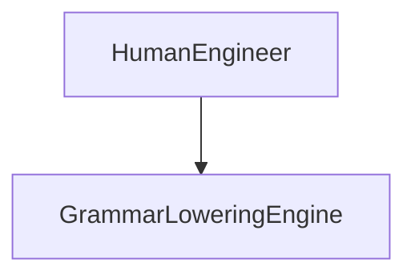

| Attribute | Specification Detail |
| :--- | :--- |
| **Issue ID** | #98 |
| **Title** | Use Case 04: UC 04 Sys ML Grammar Lowering Workflow |
| **Type** | use-case |
| **Primary Actor** | HumanEngineer |
| **Scope** | GrammarLoweringEngine |
| **Level** | User Goal |
| **Generation Mode** | subagent |
| **Specification Source** | [schema/conops/activities.sysml](../../schema/conops/activities.sysml) |

# Use Case 04: UC 04 Sys ML Grammar Lowering Workflow

## UML Diagrams

## 1. Actors
- `HumanEngineer`

## 2. Preconditions
- The compiler execution environment is initialized in nominal operational state.
- Authoritative input schema files exist with read access.

## 3. Trigger
- Operational workflow command dispatched for UC_04_SysML_Grammar_Lowering_Workflow.

## 4. Main Success Scenario
1. Actor `HumanEngineer` initiates workflow execution.
2. System `DEAPCompilerSystem` parses input model definitions and dispatches task to `GrammarLoweringEngine`.
3. Component `GrammarLoweringEngine` processes structural elements and validates semantic constraints.
4. System verifies invariant satisfaction and completes workflow execution.

## 5. Alternate and Exception Flows
- 5a. Syntax or semantic parsing error detected:
  - System captures error location and emits structured diagnostic error catalog entries.
  - Execution halts gracefully without crashing or corrupting working tree state.

## 6. Postconditions
- All semantic models and generated artifacts satisfy formal invariant requirements.
- Output artifacts are deterministically emitted with bitwise reproducibility.

## 8. Realization Matrix
| Specification Item | Type | Link / Reference |
| :--- | :--- | :--- |
| **#92** | User Story | [User Story 04: Lower Sys MLAction](../user-stories/US-04-LowerSysMLAction.md) |
| **#28** | Feature | [Feature 19: [Sysml Grammar Lowering] GrammarLoweringEngine](../features/FEAT-19-GrammarLoweringEngine.md) |

## Source References
Use case operational flows and lifecycle activity references:
- ConOps Operational Activities: `schema/conops/activities.sysml`
- System Architecture Model: `schema/model.sysml`
- Normative Systems Engineering Standard: ISO/IEC/IEEE 29148:2018 §6.4.2 Concept of Operations

Operational use case realization and traceability links derive from `schema/conops/activities.sysml` pursuant to ISO/IEC/IEEE 29148.
