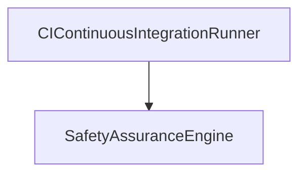

| Attribute | Specification Detail |
| :--- | :--- |
| **Issue ID** | #101 |
| **Title** | Use Case 07: Safety Assurance and Traceability Workflow |
| **Type** | use-case |
| **Primary Actor** | CIContinuousIntegrationRunner |
| **Scope** | SafetyAssuranceEngine |
| **Level** | User Goal |
| **Generation Mode** | subagent |
| **Specification Source** | [schema/subsystems/formal_safety_traceability/behavior.sysml](../../schema/subsystems/formal_safety_traceability/behavior.sysml) |

# Use Case 07: Safety Assurance and Traceability Workflow

## UML Diagrams

## 1. Actors
- `CIContinuousIntegrationRunner`

## 2. Preconditions
- Metrology flows and state models are verified.

## 3. Trigger
- Safety verification pass initiated by compiler pipeline.

## 4. Main Success Scenario
1. SafetyAssuranceEngine ingests metrology and state solver outputs.
2. BipartiteGraphBuilder builds the 7-tier traceability directed acyclic graph.
3. DisjointTierValidator verifies that edges connect strictly adjacent or permitted tiers.
4. BidirectionalSweepEngine performs forward reachability sweeps from requirements to code.
5. BidirectionalSweepEngine performs backward reachability sweeps from code to hazards.
6. SafetyAssuranceEngine verifies 100 percent closure of STPA, FMECA, and safety invariants.

## 5. Alternate and Exception Flows
- 5a. Traceability gap detected: Bipartite graph builder flags unlinked requirement and emits E0400.
- 5b. Cross-tier violation detected: Tier validator rejects illegal edge crossing multiple tiers.
- 5c. Unmitigated hazard identified: Safety engine emits critical hazard warning and binds failsafe constraint.
- 5d. Cyclic traceability edge detected: Graph builder halts traversal, breaks cycle, and reports E0402.
- 5e. Orphan design element found: Backward sweep detects element without upstream parent requirement.
- 5f. Missing FMECA failure mode: Component failure mode matrix reports unanalyzed failure mode.
- 5g. UCA guide word omitted: Generator synthesizes default guide word and logs coverage advisory.
- 5h. Safety constraint violation in code mapping: Engine reports verification mismatch.
- 5i. RPN calculation overflow: Criticality calculator saturates at maximum RPN 1000.
- 5j. Incomplete regulatory objective coverage: Audit engine lists missing regulatory clause citations.

## 6. Postconditions
- 7-tier traceability DAG is complete, bipartite, and closed with zero dangling elements.

## 8. Realization Matrix
| Specification Item | Type | Link / Reference |
| :--- | :--- | :--- |
| **#95** | User Story | [User Story 07: Verify Safety Traceability Action](../user-stories/US-07-VerifySafetyTraceabilityAction.md) |
| **#40** | Feature | [Feature 31: [Formal Safety Traceability] SafetyAssuranceEngine](../features/FEAT-31-SafetyAssuranceEngine.md) |

## Source References
Use case operational flows and lifecycle activity references:
- Subsystem Behavior Specification: `schema/subsystems/formal_safety_traceability/behavior.sysml`
- ConOps Operational Activities: `schema/conops/activities.sysml`
- System Architecture Model: `schema/model.sysml`
- Normative Systems Engineering Standard: ISO/IEC/IEEE 29148:2018 §6.4.2 Concept of Operations

Operational use case realization and traceability links derive from `schema/subsystems/formal_safety_traceability/behavior.sysml` pursuant to ISO/IEC/IEEE 29148.
