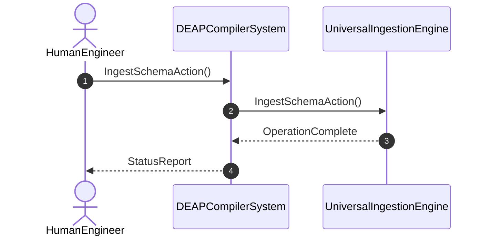

# User Story 02: Ingest Schema Action

## Metadata
| Attribute | Specification Detail |
| :--- | :--- |
| **Title** | User Story 02: Ingest Schema Action |
| **Version** | 1.0.0 |
| **Date** | 2026-10-11 |
| **Type** | user-story |
| **Interaction** | IngestSchemaAction |
| **Subject** | UniversalIngestionEngine |
| **Issue ID** | #90 |
| **Generation Mode** | subagent |

## UML Sequence Diagram

## Acceptance Criteria (BDD)
- [ ] AC-US-02-01: Given operational environment initialized, When IngestSchemaAction executes, Then UniversalIngestionEngine processes the AST within defined latency envelope.
- [ ] AC-US-02-02: Given formal constraints, When semantic validator executes, Then asserts invariant satisfaction.
- [ ] AC-US-02-03: Given exceptional conditions, When error recovery activates, Then graceful recovery occurs without data loss.

## Required Features
- [ ] [Feature 01: [ConOps] Human Engineer Interface](../features/FEAT-01-HumanEngineer.md)
- [ ] [Feature 05: [Architecture] DEAP Compiler System Architecture](../features/FEAT-05-DEAPCompilerSystem.md)
- [ ] [Feature 10: [Universal Schema Ingestion] UniversalIngestionEngine](../features/FEAT-10-UniversalIngestionEngine.md)

## Source References
Operational concept definitions and system sequence interaction models:
- ConOps Operational Activities: `schema/conops/activities.sysml`
- System Architecture Model: `schema/model.sysml`
- Normative Systems Engineering Standard: ISO/IEC/IEEE 29148:2018 §6.4.2 Concept of Operations

Authoritative user story flows and interaction lifelines derive from `schema/conops/activities.sysml` pursuant to ISO/IEC/IEEE 29148.
