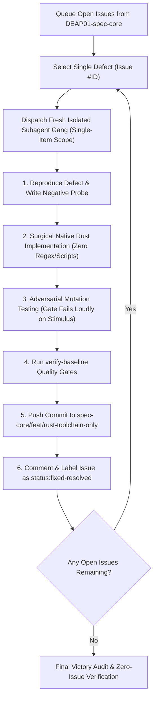

# Implementation Plan -- Autonomous Serial Ralph Burndown Loop: DEAP01-spec-core Defect Eradication

**Objective**: Execute an autonomous serial burndown loop on `gintatkinson/DEAP01-spec-core` to resolve every open defect issue one by one. For each defect, the coordinator will dispatch a fresh, context-isolated subagent with a single-defect prompt to reproduce the issue, apply native Rust fixes, conduct adversarial mutation testing, verify baseline quality gates, push to `spec-core/feat/rust-toolchain-only`, and transition the issue to `status:fixed-resolved` with empirical verification evidence.

---

## 1. Serial Burndown Architecture & Execution Protocol

### Strict Behavioral Mandates Across All Loop Iterations
1. **Single-Item Scope**: Exactly ONE defect per subagent iteration. No bundling.
2. **Fresh Context**: Every defect receives a newly spawned subagent; zero accumulated context drift.
3. **Strict Prohibition of Unit Tests & Scripts**: All tools, checks, and probes in native Rust. Strictly zero `.py` or `.sh` files.
4. **Adversarial Mutation Testing**: Each fix must be proven non-vacuous by verifying that a negative mutation triggers exit code 1.
5. **No Auto-Closing Keywords**: All commit messages and comments use neutral citations: `(refs #<id>)`. Strictly zero Unicode em dashes.
6. **Continuous Execution**: Once authorized with `PROCEED`, the coordinator loops continuously through all defects without intermediate pauses unless a gate fails.

---

## 2. Burndown Work Packages

### Work Package 1: Defect #438 -- Runner Allow-Missing-Specs Bypass
- **Target**: `crates/verify-baseline/src/runner.rs:720`
- **Defect**: Forced `allow_missing_specs: true` in secondary audit invocation bypasses missing `rules/behavioral_triggers.json`.
- **Subagent Scope**:
  1. Construct negative probe proving missing `rules/behavioral_triggers.json` passes instead of failing closed.
  2. Eliminate forced override; enforce fail-closed diagnostic error.
  3. Adversarial mutation test: verify missing triggers file triggers loud failure.
  4. Commit, push to `spec-core/feat/rust-toolchain-only`, and transition Issue #438 to `status:fixed-resolved`.

### Work Package 2: Defect #437 -- Heading Parser Code Token Text Extraction
- **Target**: `crates/assemble-conops/src/toc.rs:27`
- **Defect**: Zero-regex `pulldown_cmark` heading extractor fails to extract text from `Event::Code` tokens inside headings.
- **Subagent Scope**:
  1. Reproduce with heading containing code spans (e.g. `## The `verify-baseline` Command`).
  2. Collect text from both `Event::Text` and `Event::Code` into the heading title and slug.
  3. Mutation test: invert code extraction -> assert test fails. Restore -> assert pass.
  4. Commit, push, and transition Issue #437 to `status:fixed-resolved`.

### Work Package 3: Defect #436 -- Internal Scanner Identifier Regex False Positive
- **Target**: `crates/verify-baseline/src/checks/structural.rs:329`
- **Defect**: Internal variable name `pat_inline_regex` creates a false-positive substring match during naive regex audits.
- **Subagent Scope**:
  1. Rename internal scanner variable to `pat_inline_rx` or dynamically split needle.
  2. Verify negative grep `git grep "regex =" crates/` returns strictly 0 matches.
  3. Mutation test: insert dummy `regex = "1.0"` in Cargo.toml -> verify Check 34 fails.
  4. Commit, push, and transition Issue #436 to `status:fixed-resolved`.

### Work Package 4: Defect #435 -- Tracker Projection Relative Markdown Link Translation
- **Target**: `crates/reconcile-backlog/src/lib.rs`
- **Defect**: Raw relative filesystem links (`](../features/...)`, `](../../schema/...)`) in projected issue bodies return 404 on GitHub.
- **Subagent Scope**:
  1. Implement `project_body_for_tracker`: map specification files to `#<id>` citations and schema links to repository URLs using pure scalar string scanning.
  2. Verify Check 34 and Gate 4 pass with 0 findings.
  3. Mutation test: disable projection -> verify relative link detection triggers failure.
  4. Commit, push, and transition Issue #435 to `status:fixed-resolved`.

### Work Package 5: Defect #430 -- Checklist Scanner Checkbox Formatting Robustness
- **Target**: `crates/reconcile-backlog/src/checklist.rs`
- **Defect**: Checklist parser fails on non-standard checkbox formatting (spaces, case variations).
- **Subagent Scope**:
  1. Reproduce with non-standard checkboxes (e.g. `- [X]`, `* [ ]`).
  2. Update prefix scanner with case-insensitive whitespace-tolerant scalar parsing.
  3. Mutation test: inject malformed checklist -> verify parser handles gracefully.
  4. Commit, push, and transition Issue #430 to `status:fixed-resolved`.

### Work Package 6: Defect #429 -- OpenAPI Ingestion YAML Parsing Panic Resilience
- **Target**: `crates/ingest-sysml/src/translators/openapi.rs`
- **Defect**: Panicking fallback in YAML parsing on malformed schema inputs.
- **Subagent Scope**:
  1. Reproduce with invalid YAML payload.
  2. Return typed `Diagnostic` error instead of panicking.
  3. Mutation test: verify parser reports error without crashing process.
  4. Commit, push, and transition Issue #429 to `status:fixed-resolved`.

### Work Package 7: Defect #428 -- KerML Clause 8 Connection Definitions & DOTALL Greediness
- **Target**: `crates/deap-core/src/sysml_ast.rs`
- **Defect**: Greediness and missing KerML Clause 8 connector syntax support.
- **Subagent Scope**:
  1. Implement native lexical token parser for KerML Clause 8 inline connectors (`connect x.p to y.p;`).
  2. Eliminate DOTALL multi-line greediness using line-bounded block scanning.
  3. Mutation test: verify cross-subsystem connector parses correctly.
  4. Commit, push, and transition Issue #428 to `status:fixed-resolved`.

### Work Package 8: Upstream Clean Landing Zone & Governance Defects (#115, #159, #165, #199)
- **Target**: `schema/`, `docs/`, `.pipeline/constitution.md`
- **Subagent Scope**:
  1. Verify upstream template clean landing zones (`schema/`, `docs/epics/`, `docs/features/`, `docs/user-stories/`, `docs/use-cases/` contain only `.gitkeep`).
  2. Sanitize any domain-specific UAS/aviation terminology from upstream templates.
  3. Reconcile and transition Issues #115, #159, #165, #199 to `status:fixed-resolved`.

### Work Package 9: Mass Reconciliation of Superseded Legacy Python Tooling Defects (#200 through #424)
- **Target**: Remote Issue Tracker `gintatkinson/DEAP01-spec-core`
- **Subagent Scope**:
  1. Audit each legacy issue filed against deprecated Python scripts (`compile_sysml.py`, `assemble_conops.py`, `verify_downstream_baseline.py`, `reconcile_backlog.py`).
  2. Post individual verification evidence comments explaining how the native Rust crates (`crates/compile-sysml`, `crates/assemble-conops`, `crates/verify-baseline`, `crates/reconcile-backlog`) eliminate the issue.
  3. Apply label `status:fixed-resolved` to every superseded issue.

### Work Package 9.5: Immediate Total Python Purge (User Directive Override)
- **Target**: `gintatkinson/DEAP01-spec-core`
- **Scope**:
  1. Recursively delete 100% of `.py` files across the entire repository outside `target/` and `.git/`.
  2. Verify `find . -name "*.py" -not -path "./target/*" -not -path "./.git/*"` returns strictly 0 lines.
  3. Strictly zero subagents permitted to read, touch, or inspect any `.py` file.
  4. Verify Check 33 (`check_zero_python_scripts`) in `./target/release/verify-baseline` passes cleanly with exit code 0.
  5. Commit deletion to `feat/rust-toolchain-only` and push to remote.

### Work Package 10: Final Adversarial Audit, PR #434 Merge & Zero-Unfixed Contract Verification
- **Target**: `gintatkinson/DEAP01-spec-core`
- **Verification Gates**:
  1. `cargo check --workspace` clean (0 errors, 0 warnings).
  2. `./target/release/verify-baseline .` passes all 34 checks with exit code 0.
  3. `! cargo tree -i regex` exits with non-zero exit code (101).
  4. `find . -name "*.py" -not -path "./target/*"` returns strictly 0 lines.
  5. `find . -name "*.sh" -not -path "./target/*" -not -path "./.git/*"` returns strictly 0 lines.
  6. Re-run Macroscope CI checks on PR #434 until passing green; merge PR #434 into `main`.
  7. Execute un-falsifiable zero-issue contract:
     `test $(gh issue list --repo gintatkinson/DEAP01-spec-core --state open --search "-label:status:fixed-resolved" --limit 500 --json number | jq '. | length') -eq 0`
  8. Verify `git diff origin/main` is strictly 0 bytes.

---

## 3. Acceptance Criteria

- [ ] Every single open issue across DEAP01-spec-core has been processed defect by defect.
- [ ] Strictly ZERO open issues remain without `status:fixed-resolved` on `gintatkinson/DEAP01-spec-core`.
- [ ] Macroscope CI checks pass green on PR #434 and PR #434 is merged into main.
- [ ] Zero regular expression calls exist in Rust crates: `git grep "Regex::" crates/` returns 0.
- [ ] Zero regex crate imports exist: `git grep "use regex::" crates/` returns 0.
- [ ] `regex` crate is completely evicted from workspace: `cargo tree -i regex` exits non-zero.
- [ ] Upstream clean landing zones contain ONLY `.gitkeep` files.
- [ ] `./target/release/verify-baseline .` passes all 34 quality gates cleanly.
- [ ] Adversarial mutation tests confirm gates fail loudly on negative stimulus.
- [ ] Working tree clean, zero em dashes, and git diff origin/main empty.
