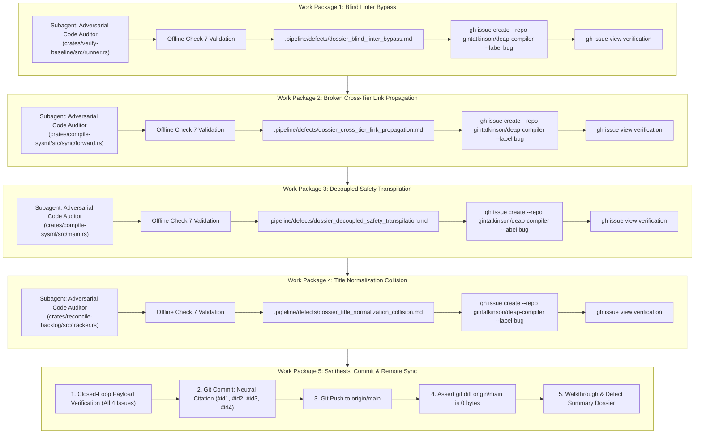

# Implementation Plan -- Serial Adversarial Code Audits & Upstream Defect Filings (`gintatkinson/deap-compiler`)

**Objective**: Execute serial adversarial code audits, offline Check 7 validations, upstream defect filings to `gintatkinson/deap-compiler`, and remote repository synchronization for four pipeline tooling defects uncovered in the compiler workspace.

---

## 1. Architectural Topology & Governance Flow



---

## 2. Work Packages Decomposition

### Work Package 1: Audit & File Defect 1 (Blind Linter Bypass in `verify-baseline`)
- **Target Component**: `crates/verify-baseline/src/runner.rs`
- **Audit Pillar**: Test Integrity
- **Target Repository**: `gintatkinson/deap-compiler`
- **Symptom**: `verify-baseline` audits static markdown files on disk without asserting dynamic compiler output freshness or checking if `compile-sysml --forward-sync` produces zero diff against the declared AST. This allows stale specifications on disk to pass baseline verification even when compiler regeneration would produce massive diffs or fail.
- **Subagent Role**: `Adversarial Code Auditor`
- **Dispatch Prompt Payload**:
  ```text
  Execute adversarial-code-auditor skill.
  Read skills/adversarial-code-auditor/SKILL.md in full. Follow the Protocol (Section 3) exactly -- Read, Audit, Write, Verify, File.
  FILE_PATH: crates/verify-baseline/src/runner.rs PILLAR: Test Integrity MODE: audit REPO: gintatkinson/deap-compiler
  Return issue URLs with severities. PROCEED
  ```
- **Deliverables**:
  1. Complete 7-section defect dossier adhering character-for-character to Section 2 skeleton.
  2. Mandatory offline Check 7 Mermaid syntax validation executed and passed.
  3. Verified dossier saved to `.pipeline/defects/dossier_blind_linter_bypass.md`.
  4. Issue filed to `gintatkinson/deap-compiler` with `--label bug`.
  5. Closed-loop verification of live published payload via `gh issue view --repo gintatkinson/deap-compiler <ID>`.

### Work Package 2: Audit & File Defect 2 (Broken Cross-Tier Link Propagation)
- **Target Component**: `crates/compile-sysml/src/sync/forward.rs`
- **Audit Pillar**: Semantic Traceability
- **Target Repository**: `gintatkinson/deap-compiler`
- **Symptom**: When a behavioral action or model element is renamed in the schema AST, `compile-sysml --forward-sync` generates the new User Story file, but fails to propagate link updates to parent Epics (`docs/epics/`) and constituent Use Cases (`docs/use-cases/`), leaving broken markdown links, stale references, and desynchronized realization matrices.
- **Subagent Role**: `Adversarial Code Auditor`
- **Dispatch Prompt Payload**:
  ```text
  Execute adversarial-code-auditor skill.
  Read skills/adversarial-code-auditor/SKILL.md in full. Follow the Protocol (Section 3) exactly -- Read, Audit, Write, Verify, File.
  FILE_PATH: crates/compile-sysml/src/sync/forward.rs PILLAR: Semantic Traceability MODE: audit REPO: gintatkinson/deap-compiler
  Return issue URLs with severities. PROCEED
  ```
- **Deliverables**:
  1. Complete 7-section defect dossier adhering character-for-character to Section 2 skeleton.
  2. Mandatory offline Check 7 Mermaid syntax validation executed and passed.
  3. Verified dossier saved to `.pipeline/defects/dossier_cross_tier_link_propagation.md`.
  4. Issue filed to `gintatkinson/deap-compiler` with `--label bug`.
  5. Closed-loop verification of live published payload via `gh issue view --repo gintatkinson/deap-compiler <ID>`.

### Work Package 3: Audit & File Defect 3 (Decoupled Safety Transpilation Architecture)
- **Target Component**: `crates/compile-sysml/src/main.rs`
- **Audit Pillar**: Resource Lifecycle
- **Target Repository**: `gintatkinson/deap-compiler`
- **Symptom**: `compile-sysml --forward-sync` is decoupled from `--stpa-transpile`. As a result, when ConOps operational activities or system hazards are updated or decomposed, forward-sync leaves `docs/safety/` frozen with stale hazard mappings (e.g. only 6 hazards instead of 28+) unless an operator manually invokes the separate `--stpa-transpile` flag.
- **Subagent Role**: `Adversarial Code Auditor`
- **Dispatch Prompt Payload**:
  ```text
  Execute adversarial-code-auditor skill.
  Read skills/adversarial-code-auditor/SKILL.md in full. Follow the Protocol (Section 3) exactly -- Read, Audit, Write, Verify, File.
  FILE_PATH: crates/compile-sysml/src/main.rs PILLAR: Resource Lifecycle MODE: audit REPO: gintatkinson/deap-compiler
  Return issue URLs with severities. PROCEED
  ```
- **Deliverables**:
  1. Complete 7-section defect dossier adhering character-for-character to Section 2 skeleton.
  2. Mandatory offline Check 7 Mermaid syntax validation executed and passed.
  3. Verified dossier saved to `.pipeline/defects/dossier_decoupled_safety_transpilation.md`.
  4. Issue filed to `gintatkinson/deap-compiler` with `--label bug`.
  5. Closed-loop verification of live published payload via `gh issue view --repo gintatkinson/deap-compiler <ID>`.

### Work Package 4: Audit & File Defect 4 (Title Normalization Collision & Rename Failure)
- **Target Component**: `crates/reconcile-backlog/src/tracker.rs`
- **Audit Pillar**: Concurrency
- **Target Repository**: `gintatkinson/deap-compiler`
- **Symptom**: `reconcile-backlog` correlates specification files with tracker issues using normalized title matching. When a specification is renamed or decomposed, the title normalization mismatch causes the reconciler to lose association with the pre-existing issue number, leading to orphaned tracker issues, duplicate issue creation, or unclosed deleted specification issues.
- **Subagent Role**: `Adversarial Code Auditor`
- **Dispatch Prompt Payload**:
  ```text
  Execute adversarial-code-auditor skill.
  Read skills/adversarial-code-auditor/SKILL.md in full. Follow the Protocol (Section 3) exactly -- Read, Audit, Write, Verify, File.
  FILE_PATH: crates/reconcile-backlog/src/tracker.rs PILLAR: Concurrency MODE: audit REPO: gintatkinson/deap-compiler
  Return issue URLs with severities. PROCEED
  ```
- **Deliverables**:
  1. Complete 7-section defect dossier adhering character-for-character to Section 2 skeleton.
  2. Mandatory offline Check 7 Mermaid syntax validation executed and passed.
  3. Verified dossier saved to `.pipeline/defects/dossier_title_normalization_collision.md`.
  4. Issue filed to `gintatkinson/deap-compiler` with `--label bug`.
  5. Closed-loop verification of live published payload via `gh issue view --repo gintatkinson/deap-compiler <ID>`.

### Work Package 5: Synthesis, Closed-Loop Verification, Commit Hygiene & Remote Sync
- **Target Scope**: `.pipeline/defects/`, Git Index, Remote Tracking Branch
- **Actions**:
  1. Inspect and verify all 4 live published GitHub issue URLs, labels, and bodies via:
     `gh issue view --repo gintatkinson/deap-compiler <ID>`
  2. Stage and commit all 4 generated defect dossiers in `.pipeline/defects/` adhering strictly to the Commit Message Non-Closure Invariant:
     `git commit -m "docs(defects): record upstream compiler defect dossiers (#<id1>, #<id2>, #<id3>, #<id4>)"`
     (Auto-closing keywords `fix`, `fixes`, `close`, `closes`, `resolve`, `resolves` strictly forbidden).
  3. Push all commits to `origin/main`.
  4. Verify remote synchronization: assert that `git diff origin/main` is empty (0 bytes).
  5. Generate final walkthrough and summary table citing all 4 issue URLs, severities, and target components.

---

## 3. Mandatory Constraints & Quality Gates

1. **Strictly Zero Python**: `python`, `python3`, `pytest`, `pip` are strictly prohibited across all operations and checks.
2. **Strictly Zero Unicode Em Dashes**: Unicode `\u2014` is strictly prohibited; use ASCII `--` or `-` exclusively.
3. **Strict Serial Execution**: Dispatch exactly ONE subagent at a time. No parallel or concurrent dispatches.
4. **Offline Validation Gate**: Check 7 must be verified offline before filing any issue.
5. **Workspace Isolation**: All operations must remain strictly inside `/Users/perkunas/jail/dumpiler-01`.
6. **Commit Message Non-Closure Invariant**: Commit messages must use neutral citations `(#<id>)` or `(refs #<id>)` without auto-closing verbs.

---

## 4. Acceptance Criteria

- [ ] Subagent 1 executes Test Integrity audit on `crates/verify-baseline/src/runner.rs`.
- [ ] Dossier 1 verified offline (Check 7) and saved to `.pipeline/defects/dossier_blind_linter_bypass.md`.
- [ ] Issue 1 filed on `gintatkinson/deap-compiler` (`--label bug`) and verified via `gh issue view`.
- [ ] Subagent 2 executes Semantic Traceability audit on `crates/compile-sysml/src/sync/forward.rs`.
- [ ] Dossier 2 verified offline (Check 7) and saved to `.pipeline/defects/dossier_cross_tier_link_propagation.md`.
- [ ] Issue 2 filed on `gintatkinson/deap-compiler` (`--label bug`) and verified via `gh issue view`.
- [ ] Subagent 3 executes Resource Lifecycle audit on `crates/compile-sysml/src/main.rs`.
- [ ] Dossier 3 verified offline (Check 7) and saved to `.pipeline/defects/dossier_decoupled_safety_transpilation.md`.
- [ ] Issue 3 filed on `gintatkinson/deap-compiler` (`--label bug`) and verified via `gh issue view`.
- [ ] Subagent 4 executes Concurrency audit on `crates/reconcile-backlog/src/tracker.rs`.
- [ ] Dossier 4 verified offline (Check 7) and saved to `.pipeline/defects/dossier_title_normalization_collision.md`.
- [ ] Issue 4 filed on `gintatkinson/deap-compiler` (`--label bug`) and verified via `gh issue view`.
- [ ] All 4 defect dossiers staged and committed with neutral citations `(#<id1>, #<id2>, #<id3>, #<id4>)`.
- [ ] Commits pushed to `origin/main` and `git diff origin/main` verified clean (0 bytes).
- [ ] Summary walkthrough and defect register produced.

---

## 5. Human Approval Gate

Per `AGENTS.md` § **Strict Planning Gate** & § **Mandatory Teamwork Preview Gate**:
The coordinator is halted and awaiting your explicit approval.

To authorize execution of this implementation plan, please reply with **PROCEED**.
