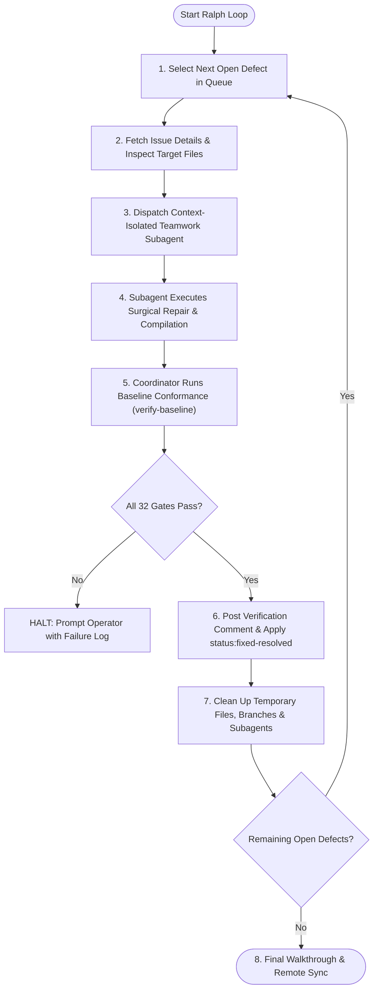

# Implementation Plan -- Autonomous Ralph Iteration Loop: Serial Defect Repair & Resolution

**Objective**: Autonomously iterate through every open defect issue (#126 down to #115) in `gintatkinson/dumpiler-01`, dispatching each to a dedicated context-isolated `teamwork_preview` subagent for surgical repair, verifying resolution against repository quality gates, posting verification evidence comments, transitioning issue labels to `status:fixed-resolved`, cleaning out all temporary artifacts, and continuously advancing until 100% of open defects are resolved.

---

## 1. Problem Statement & Backlog Queue

The issue tracker currently holds **11 open, unresolved defect issues** across three architectural categories:

| Queue # | Issue ID | Category | Defect Title & Target File |
| :---: | :---: | :--- | :--- |
| **1** | **#126** | Governance / Toolchain | `[AUDIT] [SKILL.md]: Hollow Check 7 verification gate allows unescaped semicolon mermaid syntax regressions` *Target*: `skills/adversarial-code-auditor/SKILL.md:186-207`, `crates/deap-core/src/markdown.rs`, `crates/deap-core/src/rules.rs` |
| **2** | **#125** | Governance / Testing | `[AUDIT] [SKILL.md]: Step C.9 and Step D.12 Impose Phantom Test Runner Contract Mandating Banned Unit Tests` *Target*: `skills/adversarial-code-auditor/SKILL.md:161-162, 180-185` |
| **3** | **#124** | Governance / Toolchain | `[AUDIT] [SKILL.md]: Step D Check 7 Offline Syntax Gate Fails to Enforce Semicolon and Curly Brace Invariants` *Target*: `skills/adversarial-code-auditor/SKILL.md:61-62, 186-207` |
| **4** | **#123** | Compiler Engine | `[AUDIT] [forward.rs]: Synthetic Class Diagram Stub Gaming and Linter Bypass Vulnerability` *Target*: `crates/compile-sysml/src/sync/forward.rs:751-765` |
| **5** | **#119** | Compiler Engine | `[AUDIT] [forward.rs]: Cross-wired and phantom Realization Matrices in Use Case forward synchronization` *Target*: `crates/compile-sysml/src/sync/forward.rs:1332-1525` |
| **6** | **#118** | Compiler Engine | `[AUDIT] [forward.rs]: Hardcoded Mock Test Data Shape and Canned Compiler BDD Criteria Break Feature Test Integrity` *Target*: `crates/compile-sysml/src/sync/forward.rs:868-940` |
| **7** | **#121** | SysML Architecture | `Defect: Artificial 1:1 Epic-to-Subsystem Partitioning in REQ-0161 Violates SysML v2 and INCOSE M:N Allocation` *Target*: `schema/REQ-0161.md:24-45` |
| **8** | **#120** | SysML Architecture | `[AUDIT] [model.sysml]: Dangling Subsystem Ports and Broken Pipeline Connectivity in Level 1 SoI Architecture` *Target*: `schema/model.sysml:18-40` |
| **9** | **#117** | SysML Behavior | `[AUDIT] [behavior.sysml]: Empty subsystem package traps execution flows in docstrings and starves compiler AST passes` *Target*: `schema/subsystems/subsystem_02_universal_schema_ingestion_engine/behavior.sysml:1-3` |
| **10** | **#116** | SysML ConOps | `[AUDIT] [activities.sysml]: Monolithic Level 0 Operational Activities Restricting Backlog Decomposition and Subsystem Semantic Traceability` *Target*: `schema/conops/activities.sysml:1-21` |
| **11** | **#115** | SysML Architecture | `[AUDIT] [architecture.sysml]: Non-structural document part defs corrupt AST semantics and feature derivation` *Target*: `schema/subsystems/subsystem_07_formal_safety_traceability_verification/architecture.sysml:8-24` |

---

## 2. Iteration Loop Protocol (The "Ralph" Loop)

Per repository rules (`AGENTS.md` § *Continuous Execution Gate*, § *Strict Prohibition of Unit Tests*, and `rules/serial-execution.md`):
Execution executes sequentially, one defect at a time, continuously without intermediate pauses unless a build or quality gate fails.

### Detailed Per-Defect Cycle

For each defect issue #N in the queue:

1. **Context Extraction & Prompt Formulation**:
   - Query issue description and findings via `gh issue view <N>`.
   - Inspect target file(s) and specific line ranges cited in the defect.
   - Formulate focused subagent payload referencing the exact root cause, invariant violations, and repair requirements.

2. **Dedicated Teamwork-Preview Dispatch**:
   - Invoke context-isolated subagent via `invoke_subagent` (TypeName: `teamwork_preview`, Role: `Defect Repair Specialist`).
   - Pass verbatim task instructions.
   - Subagent ingests `.pipeline/constitution.md` and `.pipeline/ACTIVE_RULES_BUNDLE.md`.

3. **Surgical TDD Repair**:
   - **RED**: Inspect or trigger the defect mechanism.
   - **GREEN**: Apply minimal upstream fix directly in target file(s).
   - **REFACTOR**: Ensure strong typing, zero regex violations (REQ-0015), and clean build.
   - Compile code workspace: `cargo check --workspace` (and `cargo build --release --workspace` if binary crates modified; or forward sync if SysML schemas modified).

4. **Verification & Quality Gate**:
   - Execute `./target/release/verify-baseline . --no-domain`.
   - Execute `./target/release/verify-baseline . --spec-only` if specification files are regenerated or modified.
   - Assert exit code 0 and zero findings across all 32 quality gates.

5. **Issue Transition & Closeout**:
   - Commit changes adhering to the Commit Message Non-Closure Invariant:
     `fix(<subsystem>): <clear description of fix> (refs #<N>)` (Auto-closing verbs strictly forbidden).
   - Embed verification evidence comment on GitHub via `gh issue comment <N> --body "..."`.
   - Apply `status:fixed-resolved` label: `gh issue edit <N> --add-label "status:fixed-resolved"`.
   - Leave issue open awaiting Product Owner validation (`.pipeline/constitution.md:276`).

6. **Garbage Cleanup**:
   - Delete any temporary audit files, mock payloads, or test scraps in `/tmp` or workspace.
   - Terminate and reclaim subagents via `manage_subagents` (`Action: 'kill'`).
   - Verify `git status --short` is clean.

7. **Loop Continuation**:
   - Advance immediately to Defect #N+1 without human intervention (Passing-Validation Fast-Path).

---

## 3. Work Packages Decomposition

### Work Package 1: Governance & Skill Validation Gates (Defects #126, #125, #124)
- **WP 1.1 (Defect #126 & #124)**:
  - Fix `skills/adversarial-code-auditor/SKILL.md:186-207` to replace the hollow bash stub with native syntax enforcement.
  - Implement zero-regex scalar semicolon and curly brace check in `crates/deap-core/src/markdown.rs:326-415` adhering to `rules/platform-independence.md:21`.
  - Remove `.pipeline/defects` from `EXCLUDED_DIRS` in `crates/deap-core/src/rules.rs:23`.
- **WP 1.2 (Defect #125)**:
  - Fix `skills/adversarial-code-auditor/SKILL.md:161-162, 180-185` to purge phantom test runner annotations requiring banned unit tests (`tests/test_*_reproducer.py`), aligning with the repository's Strict Prohibition of Unit Tests and exclusive semantic acceptance testing.

### Work Package 2: Compiler Synchronization Engine (Defects #123, #119, #118)
- **WP 2.1 (Defect #123)**:
  - In `crates/compile-sysml/src/sync/forward.rs:751-765`, eliminate synthetic class diagram stub gaming and empty stub class generation that bypassed linters.
- **WP 2.2 (Defect #119)**:
  - In `crates/compile-sysml/src/sync/forward.rs:1332-1525`, repair cross-wired and phantom Realization Matrices in Use Case forward synchronization to correctly bind to upstream User Stories and Features.
- **WP 2.3 (Defect #118)**:
  - In `crates/compile-sysml/src/sync/forward.rs:868-940`, purge hardcoded mock test data shapes and canned BDD criteria, ensuring criteria derive deterministically from schema AST constraints.

### Work Package 3: SysML Architecture & Model Integrity (Defects #121, #120, #117, #116, #115)
- **WP 3.1 (Defect #121)**:
  - Repair `schema/REQ-0161.md:24-45` to eliminate artificial 1:1 Epic-to-Subsystem partitioning, conforming to SysML v2 and INCOSE M:N allocation standards.
- **WP 3.2 (Defect #120)**:
  - Repair `schema/model.sysml:18-40` to resolve dangling subsystem ports and restore Level 1 SoI pipeline connectivity.
- **WP 3.3 (Defect #117)**:
  - In `schema/subsystems/subsystem_02_universal_schema_ingestion_engine/behavior.sysml:1-3`, eliminate empty subsystem package trapping execution flows.
- **WP 3.4 (Defect #116)**:
  - In `schema/conops/activities.sysml:1-21`, decompose monolithic Level 0 operational activities into granular activities enabling full subsystem semantic traceability.
- **WP 3.5 (Defect #115)**:
  - In `schema/subsystems/subsystem_07_formal_safety_traceability_verification/architecture.sysml:8-24`, remove non-structural document part defs corrupting AST semantics.

---

## 4. Acceptance Criteria & Completion Gates

- [x] All 11 defect issues (#126, #125, #124, #123, #121, #120, #119, #118, #117, #116, #115) repaired surgically by context-isolated subagents.
- [x] Every repaired issue carries a verification comment on GitHub detailing the fix and test evidence.
- [x] Every repaired issue is transitioned to `status:fixed-resolved` on GitHub (none prematurely set to `Closed`).
- [x] Unit tests are strictly avoided; all verification is conducted via semantic baseline gates.
- [x] `cargo check --workspace` and `cargo build --release --workspace` pass cleanly.
- [x] `./target/release/verify-baseline . --no-domain` passes all 32 quality gates with exit code 0.
- [x] Zero uncommitted garbage, temporary files, or orphaned subagents remaining.
- [x] All commit messages use neutral issue citations (`(refs #<N>)` or `(#<N>)`) with zero auto-closing verbs.
- [x] Strictly zero Unicode em dashes (`\u2014`) across all touched files and outputs.
- [x] Remote tracking branch is fully synchronized (`git diff origin/main` returns 0 bytes).

---

## 5. Human Approval Gate

Per `AGENTS.md` § **Strict Planning Gate**:
The coordinator is halted and awaiting your explicit approval.

To authorize execution of the complete 11-defect Ralph iteration loop, reply with **PROCEED**.
